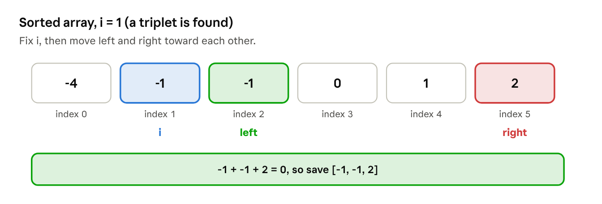
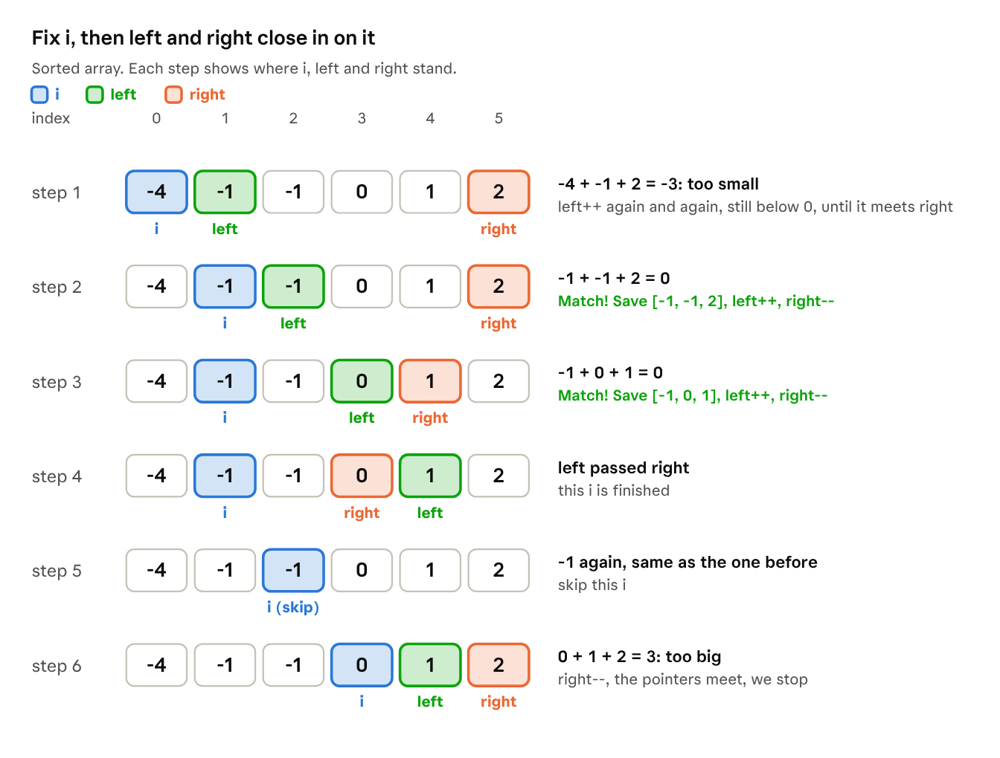

# 3Sum

**Question Link:** [LeetCode 15 - 3Sum](https://leetcode.com/problems/3sum/)

**Pattern:** Two Pointers (fix one, then two pointers)

  -22c55e?style=flat-square) -22c55e?style=flat-square)

---

> [!TIP]
> **Key insight:** 3Sum = fix 1 element + 2Sum on the rest. For each `nums[i]`, find pairs in `nums[i+1..n-1]` that add up to `-nums[i]`.

## The Question

Given an array `nums`, find all **unique** triplets that add up to 0. The same triplet must not appear twice.

**Example**

- **Input:** `nums = [-1, 0, 1, 2, -1, -4]`
- **Output:** `[[-1, -1, 2], [-1, 0, 1]]`

<details>
<summary><b>How to think about it</b></summary>

<br>

1. **Start simple.** Try every triple with three loops. That is O(n³), and I would also have to filter repeated triplets. Too slow and messy.
2. **Shrink the problem.** Pick one number `x`. The other two must add up to `-x`. That is Two Sum, which I already know.
3. **Make it easy.** I need values, not indexes, so I am free to **sort**. Sorting puts equal values side by side, so skipping duplicates becomes easy.
4. **Solve the pair on a sorted array.** Put pointers at both ends. Sum too small: I need a bigger number, so `left++`. Sum too big: `right--`. Sum right: save it and move both.
5. **Avoid repeats.** After saving a triplet, and after each `x`, skip equal neighbours. Total time is O(n²).

</details>

## Ways to Solve It

| Approach | Idea | Note | Time | Space |
| --- | --- | --- | --- | --- |
| Brute force | Three loops try every triplet of numbers. | Too slow for big arrays. | O(n³) | O(1) |
| Fix one + HashSet | Fix one number, look for the other two in a set. | Duplicates are awkward. | O(n²) | O(n) |
| **Sort + 2 pointers (best)** | **Sort first. Fix one number, then left and right pointers.** | **Skipping duplicates is easy.** | **O(n²)** | **O(1)** |

## Best Idea: Sort + Two Pointers

After sorting, a sum that is too small needs a bigger number, so move `left` right. A sum that is too big needs a smaller number, so move `right` left.



## The Logic

1. Sort the array.
2. Loop `i` from 0 to `len - 3`. This is the first number.
3. If `nums[i]` is the same as the one before it, skip it (no repeat triplets).
4. Set `left = i + 1` and `right = len - 1`.
5. While `left < right`, add up `nums[i] + nums[left] + nums[right]`:
   - **Sum is 0:** save the triplet, move both pointers, then skip any repeated values.
   - **Sum is less than 0:** `left++`.
   - **Sum is more than 0:** `right--`.

## Skipping Duplicates and Early Exit

Skip duplicates in **3 places**: `i`, `left` and `right`.

| Where | Condition | Why |
| --- | --- | --- |
| Fixed `i` | `i > 0 && nums[i] == nums[i-1]` | Compare with the previous one, so the first copy is still used |
| After a match (`left`) | `nums[left] == nums[left-1]` | Skip repeats before the next round |
| After a match (`right`) | `nums[right] == nums[right+1]` | Skip repeats before the next round |

> [!WARNING]
> **Common slip:** writing `nums[i] == nums[i+1]` instead of `nums[i-1]`. That skips triplets that use the repeated number twice, like `[-1, -1, 2]`.

**Early termination:** after sorting, if `nums[i] > 0`, every number after it is positive too, so no triplet can sum to 0. The code below has this at the top of the loop. It works without it, but this makes it faster.

## Code (Java)

```java
class Solution {
    public List<List<Integer>> threeSum(int[] nums) {
        // sort the array: needed for the two pointer method
        Arrays.sort(nums);
        List<List<Integer>> ans = new ArrayList<>();
        int len = nums.length;

        for (int i = 0; i < len - 2; i++) { // fix the first number
            // early stop: sorted, so if nums[i] > 0 no triplet can sum to 0
            if (nums[i] > 0) break;

            // skip duplicates
            if (i > 0 && nums[i] == nums[i - 1]) continue;

            int left = i + 1;
            int right = len - 1;

            while (left < right) {
                int sum = nums[left] + nums[right] + nums[i];

                if (sum == 0) { // triplet found
                    ans.add(Arrays.asList(nums[i], nums[left], nums[right]));
                    left++;
                    right--;
                    // skip duplicates
                    while (left < right && nums[left - 1] == nums[left]) left++;
                    while (left < right && nums[right + 1] == nums[right]) right--;
                } else if (sum < 0) {
                    left++;
                } else {
                    right--;
                }
            }
        }
        return ans;
    }
}
```

<details>
<summary><b>Dry run</b></summary>

<br>

Input `[-1, 0, 1, 2, -1, -4]`, sorted: `[-4, -1, -1, 0, 1, 2]`.

Read it one step at a time, top to bottom. The boxes show where `i`, `left` and `right` stand.



**Answer:** `[[-1, -1, 2], [-1, 0, 1]]`

</details>

## Complexity

> [!NOTE]
> - **Time (TC):** O(n²). The sort is O(n log n), then n passes of O(n). So TC = O(n log n + n²).
> - **Space (SC):** O(1) besides the answer list.

## Key Points

> [!TIP]
> - **Why sort?** Two pointers need a sorted order: `left++` grows the sum and `right--` shrinks it. Also, duplicates become neighbours, so skipping them is easy with `nums[x] == nums[x-1]`.
> - **Why skip duplicates in 3 places?** The fixed `i`, and both pointers after a match. Miss one and the same triplet is saved twice.
> - **Why `nums[i-1]` and not `nums[i+1]`?** Comparing with the previous one keeps the first copy in use, so `[-1, -1, 2]` is still found.
> - **Why stop when `nums[i] > 0`?** Everything after it is positive too, so the sum can never be 0.

<details>
<summary><b>Extra concepts: the kSum pattern</b></summary>

<br>

3Sum is one step of a bigger pattern. Fix some numbers, then finish with 2Sum.

| Problem | Approach | Time |
| --- | --- | --- |
| 2Sum (sorted) | Two pointers | O(n) |
| 3Sum | Fix 1 + 2Sum | O(n²) |
| 4Sum | Fix 2 + 2Sum | O(n³) |
| kSum | Recurse down to 2Sum | O(n^(k-1)) |

</details>
