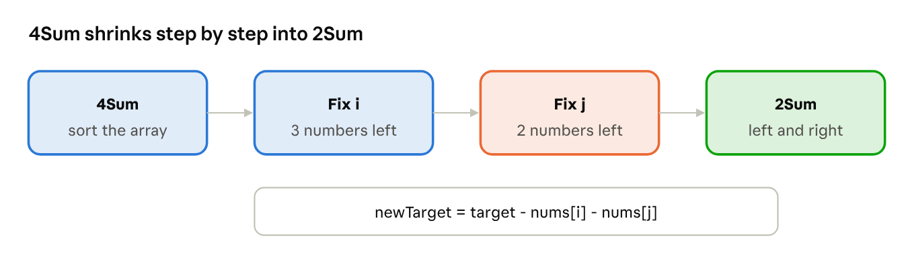
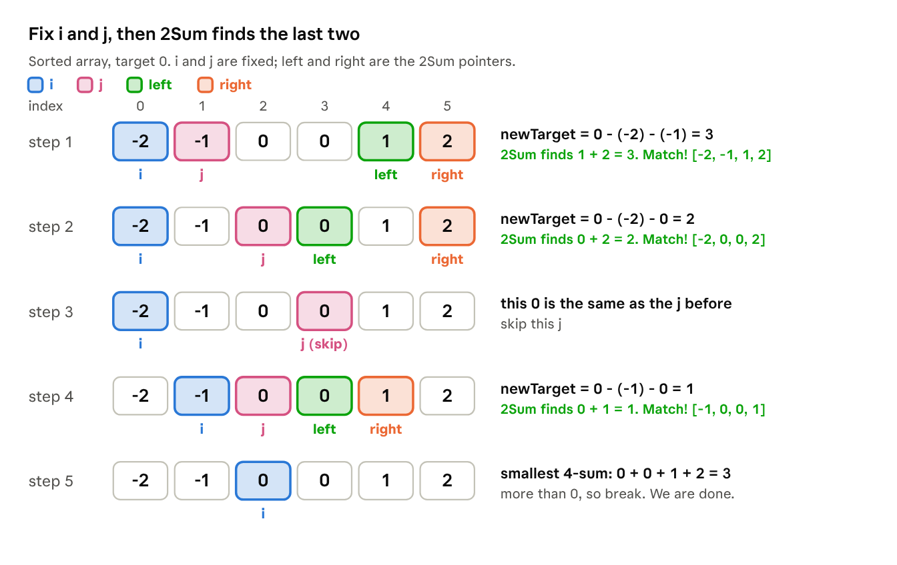

# 4Sum

**Question Link:** [LeetCode 18 - 4Sum](https://leetcode.com/problems/4sum/)

**Pattern:** Two Pointers (Converge / Partition)

  -22c55e?style=flat-square) -22c55e?style=flat-square)

---

> [!TIP]
> **Key insight:** 4Sum = fix 2 elements + 2Sum on the rest. It is 3Sum with one more loop.

## The Question

Given an array `nums` and a `target`, find all **unique** quadruplets `[a, b, c, d]` that add up to `target`. The same quadruplet must not appear twice.

> Example: `[1, 0, -1, 0, -2, 2]`, target `0` gives `[[-2, -1, 1, 2], [-2, 0, 0, 2], [-1, 0, 0, 1]]`

<details>
<summary><b>How to think about it</b></summary>

<br>

1. **Start simple.** Four loops over every quadruplet is O(n⁴). Far too slow.
2. **Reuse the 3Sum trick.** In 3Sum I fixed one number and the rest became a pair-sum. Here I fix **two** numbers `a` and `b`. The last two must add up to `target - a - b`.
3. **Sort first**, for the same reason as 3Sum. We need values, not indexes, and equal values end up together.
4. **Build it.** Two loops pick `a` and `b`. Two pointers from both ends find the last pair.
5. **Avoid repeats.** Skip equal values at all four positions. Total time is O(n³).
6. **Why sorting matters for pruning.** The smallest and largest sums are easy to find, so we can stop a loop early.

</details>

## Ways to Solve It

| Approach | Idea | Note | Time | Space |
| --- | --- | --- | --- | --- |
| Brute force | Four loops try every group of four numbers. | Far too slow. | O(n⁴) | O(1) |
| Fix 2 + HashSet | Fix two numbers, look for the other two in a set. | Duplicates are awkward. | O(n³) | O(n) |
| **Sort + 2 pointers (best)** | **Sort, fix i and j, then run 2Sum with pointers.** | **Easy to skip duplicates.** | **O(n³)** | **O(1)** |

## Best Idea: Sort + fix 2 + two pointers

Sort first. Fix `i`, then fix `j`. What is left is a 2Sum on the sorted part after `j`, which two pointers solve in one pass.



## The Logic

1. If the array has fewer than 4 numbers, return an empty list.
2. Sort the array.
3. Loop `i` from 0 to `n - 4`. Skip it if it repeats the number before it.
4. Loop `j` from `i + 1` to `n - 3`. Skip it if it repeats the number before it (and `j > i + 1`).
5. Set `newTarget = target - nums[i] - nums[j]`.
6. Run two pointers on `j + 1 .. n - 1` to find pairs that add up to `newTarget`.
7. After each match, skip repeated values for both pointers.

## Speed-up tricks (pruning)

Because the array is sorted, we can skip work early:

- If the **smallest** possible sum is already more than `target`, `break`.
- If the **largest** possible sum is still less than `target`, `continue` (this number is too small).
- The same two checks are used again for `j`.

Use `(long)` when adding. Four large ints can overflow an `int`.

## Code (Java)

```java
import java.util.*;

class Solution {
    public List<List<Integer>> fourSum(int[] nums, int target) {
        List<List<Integer>> result = new ArrayList<>();
        int n = nums.length;
        if (n < 4) return result;

        // Step 1: sort for two pointers and easy duplicate skipping
        Arrays.sort(nums);

        for (int i = 0; i < n - 3; i++) {
            // smallest possible 4-sum is already too big: stop
            if ((long)nums[i] + nums[i+1] + nums[i+2] + nums[i+3] > target) break;
            // nums[i] + the 3 largest is still too small: i is too small
            if ((long)nums[i] + nums[n-3] + nums[n-2] + nums[n-1] < target) continue;
            // Step 2: skip duplicate fixed elements
            if (i > 0 && nums[i] == nums[i - 1]) continue;

            for (int j = i + 1; j < n - 2; j++) {
                // same pruning for j
                if ((long)nums[i] + nums[j] + nums[j+1] + nums[j+2] > target) break;
                if ((long)nums[i] + nums[j] + nums[n-2] + nums[n-1] < target) continue;
                if (j > i + 1 && nums[j] == nums[j - 1]) continue;

                // Step 3: reduce to 2Sum
                long newTarget = (long)target - nums[i] - nums[j];
                List<List<Integer>> pairs = twoSum(nums, newTarget, j + 1);

                for (List<Integer> pair : pairs) {
                    result.add(Arrays.asList(nums[i], nums[j], pair.get(0), pair.get(1)));
                }
            }
        }
        return result;
    }

    private List<List<Integer>> twoSum(int[] nums, long target, int start) {
        List<List<Integer>> results = new ArrayList<>();
        int left = start;
        int right = nums.length - 1;

        while (left < right) {
            long sum = (long)nums[left] + nums[right];
            if (sum < target) {
                left++;
            } else if (sum > target) {
                right--;
            } else {
                results.add(Arrays.asList(nums[left], nums[right]));
                // Step 4: skip duplicate values for both pointers
                while (left < right && nums[left] == nums[left + 1]) left++;
                while (left < right && nums[right] == nums[right - 1]) right--;
                left++;
                right--;
            }
        }
        return results;
    }
}
```

<details>
<summary><b>Dry run</b></summary>

<br>

Input `[1, 0, -1, 0, -2, 2]`, target `0`. Sorted: `[-2, -1, 0, 0, 1, 2]`.

Read it one step at a time. `newTarget` is what the last two numbers must add up to.


Answer: `[[-2, -1, 1, 2], [-2, 0, 0, 2], [-1, 0, 0, 1]]`

</details>

## Complexity

| Time | Extra space |
| --- | --- |
| O(n³): two loops, then one pass of two pointers | O(1) besides the answer list |
