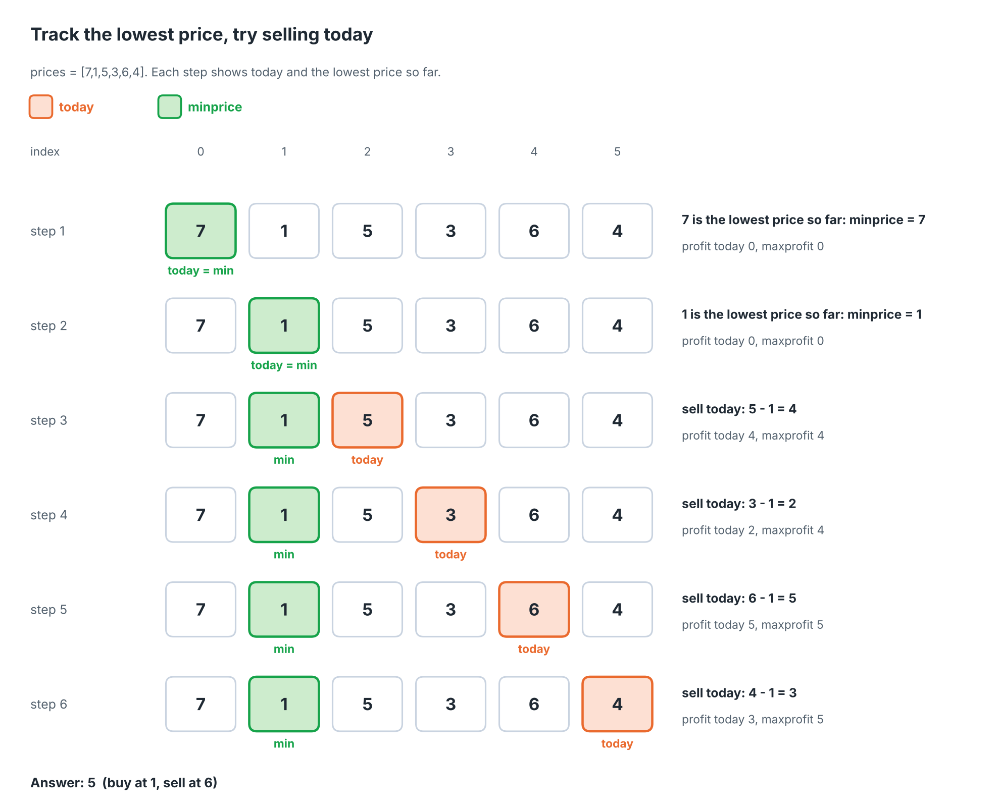

# Best Time to Buy & Sell Stock

**Question Link:** [LeetCode 121 - Best Time to Buy & Sell Stock](https://leetcode.com/problems/best-time-to-buy-and-sell-stock/)

**Pattern:** Kadane's Algorithm

  -22c55e?style=flat-square) -22c55e?style=flat-square)

---

> [!TIP]
> **Key insight:** You must buy before you sell. So the best day to have bought, for any selling day, is the lowest price seen before it.

## The Question

Given an array `prices` where `prices[i]` is the price on day `i`, pick one day to buy and a **later** day to sell. Return the biggest profit. If no profit is possible, return `0`.

> Example: `[7, 1, 5, 3, 6, 4]` gives `5`, because buying at `1` and selling at `6` makes `5`

<details>
<summary><b>How to think about it</b></summary>

<br>

1. **Start simple.** Try every pair: buy on day `i`, sell on a later day `j`, and keep the biggest `prices[j] - prices[i]`. It works, but it is O(n²).
2. **Spot the waste.** For a given selling day, we only care about the **cheapest** earlier day. Checking every earlier day again and again is wasted work.
3. **Ask the question that fixes it.** Can we remember the cheapest price so far while we walk? Yes, one variable: `minprice`.
4. **So walk once.** On each day, ask: "if I sell today, what is my profit?" That is `price - minprice`. Keep the biggest as `maxprofit`. Then update `minprice`, because today might be the new cheapest day to buy.
5. **Why start `maxprofit` at 0?** If prices only go down, the best choice is to not trade, and the answer is `0`.
6. **Order matters.** Check the profit before updating `minprice`. `maxprofit` starts at `0`, so if prices only fall we return `0`.

</details>

## Ways to Solve It

| Approach | Idea | Note | Time | Space |
| --- | --- | --- | --- | --- |
| Try every pair of days | For each buy day, check every later day to sell on. Keep the best profit. | Compares every pair of days. | O(n²) | O(1) |
| **Track the lowest price (best)** | **Walk once. Remember the lowest price so far, and try selling today.** | **One pass, two variables.** | **O(n)** | **O(1)** |

## The Logic

1. Set `minprice = Integer.MAX_VALUE` (no price seen yet) and `maxprofit = 0`.
2. For each `price`: the profit if we sell today is `price - minprice`. Keep the biggest: `maxprofit = max(maxprofit, price - minprice)`.
3. Update the lowest price: `minprice = min(minprice, price)`.
4. Return `maxprofit`.

## Code (Java)

```java
class Solution {
    public int maxProfit(int[] prices) {
        int minprice = Integer.MAX_VALUE;  // lowest price seen so far
        int maxprofit = 0;                 // best profit so far (0 = no trade)

        for (int i : prices) {
            // if we sell today, the best buy was the lowest price before today
            maxprofit = Math.max(maxprofit, i - minprice);
            // today might be the new cheapest day to buy
            minprice = Math.min(minprice, i);
        }

        return maxprofit;
    }
}
```

<details>
<summary><b>Dry run</b></summary>

<br>

Input `[7, 1, 5, 3, 6, 4]`. Read it one row at a time.


Answer: `5`

</details>

<details>
<summary><b>Is this the Kadane's pattern?</b></summary>

<br>

Optional extra. The `minprice` solution above is the one to write in an interview. This is the same problem solved with Kadane's, to show the two are connected.

**The idea**

- Look at the **change** in price from one day to the next. `[7, 1, 5, 3, 6, 4]` becomes `[-6, 4, -2, 3, -2]`.
- Buying on one day and selling on a later day gives a profit equal to the **sum of the changes in between**. Think of a bank balance: the end balance minus the start balance is every deposit and withdrawal in between added up. Check it: buy at 1, sell at 6, and the changes in between are 4 - 2 + 3 = 5, which is 6 - 1.
- So the best profit is the best run of consecutive changes. That is Maximum Subarray.

**What the two variables mean**

| Variable | Meaning |
| --- | --- |
| `currsum` | How much I am up if I sell today, counting from my chosen buy day. |
| `maxprofit` | The best `currsum` seen on any day. It starts at 0, so if prices only fall the answer is 0. |

**Why reset to 0:** if `currsum` goes below 0, the old buy day is worse than buying today. Setting it to 0 means "forget the old buy day and buy today".

```java
int maxprofit = 0;
int currsum = 0;

for (int i = 1; i < prices.length; i++) {
    currsum += prices[i] - prices[i - 1];   // today's change, added to what I am up
    currsum = Math.max(0, currsum);         // down? forget the old buy day, buy today
    maxprofit = Math.max(maxprofit, currsum);
}

return maxprofit;
```

**Dry run on `[7, 1, 5, 3, 6, 4]`**

| Day | Price | Change | currsum after reset check | maxprofit |
| --- | --- | --- | --- | --- |
| 1 | 1 | -6 | 0 (buy today) | 0 |
| 2 | 5 | +4 | 4 | 4 |
| 3 | 3 | -2 | 2 | 4 |
| 4 | 6 | +3 | 5 | 5 |
| 5 | 4 | -2 | 3 | 5 |

Answer: 5 (buy at 1, sell at 6).

**How it matches the `minprice` solution:** on any day, `currsum` equals that day's price minus the lowest price so far. On day 4 that is 6 - 1 = 5, the same as `currsum`. Both solutions work out the best profit if I sell today. `minprice` does it by remembering the lowest price. Kadane's does it by keeping a running total of the changes.

If this does not click yet, skip it. The `minprice` solution is enough for this problem, and the idea will come back in other Kadane's problems.

</details>

## Complexity

| Time | Extra space |
| --- | --- |
| O(n): one pass over the prices | O(1): just `minprice` and `maxprofit` |
