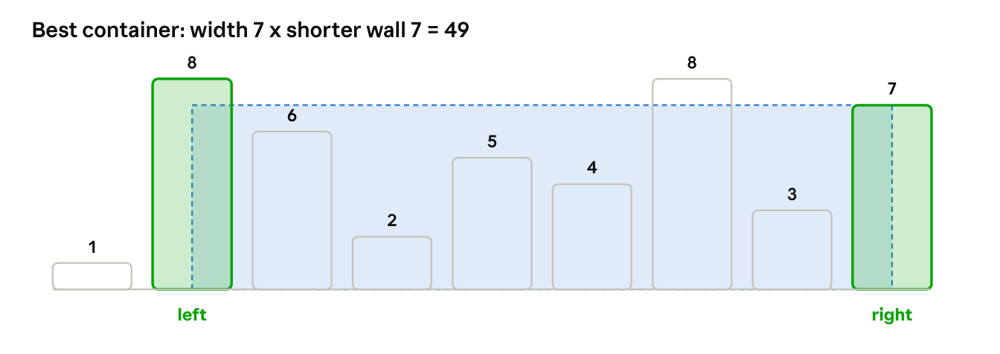
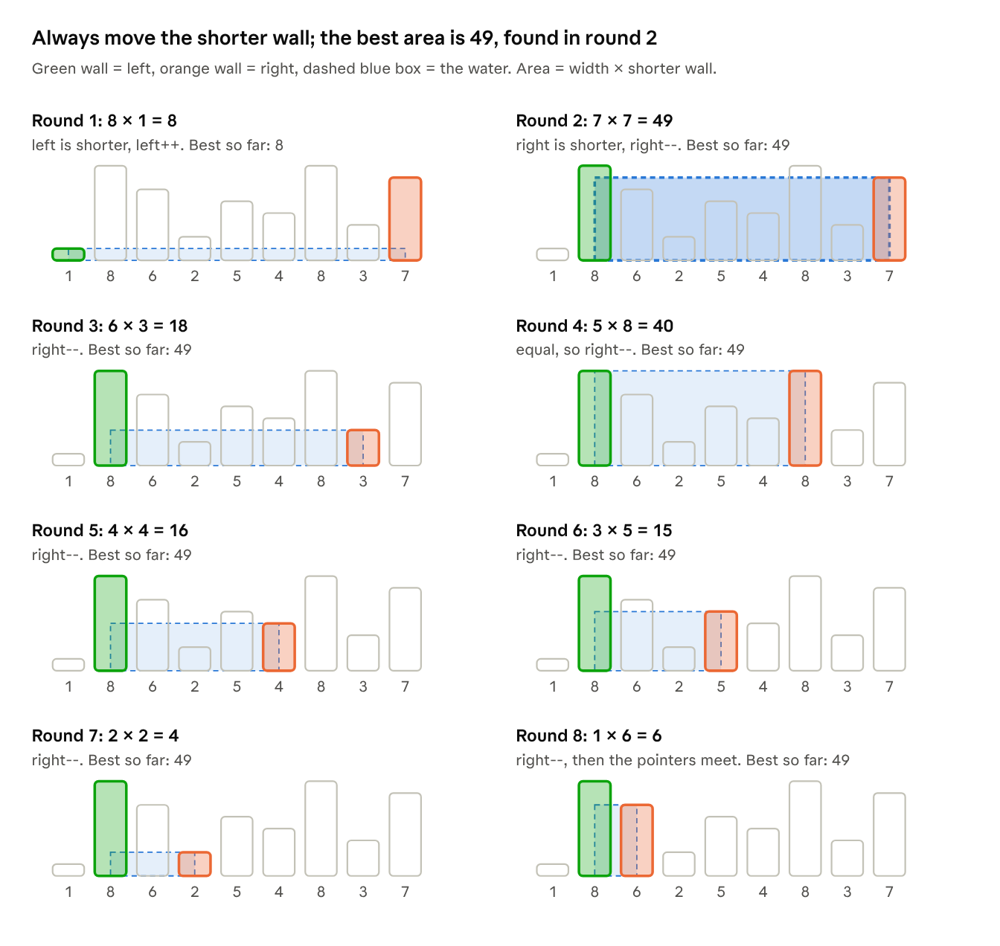

# Container With Most Water

**Question Link:** [LeetCode 11 - Container With Most Water](https://leetcode.com/problems/container-with-most-water/)

**Pattern:** Two Pointers (Converge / Partition)

  -22c55e?style=flat-square) -22c55e?style=flat-square)

---

> [!TIP]
> **Key insight:** Water is held by the **shorter** wall. Moving the taller wall can never help, so only the shorter wall is worth moving.

## The Question

You are given an array `height`. Each number is the height of a vertical wall. Pick two walls so that, together with the ground, they hold the **most water**. Return that amount.

> Example: `[1, 8, 6, 2, 5, 4, 8, 3, 7]` gives `49`

Area = width x shorter wall, where width is the distance between the two walls.

<details>
<summary><b>How to think about it</b></summary>

<br>

1. **What decides the water?** Two walls and the ground hold it. Water spills over the **shorter** wall, so area = width x shorter wall.
2. **Start simple.** Try every pair of walls. That is O(n²).
3. **Which pairs can I skip?** Start with the two ends. This is the widest container, and width only shrinks from here.
4. **Move one pointer inward.** Which one? If I move the **taller** wall, the shorter wall still limits the water and the width is smaller, so the area cannot get better. Moving the taller wall never helps.
5. **So move the shorter wall.** It might find a taller wall and give more water. Track the best area each round.
6. **Stop** when the pointers meet. Each wall is visited once, so it is O(n).

</details>

## Ways to Solve It

| Approach | Idea | Note | Time | Space |
| --- | --- | --- | --- | --- |
| Brute force | Try every pair of walls with two loops. | Works, but slow. | O(n²) | O(1) |
| **Two pointers (best)** | **Start at both ends. Always move the pointer at the shorter wall.** | **Only one pass.** | **O(n)** | **O(1)** |

## Best Idea: Two pointers from both ends

Start with the widest container. Every move makes it narrower, so the only hope for more water is a taller shorter-wall. That is why we move the shorter side.



## The Logic

1. Set `left = 0`, `right = n - 1` and `ans = 0`.
2. While `left < right`, find `width = right - left`.
3. Find `minHeight` as the smaller of `height[left]` and `height[right]`.
4. Area is `width * minHeight`. Keep the biggest one in `ans`.
5. Move the pointer at the **smaller** wall: `left++` if the left is shorter, otherwise `right--`.
6. When the pointers meet, return `ans`.

## Code (Java)

```java
class Solution {
    public int maxArea(int[] height) {
        int ans = 0;
        int left = 0;
        int right = height.length - 1;

        while (left < right) {
            // calculate the current area
            int width = right - left;
            int minHeight = Math.min(height[left], height[right]);
            int currArea = width * minHeight;

            // update maximum area
            ans = Math.max(ans, currArea);

            // move the pointer with the smaller height
            if (height[left] < height[right]) {
                left++;
            } else {
                right--;
            }
        }
        return ans;
    }
}
```

<details>
<summary><b>Dry run</b></summary>

<br>

Input `[1, 8, 6, 2, 5, 4, 8, 3, 7]`. Read it one round at a time.


Answer: `49`

</details>

## Why does it work?

> [!TIP]
> - Every move shrinks the width by 1, so the next area can only be bigger if the shorter wall gets taller.
> - If we moved the **taller** wall, the shorter wall would still limit the water, and the width would be smaller. The area could never grow.
> - So moving the shorter wall is the only move that can help, and we never skip the best pair.

## Complexity

| Time | Extra space |
| --- | --- |
| O(n): each pointer moves one way and the pointers meet | O(1) |
