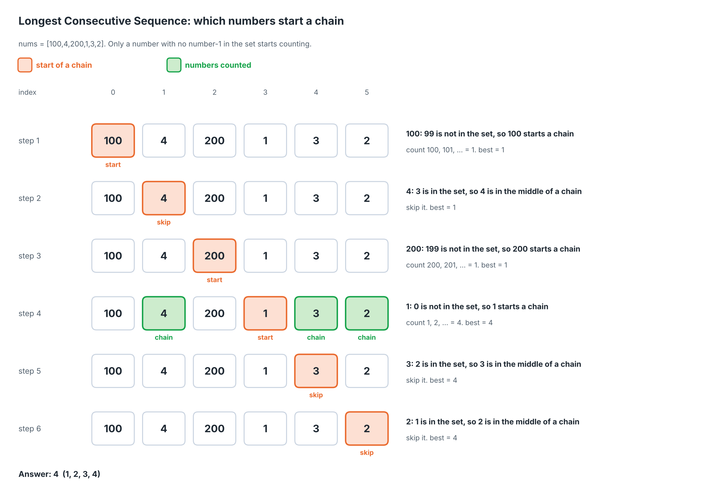

# Longest Consecutive Sequence

**Question Link:** [LeetCode 128 - Longest Consecutive Sequence](https://leetcode.com/problems/longest-consecutive-sequence/)

**Pattern:** Hashing / Prefix Sum

  -22c55e?style=flat-square) -22c55e?style=flat-square)

---

> [!TIP]
> **Key insight:** A number with `num - 1` in the set is in the middle of a chain, so skip it. Each chain is then counted once, from its start.

## The Question

Given an unsorted array `nums`, return the length of the longest chain of numbers that follow each other, like `4, 5, 6, 7`. The numbers can be anywhere in the array. The question wants O(n) time.

> Example: `[100, 4, 200, 1, 3, 2]` gives `4`, because `1, 2, 3, 4` is the longest chain

<details>
<summary><b>How to think about it</b></summary>

<br>

1. **Start simple.** Sort the array, then walk through it and count how long the numbers keep going up by 1. It works, but sorting is O(n log n), and the question wants O(n).
2. **Where is the cost?** We only need to ask "is the next number here?". A HashSet answers that at once, with no sorting.
3. **First idea.** For every number, keep checking `num + 1`, `num + 2`, ... in the set and count. But a chain like `1, 2, 3, 4` would be counted again from 2, from 3 and from 4. That wastes time, up to O(n²).
4. **The fix.** Only count from the **start** of a chain. A number is a start if `num - 1` is **not** in the set. If `num - 1` is there, skip it, because a smaller number will count it.
5. **Why this is fast.** Each chain is walked once, from its start. So every number is looked at only a couple of times: O(n).
6. **Duplicates.** The set removes them, so a repeated number is not counted twice.

</details>

## Ways to Solve It

| Approach | Idea | Note | Time | Space |
| --- | --- | --- | --- | --- |
| Sort first | Sort, then walk through and count numbers that go up by 1. | Correct, but sorting is slower than O(n). | O(n log n) | O(1) |
| **HashSet (best)** | **Only count from the start of a chain, never from the middle.** | **Each number is walked once.** | **O(n)** | **O(n)** |

## The Logic

1. Put every number of `nums` into a `HashSet`. This also removes duplicates.
2. For each `num` in the set, check `num - 1`. If it is in the set, skip this number.
3. Otherwise `num` starts a chain. Set `current = num` and `currcount = 0`.
4. While `current` is in the set: `currcount++` and `current++`.
5. Keep the biggest: `maxcount = max(maxcount, currcount)`.
6. Return `maxcount`.

## Code (Java)

```java
class Solution {
    public int longestConsecutive(int[] nums) {
        // put every number in a set: "is it here?" is now one quick check
        HashSet<Integer> set = new HashSet<>();
        for (int num : nums) {
            set.add(num);
        }

        int maxcount = 0;  // longest chain found so far

        for (int num : set) {
            // num - 1 exists, so num is in the middle of a chain: skip it
            if (set.contains(num - 1)) continue;

            // num starts a chain: count how far it goes
            int current = num;
            int currcount = 0;
            while (set.contains(current)) {
                currcount++;
                current++;
            }

            maxcount = Math.max(maxcount, currcount);
        }

        return maxcount;
    }
}
```

<details>
<summary><b>Dry run</b></summary>

<br>

Input `[100, 4, 200, 1, 3, 2]`. Read it one row at a time.


Answer: `4`

</details>

## Complexity

| Time | Extra space |
| --- | --- |
| O(n): each number is walked at most once, and only from the start of its chain | O(n): the set holds every number |
