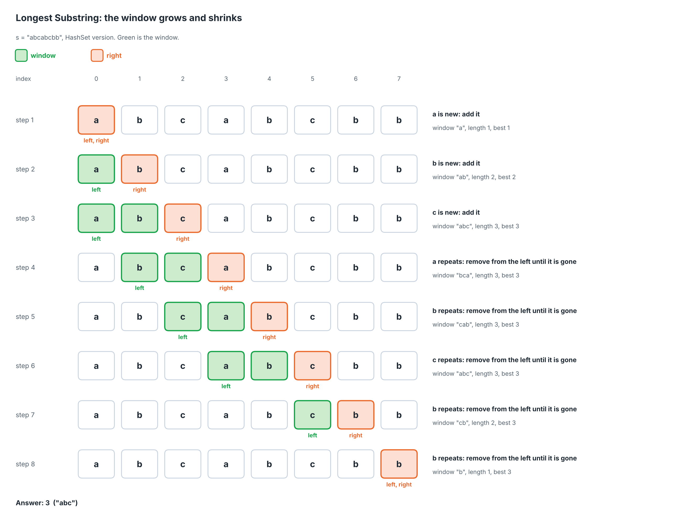
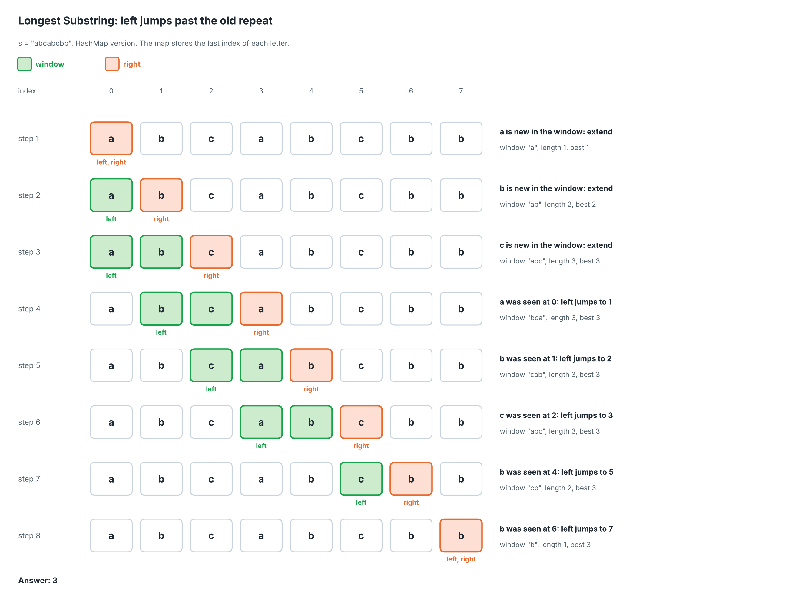

# Longest Substring Without Repeating Characters

**Question Link:** [LeetCode 3 - Longest Substring Without Repeating Characters](https://leetcode.com/problems/longest-substring-without-repeating-characters/)

**Pattern:** Hashing / Prefix Sum

  -22c55e?style=flat-square) -22c55e?style=flat-square)

---

> [!TIP]
> **In one line:** Keep a window of letters with no repeats. Move the right end forward. When a letter repeats, move the left end forward until the repeat is gone.

> [!TIP]
> **Key insight:** The window never needs to go back. When a repeat shows up, only the left side moves, so every letter is added once and removed once.

## The Question

Given a string `s`, return the length of the longest substring (a piece of letters that sit next to each other) with no repeated letter.

> Example: `"abcabcbb"` gives `3`, because `"abc"` is the longest piece with no repeats

## Ways to Solve It

| Approach | Idea | Note | Time | Space |
| --- | --- | --- | --- | --- |
| Brute force | Try every start letter, grow until a repeat. | Slow when the string is long. | O(n²) | O(n) |
| Better: HashSet | Window of unique letters, shrink left on a repeat. | Removes one letter at a time. | O(n) | O(n) |
| **Optimal: HashMap (best)** | **Remember each last index, jump left past the old repeat.** | **Jumps left in one step (best).** | **O(n)** | **O(n)** |

### 1. Brute Force: Generate all substrings

- Use two loops: `i` is the start and `j` is the end of the substring.
- Keep a `Set` of the letters in the current substring.
- If `s.charAt(j)` is already in the set, stop and move to the next `i`.
- Otherwise add it and update `maxLength`.

```java
class Solution {
    public int lengthOfLongestSubstring(String s) {
        int maxLength = 0;

        // start a substring at every index i
        for (int i = 0; i < s.length(); i++) {
            Set<Character> set = new HashSet<>();   // letters in this substring

            // extend it to the right
            for (int j = i; j < s.length(); j++) {
                if (set.contains(s.charAt(j))) break;   // repeat found: stop

                set.add(s.charAt(j));
                maxLength = Math.max(maxLength, j - i + 1);
            }
        }

        return maxLength;
    }
}
```

| Complexity | Why? |
| --- | --- |
| **Time:** O(n²) | Two loops generate all substrings. |
| **Space:** O(n) | The set can hold up to n letters. |

### 2. Better: Sliding Window + HashSet

**Intuition**

Maintain a window with unique characters. Expand it using `right`. If a duplicate appears, move `left` forward and remove characters until the duplicate is gone.

## The Logic

1. **Initialise:** Create an empty Set. Set `left = 0` and `maxLength = 0`.
2. **Expand:** Move `right` through the string and get the current character `c`.
3. **Handle duplicates:** While `c` is already in the Set, remove `s.charAt(left)` and move `left++`.
4. **Add character:** Add `c` to the Set.
5. **Update length:** Calculate `right - left + 1` and update `maxLength` if it's bigger.
6. **Return:** `maxLength`.

## Code (Java)

```java
class Solution {
    public int lengthOfLongestSubstring(String s) {
        int left = 0;          // start of the window
        int maxLength = 0;     // longest window seen so far
        Set<Character> set = new HashSet<>();   // letters inside the window

        for (int right = 0; right < s.length(); right++) {
            char c = s.charAt(right);

            // c is already in the window: drop letters from the left until it is gone
            while (set.contains(c)) {
                set.remove(s.charAt(left));
                left++;
            }

            set.add(c);   // now c is safe to add

            // window is left..right, so its size is right - left + 1
            maxLength = Math.max(maxLength, right - left + 1);
        }

        return maxLength;
    }
}
```

| Complexity | Why? |
| --- | --- |
| **Time:** O(n) | Each letter is added to the set once and removed at most once. |
| **Space:** O(min(n, charset size)) | The set only holds different letters. |

<details>
<summary><b>Dry run</b></summary>

<br>

Input `"abcabcbb"`. Read it one row at a time.


Answer: `3`

</details>

### 3. Optimal: Sliding Window + HashMap

**Intuition**

Store each character's last index. If it repeats, move `left` to `lastIndex + 1`.

**Steps**

1. **Initialise:** Create a HashMap (character → last index seen). Set `left = 0` and `maxLength = 0`.
2. **Traverse:** Move `right` through the string.
3. **Check duplicate:** If the map contains the character and its last index is inside the window, move `left = lastIndex + 1`.
4. **Update map:** Store the character's current index (`right`).
5. **Update length:** `maxLength = max(maxLength, right - left + 1)`.
6. **Return:** `maxLength`.

**Java code**

```java
class Solution {
    public int lengthOfLongestSubstring(String s) {
        Map<Character, Integer> map = new HashMap<>();   // letter -> last index
        int left = 0;          // start of the window
        int maxLength = 0;     // longest window seen so far

        for (int right = 0; right < s.length(); right++) {
            char c = s.charAt(right);

            // seen before AND inside the window: jump left past the old one
            if (map.containsKey(c) && map.get(c) >= left) {
                left = map.get(c) + 1;
            }

            map.put(c, right);   // remember the latest index of c

            // window is left..right, so its size is right - left + 1
            maxLength = Math.max(maxLength, right - left + 1);
        }

        return maxLength;
    }
}
```

| Complexity | Why? |
| --- | --- |
| **Time:** O(n) | `right` walks the string once and every map lookup is O(1). |
| **Space:** O(min(n, charset size)) | The map stores one entry per different letter. |

**Dry run**

Input `"abcabcbb"`. Read it one row at a time.


Answer: `3`

<details>
<summary><b>Quick Revision</b></summary>

<br>

| Approach | Idea | Time | Space |
| --- | --- | --- | --- |
| Brute force | Generate and check substrings | O(n²) | O(n) |
| HashSet | Shrink window until duplicate is removed | O(n) | O(n) |
| HashMap | Jump left past the previous occurrence | O(n) | O(n) |

**Key Insight:** Sliding Window + Hashing. Keep a window with unique characters and update its maximum length.

> **Important note:**
>
> - **HashSet:** We remove characters as `left` moves, so the Set only contains characters inside the current window. No extra check is needed.
> - **HashMap:** We don't remove old entries. It stores the last seen index of every character, even if it's outside the window. So we need the extra check: `map.get(c) >= left`.

**Why `map.get(c) >= left`? (the "abba" case)**

- Take `abba`. At the last `a`, its old index is `0`, but `left` is already `2`.
- Without the check, `left` would jump back to `1` and the window would include the repeated `b`.
- The check makes sure `left` only moves forward.

 

---

</details>
