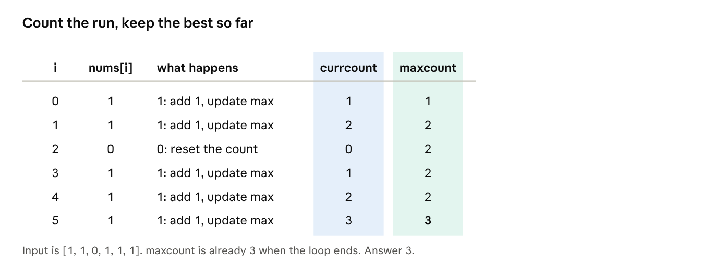

# Max Consecutive Ones

**Question Link:** [LeetCode 485 - Max Consecutive Ones](https://leetcode.com/problems/max-consecutive-ones/)

**Pattern:** Two Pointers (Read/Write)

  -22c55e?style=flat-square) -22c55e?style=flat-square)

---

> [!TIP]
> **In one line:** Walk through the array once. Count the 1s in a row, keep the biggest count so far, and reset the count on a 0.

## The Question

Given a binary array `nums` (only 0s and 1s), return the length of the longest run of **consecutive 1s**.

> Example: `[1, 1, 0, 1, 1, 1]` gives `3`

<details>
<summary><b>How to think about it</b></summary>

<br>

1. **Start simple.** From every 1, walk right until you hit a 0, and count. It works, but the same 1s get counted again and again. That is O(n²).
2. **What are we really counting?** The 1s that sit next to each other. A 0 cuts them off.
3. **So one pass is enough.** Walk left to right with a counter, `currcount`. See a 1: add 1. See a 0: the 1s stop, so set the counter back to 0.
4. **Remember the best.** `maxcount` is the biggest `currcount` we have seen. Update it every time `currcount` goes up.
5. **Nothing is left at the end.** `maxcount` was updated as we went, so just return it.
6. **No check after the loop.** `maxcount` is updated every time `currcount` goes up, so it already holds the biggest count.

</details>

## Ways to Solve It

| Approach | Idea | Note | Time | Space |
| --- | --- | --- | --- | --- |
| Brute force | From every 1, walk right until a 0 and count. | The same 1s get counted again. | O(n²) | O(1) |
| **One pass with a counter (best)** | **A 1 adds to the count, update the max. A 0 breaks it, so reset to 0.** | **Each number is read once.** | **O(n)** | **O(1)** |

## The Logic

1. Set `maxcount = 0` and `currcount = 0`.
2. Go through every number.
3. If it is `1`: do `currcount++`, then `maxcount = max(maxcount, currcount)`.
4. If it is `0`: do `currcount = 0`.
5. Return `maxcount`.

## Code (Java)

```java
class Solution {
    public int findMaxConsecutiveOnes(int[] nums) {
        int maxcount = 0;   // longest run of 1s seen so far
        int currcount = 0;  // length of the run of 1s we are in right now

        for (int i = 0; i < nums.length; i++) {
            if (nums[i] == 1) {
                // the run grows by one
                currcount++;
                // is this run a new record?
                maxcount = Math.max(maxcount, currcount);
            } else {
                // a 0 breaks the run, so start counting again
                currcount = 0;
            }
        }
        return maxcount;
    }
}
```

<details>
<summary><b>Dry run</b></summary>

<br>

Input `[1, 1, 0, 1, 1, 1]`. Read it one row at a time.


Answer: `3`

</details>

## Complexity

| Time | Extra space |
| --- | --- |
| O(n): one pass | O(1) |
