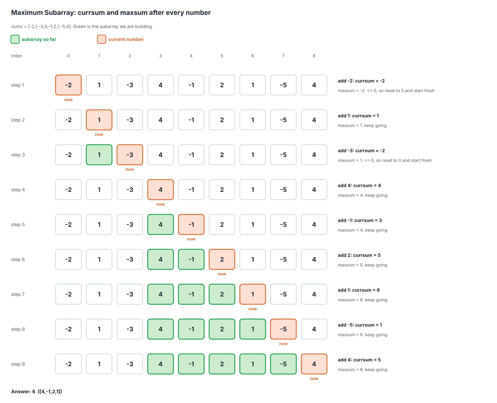

# Maximum Subarray

**Question Link:** [LeetCode 53 - Maximum Subarray](https://leetcode.com/problems/maximum-subarray/)

**Pattern:** Kadane's Algorithm

  -22c55e?style=flat-square) -22c55e?style=flat-square)

---

> [!TIP]
> **Key insight:** A running sum that is 0 or negative never helps a later subarray, so throw it away and start again from the next number.

## The Question

Given an array `nums`, return the largest sum of any subarray (a piece of numbers that sit next to each other, at least one number long).

> Example: `[-2, 1, -3, 4, -1, 2, 1, -5, 4]` gives `6`, because `[4, -1, 2, 1]` adds up to `6`

<details>
<summary><b>How to think about it</b></summary>

<br>

1. **Start simple.** Try every subarray: pick a start, keep adding numbers to the right, and keep the biggest sum. It works, but it is O(n²).
2. **Spot the waste.** Say the sum so far is `-3` and the next number is `5`. Carrying the `-3` along gives `2`, which is worse than starting fresh at `5`. A negative total only drags the next subarray down.
3. **Ask the question that fixes it.** At each number: should I extend the subarray so far, or start a new one here? Extend only if the sum so far is positive. If it is 0 or less, start fresh.
4. **So walk once.** Add each number to `currsum` and update `maxsum`. Then, if `currsum` is 0 or less, set it to 0, so the next number starts a new subarray.
5. **Why update `maxsum` before the reset?** When every number is negative, like `[-3, -1]`, the answer is `-1`. If we reset first, we would never record it.
6. **Update `maxsum` before the reset.** Then an array with only negative numbers still gives the right answer.

</details>

## Ways to Solve It

| Approach | Idea | Note | Time | Space |
| --- | --- | --- | --- | --- |
| Try every subarray (brute force) | Start at each index and keep adding to the right, tracking the biggest sum. | Checks every start and end pair. | O(n²) | O(1) |
| **Kadane's algorithm (best)** | **Keep a running sum. If it drops to 0 or below, throw it away and restart.** | **One pass, no extra memory.** | **O(n)** | **O(1)** |

## The Logic

1. Set `maxsum = Integer.MIN_VALUE` (so any sum beats it) and `currsum = 0`.
2. For each number: `currsum += num`.
3. Update the best: `maxsum = max(maxsum, currsum)`.
4. If `currsum <= 0`, set `currsum = 0`.
5. Return `maxsum`.

## Code (Java)

```java
class Solution {
    public int maxSubArray(int[] nums) {
        int maxsum = Integer.MIN_VALUE;  // best sum seen so far (starts very low)
        int currsum = 0;                 // sum of the subarray we are building now

        for (int i : nums) {
            currsum += i;                        // extend the current subarray
            maxsum = Math.max(maxsum, currsum);  // record the best BEFORE any reset

            // 0 or less can only hurt the next numbers: start fresh
            if (currsum <= 0) {
                currsum = 0;
            }
        }

        return maxsum;
    }
}
```

<details>
<summary><b>Dry run</b></summary>

<br>

Input `[-2, 1, -3, 4, -1, 2, 1, -5, 4]`. Read it one row at a time.


Answer: `6`

</details>

## Complexity

| Time | Extra space |
| --- | --- |
| O(n): one pass over the array | O(1): just `maxsum` and `currsum` |
