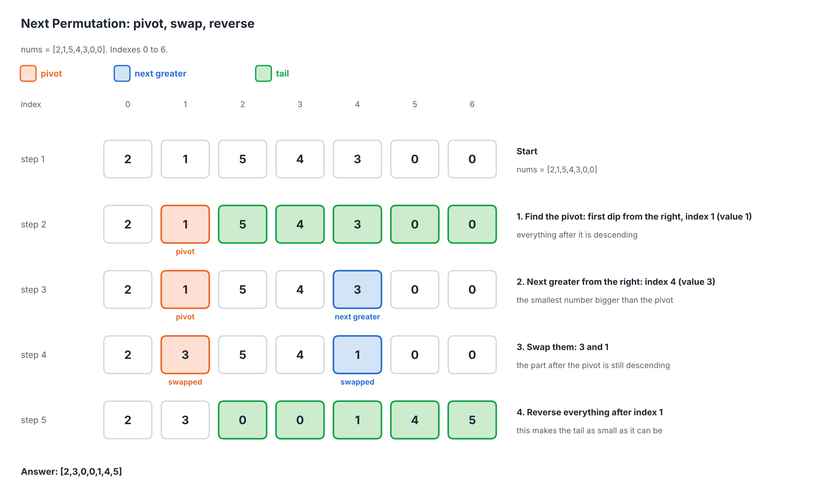

# Next Permutation

**Question Link:** [LeetCode 31 - Next Permutation](https://leetcode.com/problems/next-permutation/)

**Pattern:** Math / Binary Exponentiation

  -22c55e?style=flat-square) -22c55e?style=flat-square)

---

> [!TIP]
> **In one line:** Rearrange the array into the next bigger arrangement. If there is none, return the smallest arrangement.
>
> **Key insight:** Change as little as possible, and change it as far to the right as possible. Find the first place from the right where the numbers stop being in descending order, make that spot slightly bigger, then make everything after it as small as it can be.

## The Question

Rearrange `nums` into the **next bigger permutation**. If no bigger permutation exists, return the smallest arrangement (sorted ascending). Do it in place.

> Example: `[1, 2, 3]` gives `[1, 3, 2]`. `[3, 2, 1]` gives `[1, 2, 3]`.

## Ways to Solve It

| Approach | Idea | Note | Time | Space |
| --- | --- | --- | --- | --- |
| Brute force | Generate all permutations, sort them, take the one after the current. | There are N! permutations: far too slow. | O(N × N!) | O(N × N!) |
| **Pivot, swap, reverse (best)** | **Find the pivot, swap it with the next greater, reverse the part after the pivot.** | **A few passes, no extra memory.** | **O(N)** | **O(1)** |

**Brute force**

1. Generate all possible permutations (fix one element at a time and recursively arrange the rest).
2. Sort them in increasing order.
3. Find the current permutation and return the one after it.

```java
class Solution {
    public void nextPermutation(int[] nums) {
        // 1. make every possible arrangement
        List<List<Integer>> all = new ArrayList<>();
        generate(nums, new ArrayList<>(), new boolean[nums.length], all);

        // 2. sort them from smallest to biggest
        all.sort((a, b) -> {
            for (int i = 0; i < a.size(); i++) {
                if (!a.get(i).equals(b.get(i))) return a.get(i) - b.get(i);
            }
            return 0;
        });

        // 3. find where the current arrangement is in the sorted list
        List<Integer> cur = new ArrayList<>();
        for (int x : nums) cur.add(x);
        int idx = 0;
        for (int i = 0; i < all.size(); i++) {
            if (all.get(i).equals(cur)) idx = i;
        }

        // 4. take the next one (if we were at the last one, go back to the first)
        List<Integer> next = all.get((idx + 1) % all.size());
        for (int i = 0; i < nums.length; i++) nums[i] = next.get(i);
    }

    // picks one unused number at a time until the arrangement is full
    private void generate(int[] nums, List<Integer> cur, boolean[] used, List<List<Integer>> all) {
        if (cur.size() == nums.length) {
            all.add(new ArrayList<>(cur));
            return;
        }
        for (int i = 0; i < nums.length; i++) {
            if (used[i]) continue;
            used[i] = true;
            cur.add(nums[i]);
            generate(nums, cur, used, all);
            cur.remove(cur.size() - 1);   // undo, so the next number can be tried
            used[i] = false;
        }
    }
}
```

| Complexity | Why? |
| --- | --- |
| **Time:** O(N × N!) | There are N! arrangements and building each one takes N steps. |
| **Space:** O(N × N!) | We keep every arrangement in a list. |

### Optimal solution

**Intuition**

Make the smallest possible change, starting from the right side.

Example: `[2, 1, 5, 4, 3, 0, 0]`

1. **Find the pivot (breakpoint).**
   - Start from the right and find the first position where `nums[i] < nums[i + 1]`
   - This is the position we have to change.
   - Everything after it is in descending order, which is already the biggest arrangement of those numbers, so rearranging only that part cannot give a bigger permutation.
   - Here the pivot is `1`.
2. **Find the next greater element.**
   - Look to the right of the pivot.
   - Find the smallest number that is greater than pivot.
   - Swap them, so the new permutation is only slightly bigger. Swapping `1` and `3` gives `[2, 3, 5, 4, 1, 0, 0]`.
3. **Make the rest as small as possible.**
   - The elements after the pivot are still in descending order.
   - Reverse that part to arrange in ascending order.
   - Final answer: `[2, 3, 0, 0, 1, 4, 5]`.

**Approach:**

1. **Find pivot:** Start from `n - 2` and move left until `nums[i] < nums[i + 1]`. Store its index in `ind`.
2.  **Find next greater:** From the end, find the first number greater than `nums[ind]` and swap them.
3. **Reverse suffix:** Reverse everything after the pivot (`ind + 1` to `n - 1`).
4. **Edge case:** If `ind == -1`, no pivot exists. The array is already the largest permutation, so reverse the whole array.

## Code (Java)

```java
class Solution {
    public void nextPermutation(int[] nums) {
        int n = nums.length;
        int ind = -1;

        // find the pivot: first spot from the right where nums[i] < nums[i + 1]
        for (int i = n - 2; i >= 0; i--) {
            if (nums[i] < nums[i + 1]) {
                ind = i;
                break;
            }
        }

        if (ind != -1) {
            // the part after the pivot is descending, so the first bigger number from the right is the next greater one
            for (int i = n - 1; i > ind; i--) {
                if (nums[i] > nums[ind]) {
                    int temp = nums[i];
                    nums[i] = nums[ind];
                    nums[ind] = temp;
                    break;
                }
            }
        }

        // reverse the part after the pivot so it is the smallest arrangement
        // (if there is no pivot, ind + 1 = 0 and this reverses the whole array)
        reverse(nums, ind + 1, n - 1);
    }

    private void reverse(int[] nums, int left, int right) {
        while (left < right) {
            int temp = nums[left];
            nums[left] = nums[right];
            nums[right] = temp;
            left++;
            right--;
        }
    }
}
```

<details>
<summary><b>Dry run</b></summary>

<br>

Input `[2, 1, 5, 4, 3, 0, 0]`. Indexes are 0 to 6.


Answer: `[2, 3, 0, 0, 1, 4, 5]`

</details>

## Why does it work?

> [!TIP]
> - The part after the pivot is descending, so it is already the biggest arrangement of those numbers. The only way to get bigger is to change the pivot itself.
> - Swapping the pivot with the smallest number bigger than it makes the number bigger by the smallest possible step.
> - After the swap, the part after the pivot is still descending. Reversing it makes it ascending, which is the smallest arrangement, so the result is the very next permutation.
> - If there is no pivot, the array is fully descending (the largest permutation), so reversing the whole array gives the smallest one.

## Complexity

| Complexity | Why? |
| --- | --- |
| **Time:** O(N) | Finding the pivot, finding the next greater element and reversing the suffix are each one pass at most. |
| **Space:** O(1) | The array is rearranged in place using only a few variables. |
|  |  |

**Quick comparison:**

- **Brute force:** O(N × N!) time, O(N × N!) space.
- **Pivot, swap, reverse:** O(N) time, O(1) space.

**Quick revision:** find the pivot, swap it with the next greater number, reverse the remaining suffix.
