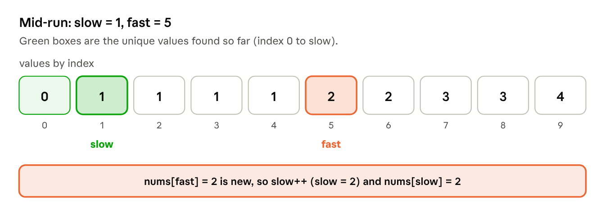
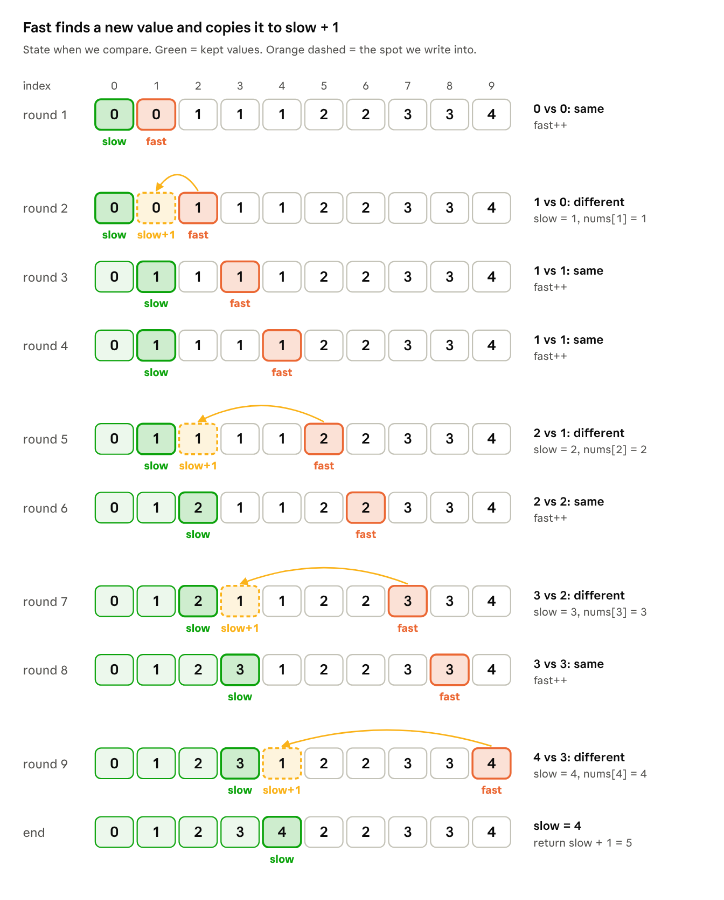

# Remove Duplicates from Sorted Array

**Question Link:** [LeetCode 26 - Remove Duplicates from Sorted Array](https://leetcode.com/problems/remove-duplicates-from-sorted-array/)

**Pattern:** Two Pointers (Read/Write)

  -22c55e?style=flat-square) -22c55e?style=flat-square)

---

> [!TIP]
> **In one line:** In a sorted array, repeats sit side by side. `fast` looks for a new value, and `slow` marks where the next unique value goes.

## The Question

Given a **sorted** array `nums`, remove the duplicates **in place** so each value appears once. Return `k`, the number of unique values. The first `k` items must hold the unique values. What is after them does not matter.

> Example: `[0, 0, 1, 1, 1, 2, 2, 3, 3, 4]` gives `k = 5`, and the first 5 items are `[0, 1, 2, 3, 4]`

<details>
<summary><b>How to think about it</b></summary>

<br>

1. **Start simple.** Put every value in a Set. But the question says in place, so no extra memory.
2. **Use "sorted".** Equal values sit side by side. So a duplicate just means "same as the value before it". No Set needed.
3. **Use "in place".** I may overwrite the array, and only the first `k` items matter. The rest can be junk. So keep a clean part at the front that holds only unique values.
4. **Two jobs, two pointers.** `fast` reads ahead looking for a new value. `slow` marks the end of the clean part.
5. **Each round.** If `nums[fast]` differs from `nums[slow]`, it is new: `slow++`, then copy it in. If it is the same, skip it.
6. **Stop** when `fast` runs out. The clean part is index 0 to `slow`, so `k = slow + 1`.

</details>

## Ways to Solve It

| Approach | Idea | Note | Time | Space |
| --- | --- | --- | --- | --- |
| Extra set or array | Copy the unique values into a new list, then copy them back. | Works, but uses extra memory. | O(n) | O(n) |
| **Slow + fast pointers (best)** | **fast looks ahead for new values. slow marks the last unique spot.** | **Changes the array in place.** | **O(n)** | **O(1)** |

## Best Idea: Slow + fast pointers

`slow` is the index of the last unique value. `fast` runs ahead looking for the next value that is different.



## The Logic

1. Set `slow = 0` and `fast = 1`.
2. While `fast < nums.length`, compare `nums[slow]` with `nums[fast]`.
3. If they are the **same**, only move `fast++` to look for a different value.
4. If they are **different**, do `slow++`, then `nums[slow] = nums[fast]`, then `fast++`.
5. When `fast` goes out of bounds, return `slow + 1`.

**Why does `slow` start at 0?** The first element at index `0` is always unique, so we don't need to check it. We start `fast` at index `1` and compare it with `nums[slow]`.

## Code (Java)

```java
class Solution {
    public int removeDuplicates(int[] nums) {
        int slow = 0;
        int fast = 1;

        while (fast < nums.length) {
            if (nums[slow] != nums[fast]) {
                slow++;
                nums[slow] = nums[fast];
            }
            fast++;
        }
        return slow + 1;
    }
}
```

<details>
<summary><b>Dry run</b></summary>

<br>

Input `[0, 0, 1, 1, 1, 2, 2, 3, 3, 4]`. `slow` starts at 0. Read it one row at a time.


Read each row top to bottom. When fast finds a new value, it is copied into the dashed slow + 1 spot; the next row shows that change.

`fast` is now out of bounds. Return `slow + 1 = 5`. The first five items are `[0, 1, 2, 3, 4]`.

</details>

## Complexity

| Time | Extra space |
| --- | --- |
| O(n): `fast` goes through the array once | O(1) |
