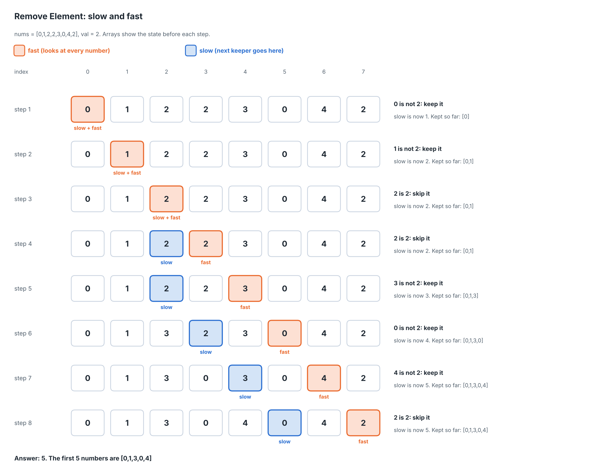

# Remove Element

**Question Link:** [LeetCode 27 - Remove Element](https://leetcode.com/problems/remove-element/)

**Pattern:** Two Pointers (Read/Write)

  -22c55e?style=flat-square) -22c55e?style=flat-square)

---

> [!TIP]
> **In one line:** Look at every number. If it is not `val`, copy it to the front. If it is `val`, skip it.

## The Question

Given an array `nums` and a number `val`, remove every `val` **in place**. Return `k`, the count of numbers that are not `val`. The first `k` items of `nums` must hold those numbers. What is after them does not matter.

> Example: `[0, 1, 2, 2, 3, 0, 4, 2]` with `val = 2` gives `k = 5`, and the first 5 items are `[0, 1, 3, 0, 4]`

<details>
<summary><b>How to think about it</b></summary>

<br>

1. **Start simple.** Make a new array, copy in every number that is not `val`, then copy it back. It works, but it uses extra memory, and the question says in place.
2. **What is the question really asking?** Keep the numbers that are not `val` and pack them at the front. Only the first `k` items are checked, so the rest can be anything.
3. **Two jobs, two pointers.** `fast` looks at every number. `slow` marks where the next number to keep should go.
4. **Each number.** Not `val`: copy it to `nums[slow]`, then `slow++`. Is `val`: do nothing, just look at the next one.
5. **At the end,** `slow` is how many numbers we kept. That is `k`.

</details>

## Ways to Solve It

| Approach | Idea | Note | Time | Space |
| --- | --- | --- | --- | --- |
| Shift on every match | When we find val, move every number after it one step left. | Lots of repeated moving. | O(n²) | O(1) |
| **Slow + fast (best)** | **fast checks every number. slow is where the next keeper goes.** | **One pass, no extra array.** | **O(n)** | **O(1)** |

## The Logic

1. Set `slow = 0`.
2. Let `fast` go from `0` to the end of the array.
3. If `nums[fast]` is **not** `val`: do `nums[slow] = nums[fast]`, then `slow++`.
4. If it is `val`: skip it.
5. Return `slow`.

## Code (Java)

```java
class Solution {
    public int removeElement(int[] nums, int val) {
        int slow = 0;  // where the next number to keep goes

        // fast looks at every number
        for (int fast = 0; fast < nums.length; fast++) {
            if (nums[fast] != val) {
                // not val: keep it
                nums[slow] = nums[fast];
                slow++;
            }
            // is val: do nothing, skip it
        }
        return slow;  // how many numbers we kept
    }
}
```

<details>
<summary><b>Dry run</b></summary>

<br>

Input `[0, 1, 2, 2, 3, 0, 4, 2]` with `val = 2`. Read it one row at a time.


Answer: `5`. The first 5 items are `[0, 1, 3, 0, 4]`.

</details>

## Complexity

| Time | Extra space |
| --- | --- |
| O(n): `fast` goes through the array once | O(1) |
