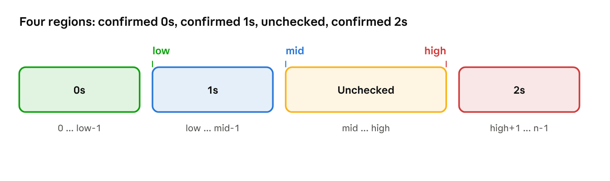
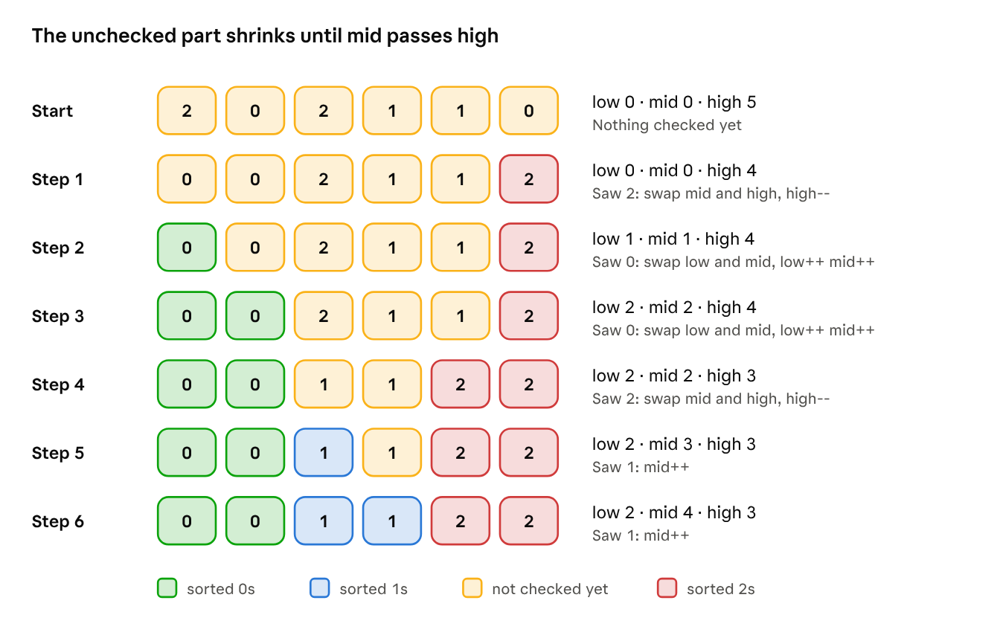

# Sort Colors (Dutch National Flag)

**Question Link:** [LeetCode 75 - Sort Colors](https://leetcode.com/problems/sort-colors/)

**Pattern:** Two Pointers (three pointers)

  -22c55e?style=flat-square) -22c55e?style=flat-square)

---

## The Question

An array has only `0`s, `1`s and `2`s. Sort it **in the same array**, without using a built-in sort.

**Example**

- **Input:** `nums = [2, 0, 2, 1, 1, 0]`
- **Output:** `[0, 0, 1, 1, 2, 2]`

<details>
<summary><b>How to think about it</b></summary>

<br>

1. **Start simple.** There are only 0, 1 and 2. I could count each and rewrite the array. It works, but it needs two passes.
2. **Can I do it in one pass?** The array must end as 0s, then 1s, then 2s. So picture three zones, with a scanner walking through the part I have not checked yet.
3. **Set up the zones.** `low` is the end of the 0-zone. `high` is the start of the 2-zone. `mid` is the scanner.
4. **Look at `nums[mid]`.** A 0 goes to the front, a 2 goes to the back, and a 1 stays.
5. **Stop** when `mid` passes `high`. The zones have met, so the array is sorted.

</details>

## Ways to Solve It

| Approach | Idea | Time | Space |
| --- | --- | --- | --- |
| Brute force | Use a normal sort (like bubble sort). Works, but slow. | O(n²) | O(1) |
| Better | Count the 0s, 1s and 2s, then write them back in order. Needs two passes. | O(n) | O(1) |
| **Best** | **Three pointers, one pass** | **O(n)** | **O(1)** |

## Best Idea

The array must end as 0s, then 1s, then 2s. So think of it as 4 parts that always stay in order:

- Everything before `low` is a **0**.
- Everything between `low` and `mid` is a **1**.
- Everything between `mid` and `high` is **not checked yet**.
- Everything after `high` is a **2**.



We only look at `nums[mid]`, the first value that is not checked yet.

## Pointers Used

- `low` = where the next 0 goes
- `mid` = the value we are checking
- `high` = where the next 2 goes

## The Logic

Start with `low = 0`, `mid = 0`, `high = n - 1`. Repeat while `mid <= high`:

- **It is 0:** swap with `nums[low]`, then `low++` and `mid++`.
- **It is 1:** it is already in the right place, so just `mid++`.
- **It is 2:** swap with `nums[high]`, then `high--`.

> [!WARNING]
> After a swap with `high`, do **not** move `mid`. The value that came from the right is not checked yet.

## Code (Java)

```java
class Solution {
    public void sortColors(int[] nums) {
        // Step 1: set up the three pointers
        int low = 0;                 // where the next 0 goes
        int mid = 0;                 // the value we are checking
        int high = nums.length - 1;  // where the next 2 goes

        // Step 2: keep going until mid passes high
        while (mid <= high) {
            if (nums[mid] == 0) {
                // Step 3: a 0 goes to the low side
                swap(nums, low, mid);
                low++;
                mid++;
            } else if (nums[mid] == 1) {
                // Step 4: a 1 is already in the middle, so just move on
                mid++;
            } else {
                // Step 5: a 2 goes to the high side
                swap(nums, mid, high);
                high--;
                // Do not move mid here: the new value at mid is not checked yet
            }
        }
    }

    private void swap(int[] nums, int i, int j) {
        int temp = nums[i];
        nums[i] = nums[j];
        nums[j] = temp;
    }
}
```


<details>
<summary><b>Dry run</b></summary>

<br>

Input: `[2, 0, 2, 1, 1, 0]`



The value is `nums[mid]` before the action. Pointers and array are shown after the action.

| Step | `nums[mid]` | Action | low | mid | high | Array |
| --- | --- | --- | --- | --- | --- | --- |
| Start | - | Initial values | 0 | 0 | 5 | `[2, 0, 2, 1, 1, 0]` |
| 1 | 2 | Swap mid and high, `high--` | 0 | 0 | 4 | `[0, 0, 2, 1, 1, 2]` |
| 2 | 0 | Swap low and mid, `low++`, `mid++` | 1 | 1 | 4 | `[0, 0, 2, 1, 1, 2]` |
| 3 | 0 | Swap low and mid, `low++`, `mid++` | 2 | 2 | 4 | `[0, 0, 2, 1, 1, 2]` |
| 4 | 2 | Swap mid and high, `high--` | 2 | 2 | 3 | `[0, 0, 1, 1, 2, 2]` |
| 5 | 1 | `mid++` | 2 | 3 | 3 | `[0, 0, 1, 1, 2, 2]` |
| 6 | 1 | `mid++` | 2 | 4 | 3 | `[0, 0, 1, 1, 2, 2]` |

After step 6, `mid = 4` and `high = 3`, so `mid` is past `high`. Stop. Final array: `[0, 0, 1, 1, 2, 2]`.

</details>

## Complexity

> [!NOTE]
> - **Time (TC):** O(n). Each value is looked at once.
> - **Space (SC):** O(1). Only a few extra variables. The array is sorted in place.

## Key Points

> [!TIP]
> - **Why `while (mid <= high)`?** The unchecked part runs from `mid` to `high`, and both are included. If we stopped at `mid < high`, we would skip the last value.
> - **Why not move `mid` after swapping with `high`?** The value from the right is not checked yet. It could be a 0 that must go to the front.
> - **Is it fast on a sorted array?** Yes. For a 0, it swaps a value with itself. For a 1, it only moves `mid`. It never does extra work.
> - **What if there were 4 colours (0, 1, 2, 3)?** Add a 4th pointer. Keep the 0s and 1s at the start and the 2s and 3s at the end, with the same idea.

<details>
<summary><b>Extra concepts</b></summary>

<br>

- **In place:** change the array you are given. Do not make a new array.
- **Invariant:** something that stays true during the whole loop. Here, the 4 parts of the array always keep their meaning.

</details>
