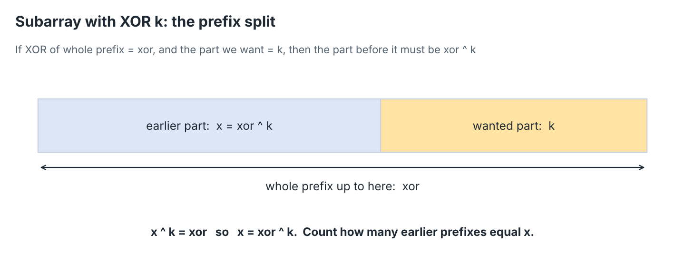
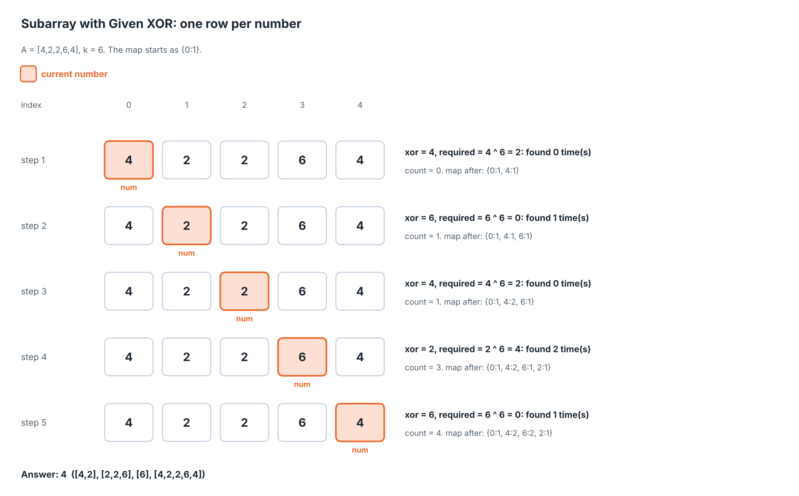

# Subarray with Given XOR

**Source:** InterviewBit

**Pattern:** Hashing / Prefix Sum

  -22c55e?style=flat-square) -22c55e?style=flat-square)

---

> [!TIP]
> **In one line:** Count the subarrays whose XOR is equal to `k`.
>
> **Key Insight:** Fix the ending point of the subarray. To get XOR = `k`, check if an earlier prefix XOR equal to `currentXor ^ k` exists in the HashMap

## The Question

Given an array and an integer `K`, count the number of subarrays whose XOR is equal to `K`.

> Example: `nums = [4, 2, 2, 6, 4]`, `k = 6` gives `4`.

## What is XOR?

XOR (`^`) compares bits. Same bits give 0. Different bits give 1.

- `a ^ a = 0`
- `a ^ 0 = a`
- `(a ^ b) ^ c = a ^ (b ^ c)`
- `a ^ b = b ^ a`

## Ways to Solve It

| Approach | Idea | Note | Time | Space |
| --- | --- | --- | --- | --- |
| Brute force | Try every subarray and keep a running XOR. | Slow when the array is large. | O(n²) | O(1) |
| **Prefix XOR + HashMap (best)** | **Fix the end, look up the start. Needed prefix = xor ^ k.** | **One pass, one map.** | **O(n)** | **O(n)** |

### Brute Force: Generate all subarrays

1. Use 2 loops to generate every subarray.
2. Keep calculating the XOR as the subarray expands.
3. If `xor == k`, increment `count`.

```java
int count = 0;

for (int i = 0; i < nums.length; i++) {
    int xor = 0;

    for (int j = i; j < nums.length; j++) {
        // add nums[j] to the XOR of the subarray starting at i
        xor ^= nums[j];

        if (xor == k) count++;
    }
}

return count;
```

| Complexity | Why? |
| --- | --- |
| **Time:** O(n²) | Two loops generate all subarrays. |
| **Space:** O(1) | Only a few variables are stored. |

### Optimal: Prefix XOR + HashMap

**Deriving the Logic**

We focus on subarrays that end at the current element.

Take `k = 6` and array `[4, 2, 2, 6, 4]`. Let's look at the subarray ending at `6`.

1. **Fix the end:** We want to find a subarray ending at `6` whose XOR is `6`.
2. **Split the array:** The elements before our subarray are `[4]`, and the subarray we want is `[2, 2, 6]`.
3. **Calculate the XOR:** Let `XR` be the XOR of everything from the beginning up to `6`. Here, `XR = 4 ^ 2 ^ 2 ^ 6 = 2`.
4. **Find the earlier XOR:** Let `x` be the XOR of the elements before our subarray. Since `x ^ k = XR`, we can calculate `x = XR ^ k`.
5. **Try the numbers:** `x = 2 ^ 6 = 4`. The XOR of `[4]` is indeed `4`.
6. **Use a HashMap:** At every index, check whether `XR ^ k` exists in the map. If it does, we've found a subarray ending at the current index with XOR `k`.


**In simple terms:** Find the XOR of the current prefix, then check if removing an earlier prefix XOR would leave us with `k`.

**Steps — Prefix XOR + HashMap**

1. **Initialise:** Set `xor = 0` and `count = 0`.
2. **Create map:** Store prefix XORs and how many times they appear.
3. **Starting point:** Add `0 → 1` to the map to count subarrays starting from index 0.
4. **Calculate XOR:** For each number, update `xor ^= num`.
5. **Find required XOR:** Calculate `required = xor ^ k` and check how many times it exists in the map. Add that frequency to `count`.
6. **Update map:** Store the current XOR and increase its frequency.
7. **Return:** `count`.

<details>
<summary><b>Dry run</b></summary>

<br>

Input `nums = [4, 2, 2, 6, 4]`, `k = 6`. The map starts as `{0: 1}`.


Answer: `4`. The four subarrays are `[4, 2]`, `[2, 2, 6]`, `[6]` and `[4, 2, 2, 6, 4]`.

</details>

## Code (Java)

```java
public class Solution {
    public int solve(ArrayList<Integer> A, int B) {
        // prefix XOR -> how many times it has appeared
        HashMap<Integer, Integer> map = new HashMap<>();
        int xor = 0;
        int count = 0;

        // empty prefix, so subarrays starting at index 0 are counted
        map.put(0, 1);

        for (int num : A) {
            xor ^= num;

            // the earlier prefix we need so the subarray ending here has XOR B
            int required = xor ^ B;

            count += map.getOrDefault(required, 0);

            map.put(xor, map.getOrDefault(xor, 0) + 1);
        }

        return count;
    }
}
```

## Complexity

| Complexity | Why? |
| --- | --- |
| **Time:** O(n) | One traversal, with average O(1) HashMap operations. |
| **Space:** O(n) | The HashMap can store up to n different prefix XOR values. |

**Quick comparison:**

- **Brute force:** O(n²) time, O(1) space.
- **Prefix XOR + HashMap:** O(n) time, O(n) space.
