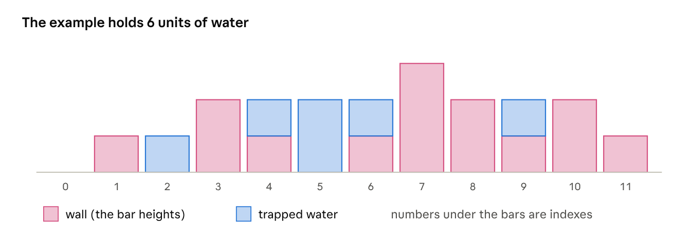
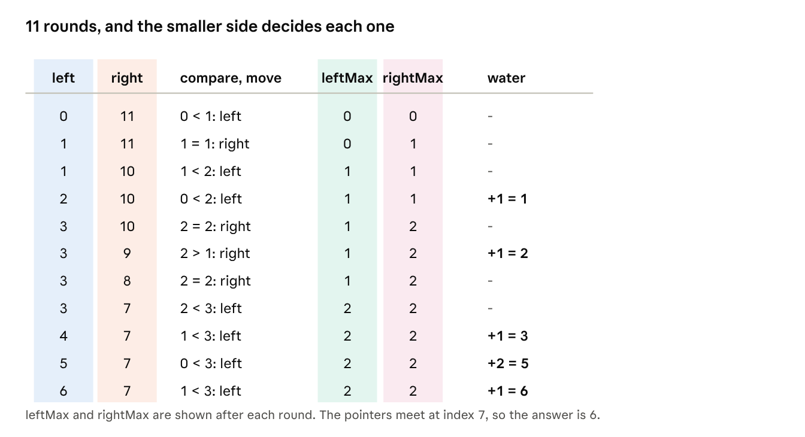

# Trapping Rain Water

**Question Link:** [LeetCode 42 - Trapping Rain Water](https://leetcode.com/problems/trapping-rain-water/)

**Pattern:** Two Pointers (Converge / Partition)

  -22c55e?style=flat-square) -22c55e?style=flat-square)

---

> [!TIP]
> **Key insight:** Only the shorter side decides. So walk in from both ends and always move the pointer on the smaller side.

## The Question

You are given an array `height`. Each number is the height of a bar, and every bar is 1 wide. After rain, how much water is trapped between the bars?

> Example: `[0, 1, 0, 2, 1, 0, 1, 3, 2, 1, 2, 1]` gives `6`



<details>
<summary><b>How to think about it</b></summary>

<br>

1. **Picture it.** Draw the bars. Water sits in the dips. What decides how much water sits on one bar?
2. **Zoom in on one bar.** Water rises until it spills over a wall. It spills over the **shorter** of the tallest wall on its left and the tallest wall on its right. So water on bar `i` = `min(maxLeft, maxRight) - height[i]`.
3. **Turn that into a plan.** I can do this for every bar and add it all up. For each bar, scan left and right for the tallest wall. That works, but it is O(n²).
4. **Notice the waste.** I rescan the same stretch for every bar. Scan once and remember: store `leftMax[i]` and `rightMax[i]` in two arrays. That is O(n), but it uses extra memory (Version 1).
5. **Can I drop the arrays?** The formula takes the **min** of the two sides. If `height[left] < height[right]`, a taller wall already exists on the right, so only `leftMax` matters for the left bar. I can finish it without the exact right max.
6. **The algorithm falls out.** Two pointers from both ends. Move the one on the smaller side. Keep a running max for each side (Version 2).
7. **When to stop.** `left < right` is enough. When they meet, that bar is the tallest wall, so it holds no water.

</details>

## Ways to Solve It

| Approach | Idea | Note | Time | Space |
| --- | --- | --- | --- | --- |
| Brute force | For each bar, scan left and right for the tallest. | Works, but slow. | O(n²) | O(1) |
| Prefix arrays | Save the tallest wall on each side in two arrays. | Easy to follow. | O(n) | O(n) |
| **Two pointers (best)** | **Walk in from both ends, keep two running maxes.** | **No extra arrays.** | **O(n)** | **O(1)** |

### Version 1: Prefix arrays (simple)

Build `leftMax[i]` and `rightMax[i]` once. Then every bar is a quick lookup.

1. `leftMax[i]` = the tallest bar from index 0 to `i`. Fill it left to right.
2. `rightMax[i]` = the tallest bar from `i` to the end. Fill it right to left.
3. For every bar, add `min(leftMax[i], rightMax[i]) - height[i]`.

```java
class Solution {
    public int trap(int[] height) {
        int n = height.length;
        if (n == 0) return 0;

        int[] leftMax = new int[n];
        int[] rightMax = new int[n];

        leftMax[0] = height[0];
        for (int i = 1; i < n; i++) {
            leftMax[i] = Math.max(leftMax[i - 1], height[i]);
        }

        rightMax[n - 1] = height[n - 1];
        for (int i = n - 2; i >= 0; i--) {
            rightMax[i] = Math.max(rightMax[i + 1], height[i]);
        }

        int water = 0;
        for (int i = 0; i < n; i++) {
            water += Math.min(leftMax[i], rightMax[i]) - height[i];
        }
        return water;
    }
}
```

## Best Idea: Two pointers from both ends (Version 2)

The prefix arrays use O(n) memory. We can drop them. Keep one running max for each side, and move the pointer on the **smaller** wall.

Why is that safe? If `height[left] < height[right]`, then some wall on the right is already taller than `height[left]`. So the right side can never be the limit for the left bar. Only `leftMax` matters, and we already know it.

## The Logic

1. Set `left = 0`, `right = n - 1`, `leftMax = 0`, `rightMax = 0`, `water = 0`.
2. While `left < right`, compare `height[left]` and `height[right]`.
3. If `height[left]` is **smaller**: if it is at least `leftMax`, it is a new tallest wall, so update `leftMax`. Otherwise add `leftMax - height[left]` to `water`. Then `left++`.
4. Otherwise do the same on the right side with `rightMax`, then `right--`.
5. When the pointers meet, return `water`.

## Code (Java)

```java
class Solution {
    public int trap(int[] height) {
        int left = 0;
        int right = height.length - 1;
        int leftMax = 0;
        int rightMax = 0;
        int water = 0;

        while (left < right) {
            if (height[left] < height[right]) {
                // the left wall is smaller, so leftMax decides
                if (height[left] >= leftMax) {
                    leftMax = height[left];
                } else {
                    water += leftMax - height[left];
                }
                left++;
            } else {
                // the right wall is smaller or equal, so rightMax decides
                if (height[right] >= rightMax) {
                    rightMax = height[right];
                } else {
                    water += rightMax - height[right];
                }
                right--;
            }
        }
        return water;
    }
}
```

<details>
<summary><b>Dry run</b></summary>

<br>

Input `[0, 1, 0, 2, 1, 0, 1, 3, 2, 1, 2, 1]`. Each pointer has its own colour column: left, right, leftMax, rightMax.


Answer: `6`

</details>

## Complexity

| Approach | Time | Extra space |
| --- | --- | --- |
| Brute force | O(n²) | O(1) |
| Prefix arrays | O(n) | O(n) |
| Two pointers | O(n) | O(1) |
