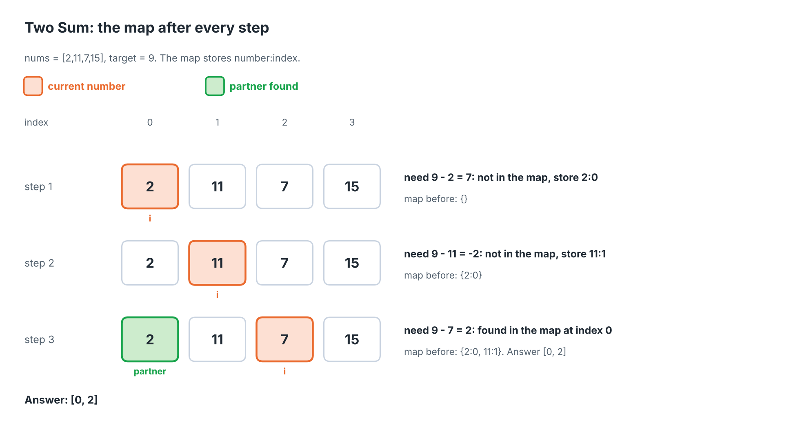

# Two Sum

**Question Link:** [LeetCode 1 - Two Sum](https://leetcode.com/problems/two-sum/)

**Pattern:** Hashing / Prefix Sum

  -22c55e?style=flat-square) -22c55e?style=flat-square)

---

> [!TIP]
> **In one line:** For each number, work out the partner it needs. Ask a HashMap if we have already seen that partner.

## The Question

Given an array `nums` and a `target`, return the **indexes** of the two numbers that add up to `target`. There is exactly one answer, and you cannot use the same item twice.

> Example: `[2, 11, 7, 15]` with `target = 9` gives `[0, 2]`, because `2 + 7 = 9`

<details>
<summary><b>How to think about it</b></summary>

<br>

1. **Start simple.** Two loops, check every pair. It works, but it is O(n²).
2. **What are we really looking for?** For a number `x`, we need one exact partner: `target - x`. So the question for each number is: "have I already seen its partner?"
3. **How do we answer that fast?** Scanning the array again is slow. A HashMap answers "is this here?" at once.
4. **So walk once.** For each number, find `partner = target - nums[i]`. If the map has the partner, we are done: return its index and `i`. If not, store this number and its index for the numbers still to come.
5. **Why check before storing?** So a number is never paired with itself.
6. **Check first, store after.** This way a number can never match itself.

</details>

## Ways to Solve It

| Approach | Idea | Note | Time | Space |
| --- | --- | --- | --- | --- |
| Brute force | Try every pair of numbers with two loops. | Works, but slow. | O(n²) | O(1) |
| **HashMap (best)** | **Remember each number we saw. Ask the map for the partner.** | **One pass.** | **O(n)** | **O(n)** |

## Why not two pointers, like 3Sum and 4Sum?

> [!TIP]
> - Two pointers needs a **sorted** array. Sorting costs O(n log n), which is slower than the O(n) HashMap pass.
> - Two Sum asks for the **indexes**. Sorting shuffles the numbers, so the original indexes are lost. We would have to store each index next to its number, which costs extra memory.
> - 3Sum and 4Sum ask for **values**, not indexes, so sorting loses nothing there. It is also cheap compared with their O(n²) and O(n³) loops, and it makes skipping duplicates easy.

## The Logic

1. Make an empty HashMap `seen`. It maps a number to its index.
2. For each `i`, find `partner = target - nums[i]`.
3. If `seen` has `partner`, return `[seen.get(partner), i]`.
4. Otherwise store `seen.put(nums[i], i)`.

## Code (Java)

```java
class Solution {
    public int[] twoSum(int[] nums, int target) {
        // number we have seen -> its index
        HashMap<Integer, Integer> seen = new HashMap<>();

        for (int i = 0; i < nums.length; i++) {
            // the number that would finish the pair
            int partner = target - nums[i];

            // seen it before? then we have the answer
            if (seen.containsKey(partner)) {
                return new int[]{seen.get(partner), i};
            }
            // not yet: remember this number for later
            seen.put(nums[i], i);
        }

        return new int[2];  // never reached, there is always an answer
    }
}
```

<details>
<summary><b>Dry run</b></summary>

<br>

Input `[2, 11, 7, 15]` with `target = 9`. Read it one row at a time.


Answer: `[0, 2]`

</details>

<details>
<summary><b>Two Sum II (sorted array)</b></summary>

<br>

[LeetCode 167](https://leetcode.com/problems/two-sum-ii-input-array-is-sorted/). Once the array is sorted, we don't need the extra memory of a HashMap. We use the **Opposite Ends** pattern with two pointers.

- **Setup:** `left = 0` and `right = nums.length - 1`.
- **Sum == target:** Success! Return the indices.
- **Sum < target:** Move `left++`. The sum is too small, so we need a bigger number.
- **Sum > target:** Move `right--`. The sum is too large, so we need a smaller number.

```java
public int[] twoSumSorted(int[] nums, int target) {
    int left = 0;
    int right = nums.length - 1;

    while (left < right) {
        int sum = nums[left] + nums[right];

        if (sum == target) {
            return new int[] { left + 1, right + 1 };   // this problem uses 1-based indexes
        } else if (sum < target) {
            left++;     // sum too small: need a bigger number
        } else {
            right--;    // sum too large: need a smaller number
        }
    }

    return new int[] {};
}
```

| Complexity | Why? |
| --- | --- |
| **Time:** O(n) | The pointers walk through the array once. |
| **Space:** O(1) | No extra data structure is used. |

</details>

## Complexity

| Time | Extra space |
| --- | --- |
| O(n): one pass, each lookup is O(1) | O(n): the map can hold every number |
