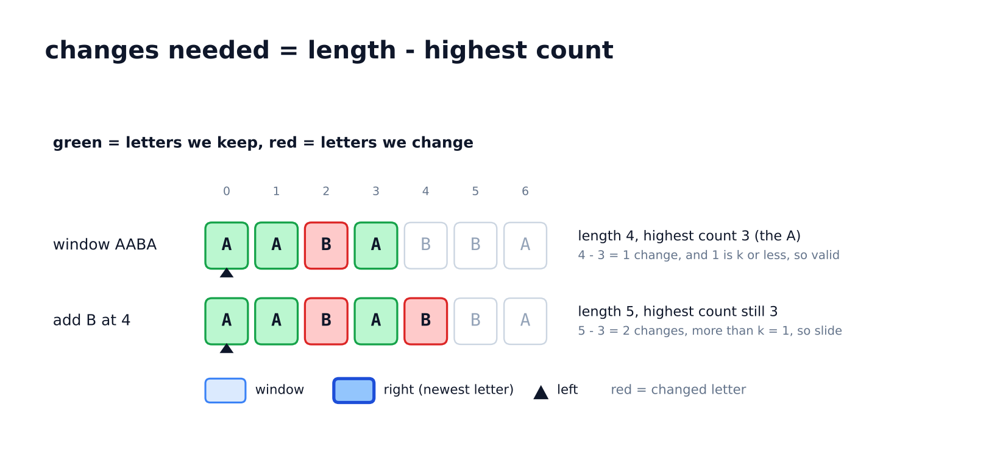
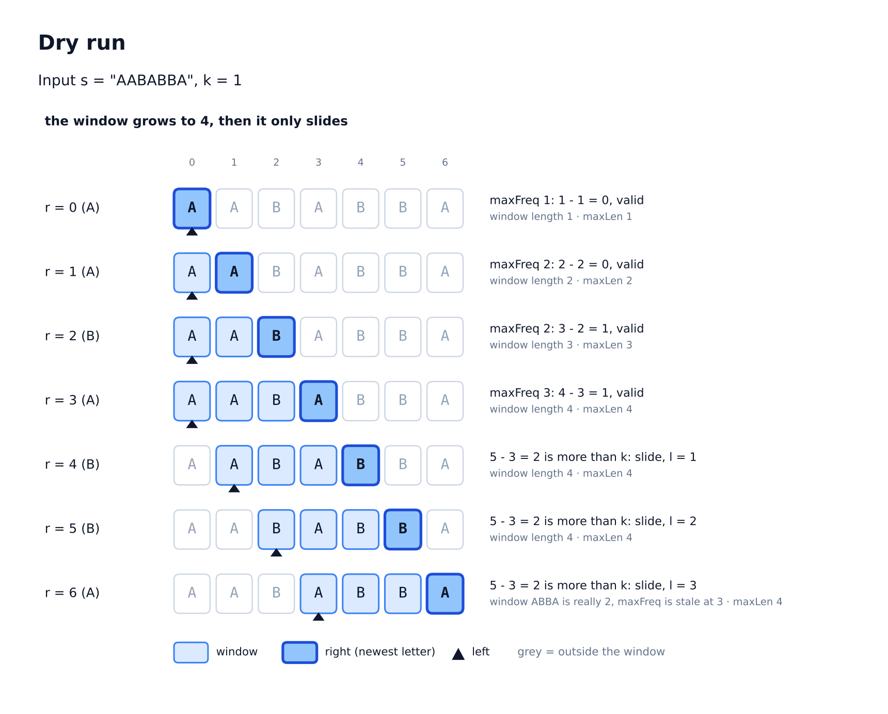

# Longest Repeating Character Replacement

**Question Link:** [LeetCode 424 - Longest Repeating Character Replacement](https://leetcode.com/problems/longest-repeating-character-replacement/)

**Pattern:** Sliding Window

  -green) -green)

---

## The Question

Given a string `s` of uppercase letters and an integer `k`, you can change at most `k` characters to any other letter. Return the length of the longest substring that can be made of one repeating letter.

**Examples**

- **Input:** `s = "ABAB"`, `k = 2` **Output:** `4`
- **Input:** `s = "AABABBA"`, `k = 1` **Output:** `4`

<details>
<summary><b>How to think about it</b></summary>

<br>

1. **Start simple.** For any substring, the letter that appears most often is the one we keep. Every other letter has to be changed.
2. **Count the changes.** Changes needed = length - highest frequency.
3. **Brute force.** Check every substring. It works, but it is O(n²).
4. **Sliding window.** Expand with `r`. If the window needs more than `k` changes, shrink it from the left until it is valid again.
5. **Do we need to shrink?** We only want the longest valid window, so the window never has to get smaller. When it becomes invalid, slide it: move `l` by one and keep the same size.
6. **So no recount.** After sliding we never recount `maxFreq`.

</details>

## Ways to Solve It

| Approach | Idea | Time | Space |
| --- | --- | --- | --- |
| Brute force | Check every substring. Count letters and track `maxFreq`. | O(n²) | O(1) |
| Better | Sliding window with a `while` loop. Recount `maxFreq` over 26 letters after each removal. | O(26 · n) | O(1) |
| **Best** | **Sliding window with an `if`. Never recount `maxFreq`.** | **O(n)** | **O(1)** |

<details>
<summary><b>Brute force and Better (steps and code)</b></summary>

<br>

### 1. Brute Force: check every substring

**Intuition:** For any substring, the letter that appears most often is the one we keep. Every other letter has to be changed.

`changes needed = length - highest frequency letter`

**Steps**

1. Start a substring at every index `i`.
2. Extend the end `j` one letter at a time. Count letters in a hash array and track `maxFreq`.
3. Changes needed = `(j - i + 1) - maxFreq`.
4. If it is `k` or less, update `maxLen`. Otherwise `break` because more letters can only need more changes, hence move on to the next substring.

```java
class Solution {
    public int characterReplacement(String s, int k) {
        int maxLen = 0;

        // start a substring at every index i
        for (int i = 0; i < s.length(); i++) {
            int[] hash = new int[26];
            int maxFreq = 0;

            // extend it letter by letter
            for (int j = i; j < s.length(); j++) {
                hash[s.charAt(j) - 'A']++;
                maxFreq = Math.max(maxFreq, hash[s.charAt(j) - 'A']);

                int changes = (j - i + 1) - maxFreq;
                if (changes <= k) maxLen = Math.max(maxLen, j - i + 1);
                else break; // more letters can only need more changes
            }
        }

        return maxLen;
    }
}
```

| Complexity | Why? |
| --- | --- |
| **Time:** O(n²) | Finding all substrings. |
| **Space:** O(1) | The hash array always has 26 slots. |

### 2. Better: sliding window with a while loop

**Intuition:** Expand the window with `r`. If the window needs more than `k` changes, shrink it from the left with a `while` until it is valid again.

When the letter at `l` leaves, it might have been the most frequent one. So the old `maxFreq` could now be too high, and we recount it over all 26 letters.

**Steps**

1. Move `r` right. Add its letter to the hash and update `maxFreq`.
2. While `(r - l + 1) - maxFreq > k`, remove the letter at `l` and move `l` right.
3. After removing a letter, recalculate `maxFreq` by looping over all 26 slots.
4. Update `maxLen` with `r - l + 1`.

```java
class Solution {
    public int characterReplacement(String s, int k) {
        int maxLen = 0;
        int maxFreq = 0;
        int l = 0, r = 0;
        int[] hash = new int[26];

        while (r < s.length()) {
            // add the new letter and update the highest count
            hash[s.charAt(r) - 'A']++;
            maxFreq = Math.max(maxFreq, hash[s.charAt(r) - 'A']);

            // window needs too many changes, so shrink it from the left
            while ((r - l + 1) - maxFreq > k) {
                hash[s.charAt(l) - 'A']--;

                // recount maxFreq over 26 letters (this is the extra work)
                maxFreq = 0;
                for (int i = 0; i < 26; ++i) {
                    maxFreq = Math.max(maxFreq, hash[i]);
                }

                l++;
            }

            maxLen = Math.max(maxLen, r - l + 1);
            r++;
        }

        return maxLen;
    }
}
```

| Complexity | Why? |
| --- | --- |
| **Time:** O(26 · n) | `r` and `l` each move n times in total. Each shrink also loops over 26 letters. |
| **Space:** O(1) | A hash array of 26 slots. |

</details>

## Best Idea

Maintain a window and find the longest substring that can be made of the same character using at most `k` replacements.

`changes needed = window length - maxFreq`



If changes needed exceed `k`, move the left pointer forward by one position. The window never has to get smaller, so it only grows or slides.

## Pointers Used

- `l` = left boundary of the window
- `r` = right end of the window, moves through the string once
- `maxFreq` = highest frequency of a character seen so far
- `hash[26]` = frequency of each character
- `maxLen` = the longest window found

## The Logic

Start with `l = 0`, `maxLen = 0`, `maxFreq = 0`. For every `r`:

- **Expand window:** increase the frequency of the current character in `hash` and update `maxFreq`.
- **Check validity:** if `window length - maxFreq` is greater than `k`, move `l` forward by one and decrease the frequency of the character leaving the window.
- **Update answer:** update `maxLen` using the current window length (`r - l + 1`).

> [!WARNING]
> `maxFreq` is not recalculated when the window shrinks. It stores the highest frequency seen so far. This is intentional and helps maintain O(n) time complexity.

## Code (Java)

```java
class Solution {
    public int characterReplacement(String s, int k) {
        // Step 1: set up the window and the counts
        int maxLen = 0;
        int maxFreq = 0;
        int l = 0, r = 0;
        int[] hash = new int[26];

        // Step 2: move r through the string
        while (r < s.length()) {
            // Step 3: add the new letter and update the highest count
            hash[s.charAt(r) - 'A']++;
            maxFreq = Math.max(maxFreq, hash[s.charAt(r) - 'A']);

            // Step 4: invalid: slide the window by one, no recount of maxFreq
            if ((r - l + 1) - maxFreq > k) {
                hash[s.charAt(l) - 'A']--;
                l++;
            }

            // Step 5: update the answer with the current window size
            maxLen = Math.max(maxLen, r - l + 1);
            r++;
        }

        return maxLen;
    }
}
```

<details>
<summary><b>Dry run</b></summary>

<br>

Input: `s = "AABABBA"`, `k = 1`



| Step | r | Letter | maxFreq | Window length - maxFreq | Action | l | Window | maxLen |
| --- | --- | --- | --- | --- | --- | --- | --- | --- |
| 1 | 0 | A | 1 | 1 - 1 = 0 | Valid | 0 | `A` | 1 |
| 2 | 1 | A | 2 | 2 - 2 = 0 | Valid | 0 | `AA` | 2 |
| 3 | 2 | B | 2 | 3 - 2 = 1 | Valid | 0 | `AAB` | 3 |
| 4 | 3 | A | 3 | 4 - 3 = 1 | Valid | 0 | `AABA` | 4 |
| 5 | 4 | B | 3 | 5 - 3 = 2 | Too many, slide `l` | 1 | `ABAB` | 4 |
| 6 | 5 | B | 3 | 5 - 3 = 2 | Too many, slide `l` | 2 | `BABB` | 4 |
| 7 | 6 | A | 3 | 5 - 3 = 2 | Too many, slide `l` | 3 | `ABBA` | 4 |

Answer: `4`

**Stale `maxFreq` example:** at `r = 6` the window `ABBA` really has a top count of 2, but `maxFreq` still says 3. The window only slides instead of growing, so the answer stays 4.

</details>

## Complexity

> [!NOTE]
> - **Time (TC):** O(n). Each pointer traverses the string at most once.
> - **Space (SC):** O(1). Fixed-size frequency array of 26 letters.

## Key Points

> [!TIP]
> - **`maxFreq` only ever goes up.** It may become stale (higher than the real count in the current window).
> - **A stale `maxFreq` can never make the window grow wrongly.** The window only grows when a new real high is reached.
> - **The answer only increases when `maxFreq` truly increases,** so the answer stays correct.
> - **Quick comparison:** brute force is O(n²) time and O(1) space. While loop with recount is O(26 · n) time and O(1) space. Single `if` (best) is O(n) time and O(1) space.
> - **Quick revision:** window size minus highest letter count must be `k` or less. Slide the window with an `if`, and never recount `maxFreq`.

<details>
<summary><b>Extra concepts</b></summary>

<br>

- **Stale:** a value that is higher than the real count in the current window. Here `maxFreq` can be stale, and that is fine.
- **Slide:** move `l` by one while `r` also moves by one, so the window keeps the same size.
- **Hash array:** an array of 26 slots, one for each uppercase letter. The slot holds how many times the letter is in the window.

</details>
