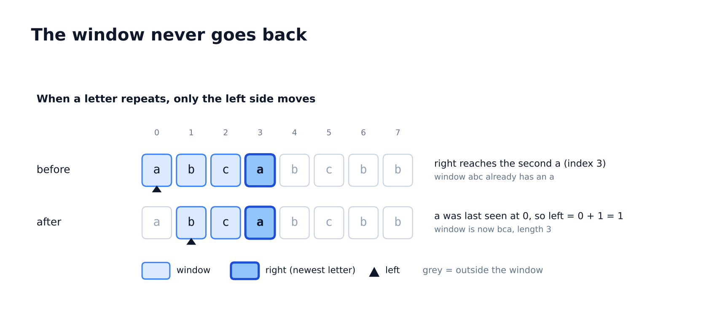
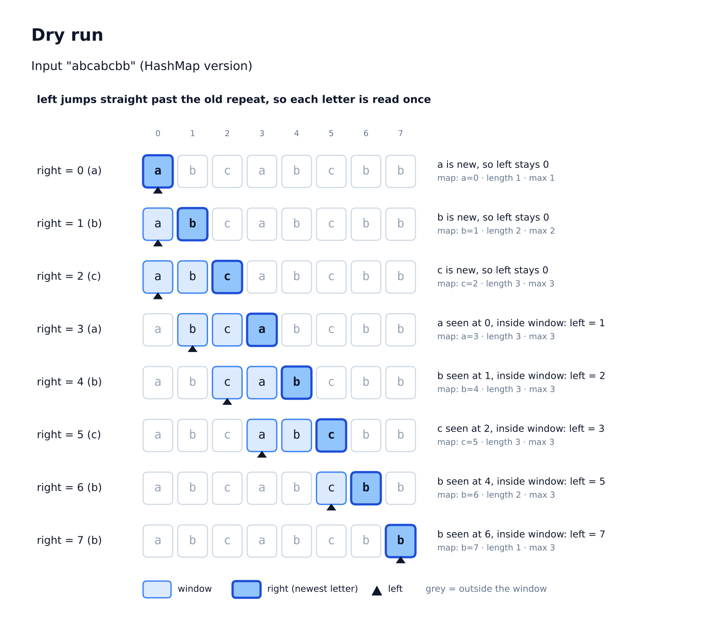

# Longest Substring Without Repeating Characters

**Question Link:** [LeetCode 3 - Longest Substring Without Repeating Characters](https://leetcode.com/problems/longest-substring-without-repeating-characters/)

**Pattern:** Sliding Window

  -green) )-green)

---

## The Question

Given a string `s`, return the length of the longest substring (a piece of letters that sit next to each other) with no repeated letter.

**Example**

- **Input:** `s = "abcabcbb"`
- **Output:** `3`, because `"abc"` is the longest piece with no repeats

<details>
<summary><b>How to think about it</b></summary>

<br>

1. **Start simple.** Try every start letter and extend to the right until a letter repeats. It works, but it is O(n²).
2. **Can the window avoid going back?** Keep a window of letters with no repeats. Move the right end forward.
3. **A letter repeats.** Only the left side moves, so every letter is added once and removed once.
4. **How far does left move?** Remove letters one by one until the repeat is gone (HashSet). Or store each letter's last index and jump left straight past the repeat (HashMap).
5. **After each step,** the window is `left..right`, so its size is `right - left + 1`. Keep the biggest one.

</details>

## Ways to Solve It

| Approach | Idea | Time | Space |
| --- | --- | --- | --- |
| Brute force | Generate all substrings with two loops and a Set. Stop at a repeat. | O(n²) | O(n) |
| Better | Sliding window + HashSet. Shrink the window until the repeat is removed. | O(n) | O(n) |
| **Best** | **Sliding window + HashMap. Jump left past the old repeat.** | **O(n)** | **O(min(n, charset size))** |

<details>
<summary><b>Brute force and Better (steps and code)</b></summary>

<br>

### 1. Brute Force: generate all substrings

- Use two loops: `i` is the start and `j` is the end of the substring.
- Keep a `Set` of the letters in the current substring.
- If `s.charAt(j)` is already in the set, stop and move to the next `i`.
- Otherwise add it and update `maxLength`.

```java
class Solution {
    public int lengthOfLongestSubstring(String s) {
        int maxLength = 0;

        // start a substring at every index i
        for (int i = 0; i < s.length(); i++) {
            Set<Character> set = new HashSet<>();   // letters in this substring

            // extend it to the right
            for (int j = i; j < s.length(); j++) {
                if (set.contains(s.charAt(j))) break;   // repeat found: stop

                set.add(s.charAt(j));
                maxLength = Math.max(maxLength, j - i + 1);
            }
        }

        return maxLength;
    }
}
```

| Complexity | Why? |
| --- | --- |
| **Time:** O(n²) | Two loops generate all substrings. |
| **Space:** O(n) | The set can hold up to n letters. |

### 2. Better: Sliding Window + HashSet

**Intuition:** Maintain a window with unique characters. Expand it using `right`. If a duplicate appears, move `left` forward and remove characters until the duplicate is gone.

**Steps**

1. **Initialise:** Create an empty Set. Set `left = 0` and `maxLength = 0`.
2. **Expand:** Move `right` through the string and get the current character `c`.
3. **Handle duplicates:** While `c` is already in the Set, remove `s.charAt(left)` and move `left++`.
4. **Add character:** Add `c` to the Set.
5. **Update length:** Calculate `right - left + 1` and update `maxLength` if it's bigger.
6. **Return:** `maxLength`.

```java
class Solution {
    public int lengthOfLongestSubstring(String s) {
        int left = 0;          // start of the window
        int maxLength = 0;     // longest window seen so far
        Set<Character> set = new HashSet<>();   // letters inside the window

        for (int right = 0; right < s.length(); right++) {
            char c = s.charAt(right);

            // c is already in the window: drop letters from the left until it is gone
            while (set.contains(c)) {
                set.remove(s.charAt(left));
                left++;
            }

            set.add(c);   // now c is safe to add

            // window is left..right, so its size is right - left + 1
            maxLength = Math.max(maxLength, right - left + 1);
        }

        return maxLength;
    }
}
```

| Complexity | Why? |
| --- | --- |
| **Time:** O(n) | Each letter is added to the set once and removed at most once. |
| **Space:** O(min(n, charset size)) | The set only holds different letters. |

</details>

## Best Idea

Keep a window of letters with no repeats. Move the right end forward. When a letter repeats, move the left end forward until the repeat is gone.



The window never needs to go back. When a repeat shows up, only the left side moves, so every letter is added once and removed once. Store each letter's last index in a HashMap. If the letter repeats inside the window, move `left` to `lastIndex + 1`.

## Pointers Used

- `left` = start of the window
- `right` = end of the window, moves through the string once
- `map` = letter and the last index where it was seen

## The Logic

Start with `left = 0` and `maxLength = 0`. For every `right`:

- **Seen before and inside the window:** move `left = lastIndex + 1`.
- **Always:** store the letter's current index in the map.
- **Always:** update `maxLength` with `right - left + 1`.

> [!WARNING]
> The HashMap does not remove old entries. It stores the last seen index of every letter, even if it is outside the window. So we need the extra check `map.get(c) >= left`.

## Code (Java)

```java
class Solution {
    public int lengthOfLongestSubstring(String s) {
        // Step 1: set up the map and the window
        Map<Character, Integer> map = new HashMap<>();   // letter -> last index
        int left = 0;          // start of the window
        int maxLength = 0;     // longest window seen so far

        // Step 2: move right through the string
        for (int right = 0; right < s.length(); right++) {
            char c = s.charAt(right);

            // Step 3: seen before AND inside the window: jump left past the old one
            if (map.containsKey(c) && map.get(c) >= left) {
                left = map.get(c) + 1;
            }

            // Step 4: remember the latest index of c
            map.put(c, right);

            // Step 5: window is left..right, so its size is right - left + 1
            maxLength = Math.max(maxLength, right - left + 1);
        }

        return maxLength;
    }
}
```

<details>
<summary><b>Dry run</b></summary>

<br>

Input: `"abcabcbb"`

**HashMap (best)**



| Step | right | Letter | Action | left | Window | maxLength |
| --- | --- | --- | --- | --- | --- | --- |
| 1 | 0 | a | New letter | 0 | `a` | 1 |
| 2 | 1 | b | New letter | 0 | `ab` | 2 |
| 3 | 2 | c | New letter | 0 | `abc` | 3 |
| 4 | 3 | a | Last index 0 is inside, `left = 1` | 1 | `bca` | 3 |
| 5 | 4 | b | Last index 1 is inside, `left = 2` | 2 | `cab` | 3 |
| 6 | 5 | c | Last index 2 is inside, `left = 3` | 3 | `abc` | 3 |
| 7 | 6 | b | Last index 4 is inside, `left = 5` | 5 | `cb` | 3 |
| 8 | 7 | b | Last index 6 is inside, `left = 7` | 7 | `b` | 3 |

Answer: `3`

**HashSet (better)**

| right | Letter | Action | left | Set after | maxLength |
| --- | --- | --- | --- | --- | --- |
| 0 | a | Add | 0 | a | 1 |
| 1 | b | Add | 0 | a b | 2 |
| 2 | c | Add | 0 | a b c | 3 |
| 3 | a | Remove a, then add | 1 | b c a | 3 |
| 4 | b | Remove b, then add | 2 | c a b | 3 |
| 5 | c | Remove c, then add | 3 | a b c | 3 |
| 6 | b | Remove a, b, then add | 5 | c b | 3 |
| 7 | b | Remove c, b, then add | 7 | b | 3 |

Answer: `3`

</details>

## Complexity

> [!NOTE]
> - **Time (TC):** O(n). `right` walks the string once and every map lookup is O(1).
> - **Space (SC):** O(min(n, charset size)). The map stores one entry per different letter.

## Key Points

> [!TIP]
> - **HashSet:** we remove letters as `left` moves, so the Set only contains letters inside the current window. No extra check is needed.
> - **HashMap:** old entries are not removed, so we need the check `map.get(c) >= left`.
> - **Why `while` and not `if` in the HashSet version?** One removal may not be enough. We keep removing until the repeat is gone.
> - **Pattern:** two pointers plus a HashSet. The window grows on the right and shrinks on the left, which is called a sliding window.
> - **Follow-up:** store each letter's last index in a HashMap, so `left` can jump straight past the repeat. Still O(n).

<details>
<summary><b>Extra concepts</b></summary>

<br>

- **Substring:** a piece of letters that sit next to each other.
- **Sliding window:** a range `left..right` that grows on the right and shrinks on the left.

</details>
