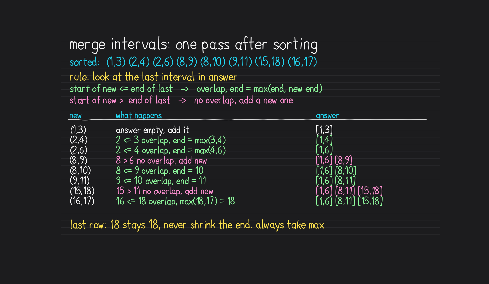

# Merge Intervals

**Question Link:** [LeetCode 56 - Merge Intervals](https://leetcode.com/problems/merge-intervals/)

**Pattern:** Sorting + one pass (interval merge)

  -green>) -green>)

---

## The Question

You are given an array of intervals. An interval `[start, end]` covers every number from `start` to `end`. Merge all the overlapping intervals and return the **minimum** number of intervals that cover the same numbers.

```
Input:  (1,3) (2,6) (8,9) (9,11) (8,10) (2,4) (15,18) (16,17)
Output: (1,6) (8,11) (15,18)
```

**Why not just one big interval `(1,18)`?**

- Every number inside an answer interval must be touched by some input interval.
- `(1,18)` would also cover 12, 13, 14, which no input interval covers.
- So only intervals that really overlap are joined.

---

## Quick Revision

| Item          | Value                                        |
| ------------- | -------------------------------------------- |
| First step    | Sort by start                                |
| Overlap check | `start of new <= end of last`                |
| If overlap    | `end of last = max(end of last, end of new)` |
| If no overlap | Add the new interval as a new one            |
| Time          | `O(n log n)`                                 |
| Space         | `O(n)` for the answer                        |

**Memory cue:** Sort first. Then compare each interval only with the last interval in the answer. Always take the `max` of the ends.

---

## How to Think About It

- After sorting by start, intervals that overlap sit **next to each other**.
- So there is no need to look at the whole array for each interval.
- A new interval can only overlap the **last** interval in the answer. If it does not, no later one can either (starts only grow).

Sorting rule: pairs are sorted by the first number. If the first numbers are equal, they are sorted by the second number.

Sorted example: `(1,3) (2,4) (2,6) (8,9) (8,10) (9,11) (15,18) (16,17)`

---

## Approach 1: Brute Force (stand at one, look forward)

**Idea**

1. Sort the array.
2. Stand at interval `i`. This is the start of a possible merged interval.
3. Look at the next ones. While they overlap, grow the end with `max`. Stop at the first one that does not overlap (**break**), because sorted order means nothing after it can overlap either.
4. Save `(start, end)` in the answer.
5. Move on to the next `i`.

**Skip rule:** If the interval at `i` already sits inside the last answer (`end <= last answer end`), it was already merged. Do nothing (**continue**).

**Code**

```java
import java.util.*;

class Solution {
    public int[][] merge(int[][] arr) {
        int n = arr.length;
        // sort by start (if starts are equal, by end)
        Arrays.sort(arr, (a, b) -> a[0] != b[0] ? Integer.compare(a[0], b[0]) : Integer.compare(a[1], b[1]));

        // merged intervals so far
        List<int[]> ans = new ArrayList<>();

        for (int i = 0; i < n; i++) {
            // start of a possible merged interval
            int start = arr[i][0];
            int end = arr[i][1];

            // already inside the last merged interval
            if (!ans.isEmpty() && end <= ans.get(ans.size() - 1)[1]) {
                continue;
            }

            // look forward for intervals that overlap
            for (int j = i + 1; j < n; j++) {
                if (arr[j][0] <= end) {
                    end = Math.max(end, arr[j][1]);
                } else {
                    break;
                }
            }
            // save the merged interval
            ans.add(new int[]{start, end});
        }
        // convert the list to a 2D array
        return ans.toArray(new int[0][]);
    }
}
```

<details>
<summary>Dry run on the example</summary>

- Stand at `(1,3)`. `(2,4)` overlaps, end becomes 4. `(2,6)` overlaps, end becomes 6. `(8,9)` does not overlap (8 > 6), **break**. Save `(1,6)`.
- `i` at `(2,4)`: 4 <= 6, already inside. **continue**.
- `i` at `(2,6)`: 6 <= 6, already inside. **continue**.
- `i` at `(8,9)`: not inside. Look forward: `(8,10)` overlaps, end 10. `(9,11)` overlaps, end 11. `(15,18)` does not, **break**. Save `(8,11)`.
- `(8,10)` and `(9,11)`: already inside. **continue**.
- `i` at `(15,18)`: look forward, `(16,17)` overlaps, but `max(18,17)` stays 18. Save `(15,18)`.
- `(16,17)`: already inside. **continue**.

Answer: `(1,6) (8,11) (15,18)`.

</details>

<details>
<summary>Why this is not O(n²)</summary>

It looks like two loops, but the `break` and `continue` save a lot of work. For each interval, the inner loop only runs over the intervals that overlap with it, and then stops. Every element is touched about **twice** in total: once by the outer loop and once by the inner loop.

So the work is `O(n)` for the loops plus `O(n log n)` for sorting.

</details>

> [!NOTE]
> **Complexity (brute):** Time `O(n log n) + O(2n)`. Space `O(n)` for the answer (if no intervals overlap, all of them are stored).

The interviewer will not be happy with the `2n`, because for each interval we still go forward and check. We can do it in a single pass.

---

## Approach 2: Optimal (one pass, compare with the last)



**Idea**

Do not stand and look forward. Just go through the sorted array once and keep checking against the **last interval in the answer**.

1. If the answer is empty, or the new interval does **not** overlap the last one (`start > end of last`), add the new interval.
2. Otherwise it overlaps. Update the last interval's end: `max(end of last, end of new)`.

**Code**

```java
import java.util.*;

class Solution {
    public int[][] merge(int[][] arr) {
        // sort by start
        Arrays.sort(arr, (a, b) -> Integer.compare(a[0], b[0]));

        // merged intervals so far
        List<int[]> ans = new ArrayList<>();

        for (int i = 0; i < arr.length; i++) {
            // empty, or no overlap with the last one: new interval
            if (ans.isEmpty() || arr[i][0] > ans.get(ans.size() - 1)[1]) {
                ans.add(new int[]{arr[i][0], arr[i][1]});
            }
            // overlap: stretch the end of the last one
            else {
                int[] last = ans.get(ans.size() - 1);
                last[1] = Math.max(last[1], arr[i][1]);
            }
        }
        // convert the list to a 2D array
        return ans.toArray(new int[0][]);
    }
}
```

<details>
<summary>Dry run on the example</summary>

| New       | What happens                | Answer                 |
| --------- | --------------------------- | ---------------------- |
| `(1,3)`   | answer empty, add it        | `[1,3]`                |
| `(2,4)`   | 2 <= 3, end = max(3,4)      | `[1,4]`                |
| `(2,6)`   | 2 <= 4, end = max(4,6)      | `[1,6]`                |
| `(8,9)`   | 8 > 6, add new              | `[1,6] [8,9]`          |
| `(8,10)`  | 8 <= 9, end = 10            | `[1,6] [8,10]`         |
| `(9,11)`  | 9 <= 10, end = 11           | `[1,6] [8,11]`         |
| `(15,18)` | 15 > 11, add new            | `[1,6] [8,11] [15,18]` |
| `(16,17)` | 16 <= 18, `max(18,17)` = 18 | `[1,6] [8,11] [15,18]` |

</details>

> [!NOTE]
> **Complexity (optimal):** Time `O(n log n)` for sorting, plus `O(n)` for the single pass. Space `O(n)` for the answer (if no intervals overlap, all are stored).

---

## Key Points

> [!TIP]
>
> - **Sort first.** Without sorting, overlapping intervals are not next to each other.
> - **Always take the `max` of the ends.** For `(15,18)` and `(16,17)`, the end must stay 18. Never shrink it.
> - Compare only with the **last** interval in the answer.
> - Use `<=` for overlap: `(1,3)` and `(3,5)` touch at 3, so they merge.
> - In the brute force, `break` when one does not overlap and `continue` when it is already inside. That is why it is not `O(n²)`.
