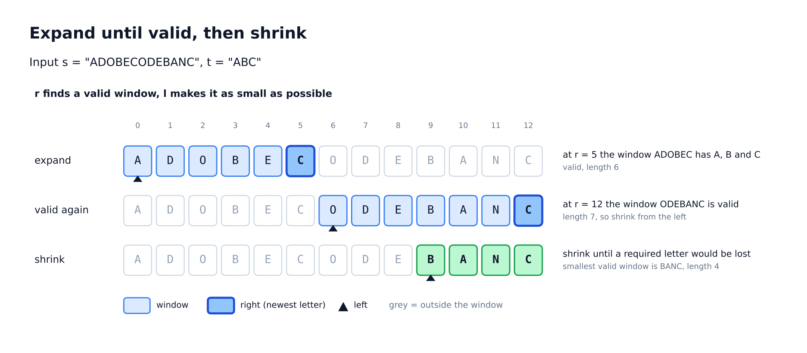
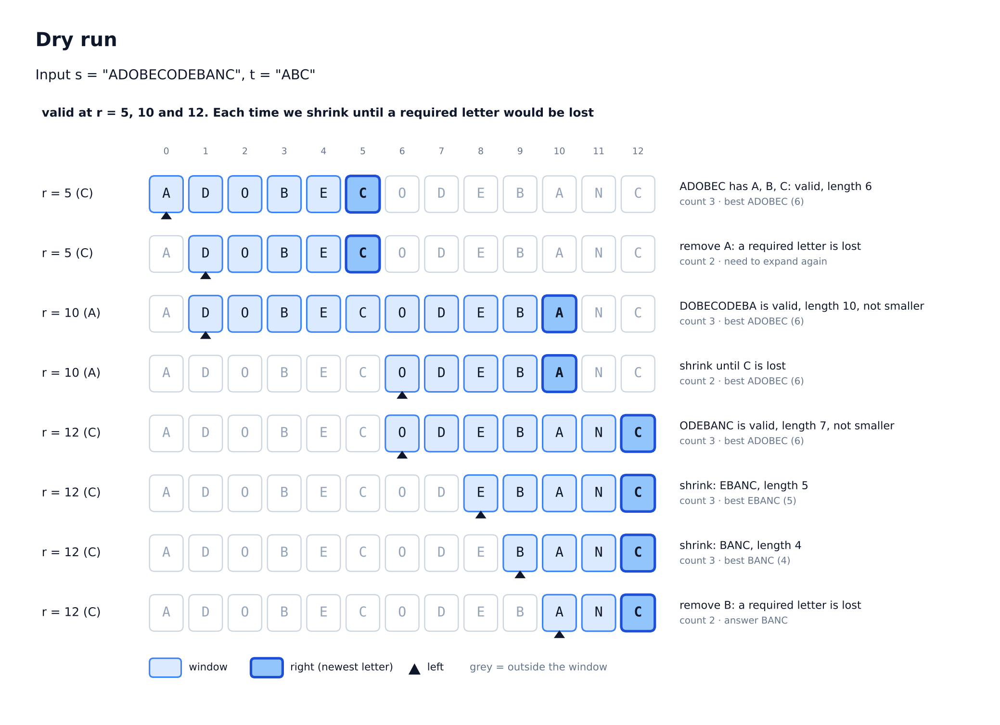

# Minimum Window Substring

**Question Link:** [LeetCode 76 - Minimum Window Substring](https://leetcode.com/problems/minimum-window-substring/)

**Pattern:** Sliding Window (shortest window)

  -green) -green)

---

## The Question

Given two strings `s` and `t`, return the smallest substring of `s` that contains every character of `t`, including duplicates. If no such substring exists, return `""`.

**Example**

- **Input:** `s = "ADOBECODEBANC"`, `t = "ABC"`
- **Output:** `"BANC"`

<details>
<summary><b>How to think about it</b></summary>

<br>

1. **Start simple.** Try every starting index in `s` and expand the window towards the right until it has all the characters of `t`. It works, but the time is O(n² + n·m).
2. **Track what is still needed.** Use a frequency array of the characters required from `t`. Each time a character enters the window, decrease its frequency.
3. **When is the window valid?** When `count == t.length()`, all required characters, including duplicates, are present.
4. **Expand, then shrink.** Expand with `r` until the window is valid. Then shrink with `l` to find the smallest possible window.
5. **Shrinking can break it.** If shrinking removes a required character, the window becomes invalid. Expand again until it becomes valid.
6. **Keep the best.** Update the minimum window length and its starting index whenever a smaller valid window is found.

</details>

## Ways to Solve It

| Approach | Idea | Time | Space |
| --- | --- | --- | --- |
| Brute force | Try every start index and expand right until the window is valid. | O(n² + n·m) | O(1) |
| **Best** | **Sliding window with a hash array. Expand `r`, shrink `l` while valid.** | **O(n + m)** | **O(1)** |

`n` = length of `s`, `m` = length of `t`.

<details>
<summary><b>Brute force (steps and code)</b></summary>

<br>

### 1. Brute Force: try every start

**Intuition:** Try every possible starting index in `s` and expand the window towards the right. Use a frequency array to track how many occurrences of each character are still required from `t`.

As the window expands, decrease the required frequency of each character. Whenever we have included all characters of `t`, including duplicates, we have a valid window. Update the minimum window length and its starting index whenever we find a smaller valid window.

**Steps**

1. **Initialise variables:**
   - `minLen = Integer.MAX_VALUE`: stores the length of the smallest valid window found.
   - `sIndex = -1`: stores the starting index of that window.
   - `hash[256]`: stores the frequency of each character required from `t`.
2. **Pick a starting index:** Traverse `s` using the outer loop (`i`). For every new starting index, reset the frequency array with the character frequencies of `t`. Initialise `count = 0` to track how many required characters have been included.
3. **Expand the window:** Use the inner loop (`j`) to expand the window towards the right.
   - Check the frequency of `s.charAt(j)` in the hash array.
   - If its frequency is greater than 0, the character is still required, so increment `count`.
   - Decrease its frequency in the hash array.
4. **Check if the window is valid:** When `count == t.length()`, all required characters, including duplicates, are present. Calculate the current window length `j - i + 1`. If it is smaller than `minLen`, update `minLen` and `sIndex`.
5. **Break the inner loop:** Once a valid window is found for starting index `i`, break. Expanding it further would only increase its length, so it cannot give a smaller window with the same starting index.
6. **Return the answer:** If `sIndex == -1`, return `""` because no valid window exists. Otherwise, return `s.substring(sIndex, sIndex + minLen)`.

```java
class Solution {
    public String minWindow(String s, String t) {
        int minLen = Integer.MAX_VALUE;
        int sIndex = -1;

        for (int i = 0; i < s.length(); i++) {
            int[] hash = new int[256];

            for (int k = 0; k < t.length(); k++) {
                hash[t.charAt(k)]++;
            }

            int count = 0;

            for (int j = i; j < s.length(); j++) {
                if (hash[s.charAt(j)] > 0) {
                    count++;
                }

                hash[s.charAt(j)]--;

                if (count == t.length()) {
                    if (j - i + 1 < minLen) {
                        minLen = j - i + 1;
                        sIndex = i;
                    }
                    break;
                }
            }
        }

        if (sIndex == -1) return "";

        return s.substring(sIndex, sIndex + minLen);
    }
}
```

| Complexity | Why? |
| --- | --- |
| **Time:** O(n² + n·m) | Every start index expands up to n letters, and the frequency array is rebuilt from `t` (m letters) at each start. |
| **Space:** O(1) | The frequency array has a fixed size of 256. |

</details>

## Best Idea

Use a sliding window with two pointers to find the smallest substring of `s` that contains all required characters from `t`, including duplicates.

First, store the frequency of each character required by `t` in a hash array.

- Expand the window using `r` until all required characters are included.
- Once the window is valid, shrink it using `l` to find the smallest possible window.
- If shrinking removes a required character, the window becomes invalid. Expand again until it becomes valid.



Keep updating the minimum window length and its starting index whenever a smaller valid window is found.

## Pointers Used

- `l` = left boundary of the window
- `r` = right boundary of the window
- `count` = how many required character occurrences have been matched
- `hash[256]` = the required frequency of each character in `t`
- `minLen` = length of the smallest valid window
- `sIndex` = starting index of the smallest window

## The Logic

First fill `hash` from `t`. Then for every `r`:

- **Expand with `r`:** if `hash[s.charAt(r)] > 0`, the character is still required, so increment `count`. Always decrease its frequency in the hash array, outside the if condition.
- **Valid window:** when `count == t.length()`, update `minLen` and `sIndex` if the current window is smaller.
- **Shrink with `l`:** restore the frequency of the character leaving the window using `hash[s.charAt(l)]++`. If its restored frequency becomes greater than 0, we have lost a required character, so decrease `count`. Move `l` forward. Continue shrinking while the window remains valid.

> [!WARNING]
> Always decrease the frequency when a character enters the window, even if it is an extra occurrence. We need to track every character entering the window, including extra occurrences.

## Code (Java)

```java
class Solution {
    public String minWindow(String s, String t) {
        // Step 1: set up the answer and the required frequencies
        int minLen = Integer.MAX_VALUE;
        int sIndex = -1;

        int[] hash = new int[256];

        for (int i = 0; i < t.length(); i++) {
            hash[t.charAt(i)]++;
        }

        int count = 0;
        int l = 0, r = 0;

        // Step 2: move r through s
        while (r < s.length()) {
            // Step 3: still required, so one more is matched
            if (hash[s.charAt(r)] > 0) {
                count++;
            }

            // always decrease, even for an extra occurrence
            hash[s.charAt(r)]--;

            // Step 4: valid window, so shrink it as much as possible
            while (count == t.length()) {
                if (r - l + 1 < minLen) {
                    minLen = r - l + 1;
                    sIndex = l;
                }

                // Step 5: restore the letter leaving the window
                hash[s.charAt(l)]++;

                // a required letter is lost, window is invalid now
                if (hash[s.charAt(l)] > 0) {
                    count--;
                }

                l++;
            }

            r++;
        }

        // Step 6: no valid window means ""
        if (sIndex == -1) return "";

        return s.substring(sIndex, sIndex + minLen);
    }
}
```

<details>
<summary><b>Dry run</b></summary>

<br>

Input: `s = "ADOBECODEBANC"`, `t = "ABC"`



| r | Window (l to r) | count | What happens | Best so far |
| --- | --- | --- | --- | --- |
| 5 | `ADOBEC` | 3 | Valid, length 6 | `ADOBEC` (6) |
| 5 | `DOBEC` | 2 | Removed `A`, a required letter is lost | `ADOBEC` (6) |
| 10 | `DOBECODEBA` | 3 | Valid, length 10, not smaller | `ADOBEC` (6) |
| 10 | `ODEBA` | 2 | Shrunk until `C` was lost | `ADOBEC` (6) |
| 12 | `ODEBANC` | 3 | Valid, length 7, not smaller | `ADOBEC` (6) |
| 12 | `EBANC` | 3 | Shrink, length 5 | `EBANC` (5) |
| 12 | `BANC` | 3 | Shrink, length 4 | `BANC` (4) |
| 12 | `ANC` | 2 | Removed `B`, a required letter is lost | `BANC` (4) |

Answer: `"BANC"`

**What to notice:** the window is valid at r = 5, 10 and 12. Each time we shrink until a required letter would be lost. The shrink at r = 12 reaches `BANC` (length 4), the smallest.

</details>

## Complexity

> [!NOTE]
> - **Time (TC):** O(n + m). Both pointers traverse `s` at most once. Initialising the frequency array from `t` takes O(m).
> - **Space (SC):** O(1). The hash array has a fixed size of 256.

## Key Points

> [!TIP]
> 1. `count` counts matched character occurrences, not distinct characters.
> 2. Always decrease the frequency when a character enters the window, even if it is an extra occurrence.
> 3. When shrinking, restore the frequency of the character leaving the window.
> 4. If the restored frequency becomes greater than 0, a required occurrence has been lost, so decrease `count`.
> 5. Use a `while` loop to shrink the window as much as possible while it remains valid.
>
> **Quick revision:** expand `r` until `count == t.length()`, then shrink `l` while the window stays valid and keep the smallest one. Decrease `hash` when a letter enters, increase it when a letter leaves.

<details>
<summary><b>Extra concepts</b></summary>

<br>

- **What the hash value means:**
  - Positive frequency means the character is still required.
  - Zero means we have exactly enough.
  - Negative frequency means we have extra occurrences.
- **Quick comparison:** brute force is O(n² + n·m) time and O(1) space. Sliding window (best) is O(n + m) time and O(1) space.

</details>
