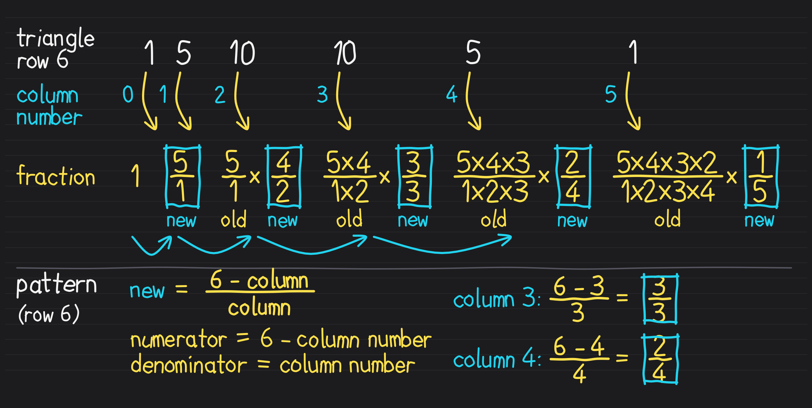

# Pascal's Triangle

**Question Link:** [LeetCode 118 - Pascal's Triangle](https://leetcode.com/problems/pascals-triangle/)

**Pattern:** Arrays + nCr (a small math trick)

  -green>) -green>)

---

## The Question

Print Pascal's Triangle for `n` rows.

```
1
1 1
1 2 1
1 3 3 1
1 4 6 4 1
```

**The rules**

- Every row starts with `1` and ends with `1`.
- Every number in the middle is the **sum of the two numbers directly above it**.
- Row `r` has exactly `r` numbers.
- The question counts rows and columns from **1**. Java arrays and lists count from **0**.

**This question has 3 types.** An interviewer can ask any one of them.

| Type                | Input               | Output                       | Example                   |
| ------------------- | ------------------- | ---------------------------- | ------------------------- |
| I. One element      | Row `r`, column `c` | One number                   | `r = 5, c = 3` gives `6`  |
| II. One row         | Row `r`             | All numbers of row `r`       | `r = 5` gives `1 4 6 4 1` |
| III. Whole triangle | Number of rows `n`  | Rows 1 to `n` (LeetCode 118) | `n = 5` gives 5 rows      |

---

## Quick Revision

**Key formulas**

| Purpose                        | Formula                         |
| ------------------------------ | ------------------------------- |
| Element at row `r`, column `c` | `C(r - 1, c - 1)`               |
| nCr symmetry                   | `C(n, r) = C(n, n - r)`         |
| Next number in a row           | `next = previous × (r - i) / i` |

**The two loops to remember**

```java
// nCr : multiply by (n - i), divide by (i + 1)
for (int i = 0; i < r; i++) {
    res = res * (n - i);
    res = res / (i + 1);
}

// one row : multiply by (r - i), divide by i
for (int i = 1; i < r; i++) {
    ans[i] = (ans[i - 1] * (r - i)) / i;
}
```

**The three types**

| Type                | Main idea                                      | Time                 | Space                                |
| ------------------- | ---------------------------------------------- | -------------------- | ------------------------------------ |
| I. One element      | Calculate `C(r - 1, c - 1)`                    | O(min(c - 1, r - c)) | O(1)                                 |
| II. One row         | Calculate each number from the previous number | O(r)                 | O(1), plus O(r) for the returned row |
| III. Whole triangle | Generate each row with the Type II idea        | O(n²)                | O(n²) for the output                 |

**Memory cue:** one cell is nCr. One row is previous value. Whole triangle is generate each row.

**Do not forget:** nCr and the row loop can overflow. Use `long` for the middle calculation.

---

<details>
<summary><b>How to think about it</b></summary>

<br>

Build the triangle by hand first.

- Row 1 is `1`. Row 2 is `1 1`.
- In row 3, there is one number in the middle. Add the two numbers above it: `1 + 1 = 2`. So row 3 is `1 2 1`.
- In row 4, there are two middle numbers: `1 + 2 = 3` and `2 + 1 = 3`. So row 4 is `1 3 3 1`.
- In row 5, there are three middle numbers: `1 + 3 = 4`, `3 + 3 = 6`, `3 + 1 = 4`. So row 5 is `1 4 6 4 1`.

This builds the whole triangle, but it is slow if someone only asks for one number or one row.

So each type gets its own faster idea:

- One number: use the nCr formula directly.
- One row: each number comes from the number before it in the same row.
- Whole triangle: do the one-row idea for every row.

</details>

---

## Ways to Solve It

| Type | Approach                                            | Time                     | Space          |
| ---- | --------------------------------------------------- | ------------------------ | -------------- |
| I    | Build the whole triangle, then read the number      | O(n²)                    | O(n²)          |
| I    | **nCr with the shortcut loop**                      | **O(min(c - 1, r - c))** | **O(1)**       |
| II   | Call nCr for every column                           | O(r × r)                 | O(1)           |
| II   | **Calculate each number from the previous number**  | **O(r)**                 | **O(1)**       |
| III  | Call nCr for every number                           | O(n³)                    | O(1) extra     |
| III  | **Generate each row with the previous-number idea** | **O(n²)**                | **O(1) extra** |

---

## Best Idea

### Type I: Find one element

**The idea**

The number at row `r`, column `c` is `C(r - 1, c - 1)`.

For `r = 5, c = 3`, that is `C(4, 2) = 6`.

**How to calculate nCr fast**

The formula is `n! / (r! × (n - r)!)`. Do not find the three factorials one by one. It is slow and the numbers get very big.

See `7 C 2`:

```
7 × 6 × 5 × 4 × 3 × 2 × 1
--------------------------------
(2 × 1) × (5 × 4 × 3 × 2 × 1)
```

`5 × 4 × 3 × 2 × 1` is on the top and on the bottom, so it cancels. Only `(7 × 6) / (2 × 1)` is left.

- The top goes down from `n`, for `r` numbers.
- The bottom goes up from `1`, for `r` numbers.
- `10 C 3 = (10 × 9 × 8) / (3 × 2 × 1)`.

Multiply and divide **at every step**, as `10/1 × 9/2 × 8/3`. After every step the answer is a whole number, and it never gets too big.

**Steps**

1. Convert the row and column: `n = r - 1`, `r = c - 1`.
2. If `r` is larger than `n - r`, replace `r` with `n - r`. This keeps the loop short.
3. Start with `res = 1`.
4. Loop `r` times: multiply by `(n - i)`, then divide by `(i + 1)`.

**Code (Java)**

```java
public static int pascalTriangleI(int r, int c) {
    return nCr(r - 1, c - 1);
}

private static int nCr(int n, int r) {
    // Step 1: use the smaller side of the combination
    if (r > n - r) {
        r = n - r;
    }

    // Step 2: C(n, 1) is always n
    if (r == 1) {
        return n;
    }

    int res = 1;

    // Step 3: multiply by the top, divide by the bottom, one step at a time
    for (int i = 0; i < r; i++) {
        res = res * (n - i);
        res = res / (i + 1);
    }

    return res;
}
```

<details>
<summary><b>Dry run: row 5, column 3</b></summary>

<br>

`n = 5 - 1 = 4` and `r = 3 - 1 = 2`. We find `C(4, 2)`.

`r = 2` is not larger than `n - r = 2`, so `r` stays 2.

| i   | Multiply by `(n - i)` | Divide by `(i + 1)` | res |
| --- | --------------------- | ------------------- | --- |
| 0   | `1 × 4 = 4`           | `4 / 1`             | 4   |
| 1   | `4 × 3 = 12`          | `12 / 2`            | 6   |

Answer: `6`

</details>

<details>
<summary><b>Why are r - 1 and c - 1 used?</b></summary>

<br>

The combination formula starts counting from 0. The question starts counting from 1.

- Row `r` becomes combination row `r - 1`.
- Column `c` becomes combination position `c - 1`.

Look at the triangle written as combinations:

```
Row 1:            0C0
Row 2:         1C0   1C1
Row 3:      2C0   2C1   2C2
Row 4:   3C0   3C1   3C2   3C3
Row 5: 4C0  4C1  4C2  4C3  4C4
        1    4    6    4    1
```

The top row is `n = 0`, but it is called row 1. The first number of a row has `0` at the bottom, but it is called column 1.

Row 5, column 3 is `C(5 - 1, 3 - 1) = C(4, 2) = 6`.

</details>

<details>
<summary><b>Why use C(n, r) = C(n, n - r)?</b></summary>

<br>

Choosing `r` items is the same as choosing the `n - r` items that are left out. So:

`C(n, r) = C(n, n - r)`

The code swaps `r` with `n - r` when `r` is bigger. The loop then runs fewer times.

Example: `C(5, 4) = C(5, 1) = 5`.

This is also why every row reads the same from both sides.

</details>

<details>
<summary><b>How does the nCr loop work?</b></summary>

<br>

```java
res = res * (n - i);
res = res / (i + 1);
```

At each step:

1. Multiply by the next top number, `n - i`.
2. Divide by the next bottom number, `i + 1`.

The division is exact at every step, because the result so far is itself a smaller nCr.

If `r` is 0, the loop runs zero times and `res` stays 1. That is correct, because `C(n, 0) = 1`.

> [!WARNING]
> `res` is an `int`. The multiplication `res * (n - i)` can overflow before the division happens. Using `int` does not guarantee safety for big values.

</details>

---

### Type II: Return one whole row

**The idea**

Row `r` has `r` numbers. Each number comes from the number before it. Look at row 6 (`1 5 10 10 5 1`).



Each column keeps the whole old fraction and adds one new part. The new part is `(r - i) / i`, where `i` is the column number counted from 0.

**Steps**

1. Make an array of size `r`. Put `1` in the first place.
2. For `i` from `1` to `r - 1`: new number = previous number × `(r - i)` / `i`.

**Code (Java)**

```java
public int[] pascalTriangleII(int r) {
    int[] ans = new int[r];
    // Step 1: first number is always 1
    ans[0] = 1;

    // Step 2: each number comes from the one before it
    for (int i = 1; i < r; i++) {
        ans[i] = (ans[i - 1] * (r - i)) / i;
    }

    return ans;
}
```

<details>
<summary><b>How we got this formula</b></summary>

<br>

**Step 1: Every column is an nCr**

Columns are counted from 0. In row 6, the number in column `i` is `5 C i`.

**Step 2: Write each nCr with the shortcut**

`5 C i` has `i` numbers on the top, starting from 5 and going down. It has `i` numbers on the bottom, starting from 1 and going up.

| Column | nCr     | As a fraction                       | Answer |
| ------ | ------- | ----------------------------------- | ------ |
| 1      | `5 C 1` | `5 / 1`                             | 5      |
| 2      | `5 C 2` | `(5 × 4) / (1 × 2)`                 | 10     |
| 3      | `5 C 3` | `(5 × 4 × 3) / (1 × 2 × 3)`         | 10     |
| 4      | `5 C 4` | `(5 × 4 × 3 × 2) / (1 × 2 × 3 × 4)` | 5      |

**Step 3: Compare a column with the column before it**

- Column 2 is `(5 × 4) / (1 × 2)`.
- Column 3 is `(5 × 4 × 3) / (1 × 2 × 3)`.

Column 3 has the whole of column 2 inside it. Only a `3` on the top and a `3` on the bottom are added.

```
column 3 = column 2  ×  3 / 3
            (old)      (new)
```

Column 4 is column 3 × `2 / 4`. The same happens for every column.

**Step 4: Find the new part for any column**

| Column | New part |
| ------ | -------- |
| 1      | `5 / 1`  |
| 2      | `4 / 2`  |
| 3      | `3 / 3`  |
| 4      | `2 / 4`  |
| 5      | `1 / 5`  |

- The top goes down by 1 each time: 5, 4, 3, 2, 1. It is always **6 - column number**.
- The bottom goes up by 1 each time: 1, 2, 3, 4, 5. It is always the **column number**.

**Step 5: The formula**

```
next = previous × (r - i) / i
```

Here `r` is the row number (6 in this example) and `i` is the column number.

**Check:** column 4 is `10 × (6 - 4) / 4 = 10 × 2 / 4 = 5`. ✔

</details>

<details>
<summary><b>How is the next value calculated?</b></summary>

<br>

`next = previous × (r - i) / i`

- `r` is the row number. It is also how many numbers the row has.
- `i` is the current position, starting at 1.
- `ans[i - 1]` is the previous number, already calculated.
- `ans[i]` stores the next number.

This avoids finding every number on its own with factorials or a separate nCr call.

</details>

<details>
<summary><b>Dry run: row 5</b></summary>

<br>

Start with `[1]`.

| i   | Calculation     | Row so far      |
| --- | --------------- | --------------- |
| 1   | `1 × 4 / 1 = 4` | [1, 4]          |
| 2   | `4 × 3 / 2 = 6` | [1, 4, 6]       |
| 3   | `6 × 2 / 3 = 4` | [1, 4, 6, 4]    |
| 4   | `4 × 1 / 4 = 1` | [1, 4, 6, 4, 1] |

Answer: `[1, 4, 6, 4, 1]`

</details>

<details>
<summary><b>What is the overflow limit?</b></summary>

<br>

The array and the multiplication both use `int`:

```java
ans[i] = (ans[i - 1] * (r - i)) / i;
```

The multiplication can overflow before the division happens. For big rows, use `long` for the middle calculation. The returned `int[]` still cannot hold values outside the `int` range.

</details>

---

### Type III: Generate the whole triangle

**The idea**

Type II already gives one row. Do it for every row from `1` to `n`, and put each row in a bigger list.

**Steps**

1. Write `generateRow(row)`. It makes one row using the Type II idea.
2. Loop `row` from `1` to `n`.
3. Add `generateRow(row)` to the triangle each time.

**Code (Java)**

```java
private List<Integer> generateRow(int row) {
    long ans = 1;
    List<Integer> ansRow = new ArrayList<>();

    // Step 1: first number is always 1
    ansRow.add(1);

    // Step 2: each next number comes from the last one
    for (int col = 1; col < row; col++) {
        ans = ans * (row - col);
        ans = ans / col;
        ansRow.add((int) ans);
    }

    return ansRow;
}

public List<List<Integer>> pascalTriangleIII(int n) {
    List<List<Integer>> pascalTriangle = new ArrayList<>();

    // Step 3: build every row and add it
    for (int row = 1; row <= n; row++) {
        pascalTriangle.add(generateRow(row));
    }

    return pascalTriangle;
}
```

Keep `generateRow` as its own function. It makes the code easy to read, and interviewers check code quality.

<details>
<summary><b>Dry run: n = 4</b></summary>

<br>

| row | generateRow(row) |
| --- | ---------------- |
| 1   | [1]              |
| 2   | [1, 1]           |
| 3   | [1, 2, 1]        |
| 4   | [1, 3, 3, 1]     |

Inside `generateRow(3)`, starting with `ans = 1` and `ansRow = [1]`:

| col | Calculation           | ansRow    |
| --- | --------------------- | --------- |
| 1   | `1 × (3 - 1) / 1 = 2` | [1, 2]    |
| 2   | `2 × (3 - 2) / 2 = 1` | [1, 2, 1] |

</details>

<details>
<summary><b>How do the helper and the outer function work together?</b></summary>

<br>

`generateRow(row)`

1. Makes a list for one row.
2. Adds the first number, `1`.
3. Calculates each remaining number from the previous number.
4. Returns the finished row.

`pascalTriangleIII(n)`

1. Makes a list to hold the whole triangle.
2. Loops from row 1 to row `n`.
3. Calls `generateRow(row)` for each row.
4. Adds each finished row to the triangle.
5. Returns the triangle.

</details>

<details>
<summary><b>Why is ans a long here?</b></summary>

<br>

The middle multiplication can go past the `int` range. `long` gives a wider range for the calculation.

Two limits still remain:

- A big enough middle value can overflow `long`.
- `ansRow` stores `Integer` values, so `(int) ans` can overflow if the value is outside the `int` range.

`long` lowers the risk during the calculation. It does not make the final `List<Integer>` unlimited.

</details>

---

### How the three types connect

- One element: calculate one value directly with nCr.
- One row: reuse the previous value to get the next value.
- Whole triangle: generate one row again and again with the same idea.

### Complexity

> [!NOTE]
>
> - **Type I:** Time O(min(c - 1, r - c)), because the loop runs for the smaller side. Space O(1).
> - **Type II:** Time O(r). Space O(1) extra, plus O(r) for the returned row.
> - **Type III:** Time O(n²), because there are `n` rows and each row takes O(n). Space O(n²) only because we store the output.

### Key Points

> [!TIP]
>
> - Row `r` has `r` numbers. First and last are `1`.
> - The question counts from 1. nCr counts from 0. Take 1 off both: `C(r - 1, c - 1)`.
> - nCr shortcut: multiply by `(n - i)`, divide by `(i + 1)`, and use the smaller side with `C(n, r) = C(n, n - r)`.
> - Row idea: `next = previous × (r - i) / i`.
> - Use `long` for the middle calculation.
> - For Type III, do not call nCr for every number. That is O(n³). Use the row idea, which is O(n²).
> - Break the code into a small `generateRow` function.

<details>
<summary><b>Extra concepts</b></summary>

<br>

**Brute force for Type I**

Build the whole triangle and read the number at row `r`, column `c`. It takes O(n²) time and space.

**Brute force for Type II**

Call nCr for every column of the row. Each call takes O(r), so the total is about O(r × r). The interviewer will ask why the formula is repeated again and again.

**Brute force for Type III**

Two loops, one for rows and one for columns. Call `nCr(row - 1, col - 1)` for each number. Each call takes O(r), so the total is about O(n³). This is slow.

**Another way to build the triangle**

Start with `[1]`. For each new row, take the last row, put a `0` on the left and a `0` on the right, and add the numbers that sit next to each other. This is also O(n²).

</details>
