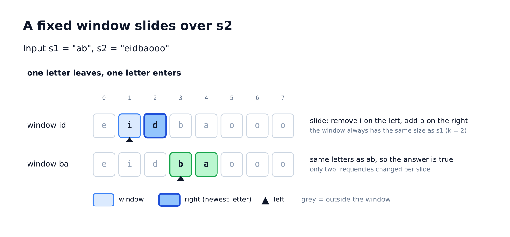
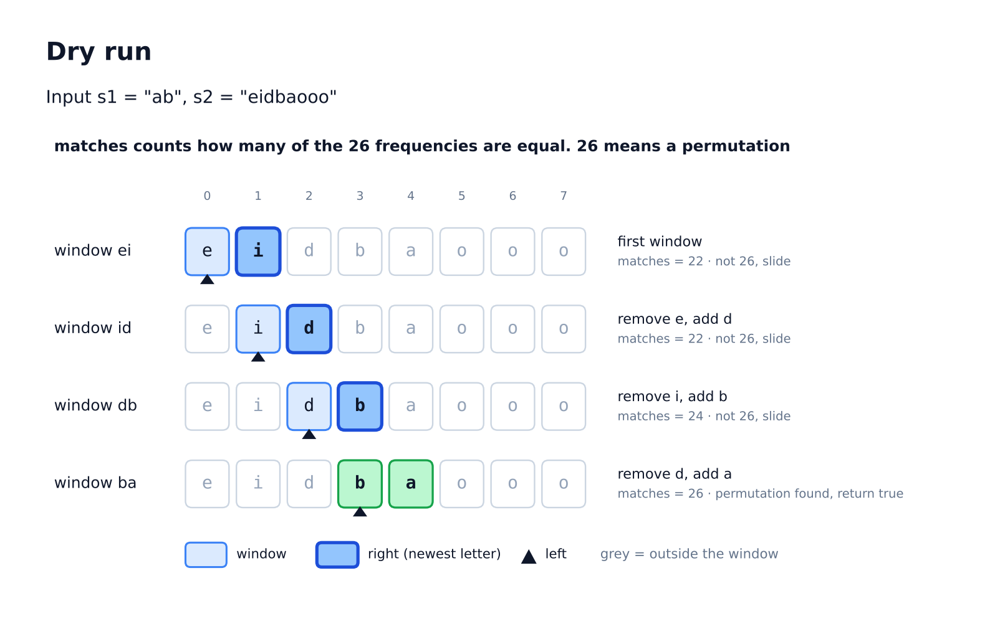

# Permutation in String

**Question Link:** [LeetCode 567 - Permutation in String](https://leetcode.com/problems/permutation-in-string/)

**Pattern:** Sliding Window (fixed size)

  -green) -green)

---

## The Question

Given two strings `s1` and `s2`, return `true` if `s2` contains a contiguous substring that is a permutation of `s1`.

A permutation means:

- Same characters.
- Same frequency of each character.
- Order can be different.

**Examples**

- **Input:** `s1 = "ab"`, `s2 = "eidbaooo"` **Output:** `true`, because `"ba"` is a permutation of `"ab"`.
- **Input:** `s1 = "ab"`, `s2 = "eidboaoo"` **Output:** `false`

<details>
<summary><b>How to think about it</b></summary>

<br>

1. **Do we need to generate permutations?** No. We only need to compare character frequencies.
2. **What are we looking for?** A substring in `s2` that has exactly the same character frequencies as `s1`.
3. **How long is the window?** Exactly the same length as `s1`. So we use a fixed-size sliding window.
4. **Compare the counts.** Keep `freq1` for `s1` and `freq2` for the current window of `s2`. If both arrays are equal, we have found a permutation.
5. **Can we avoid comparing all 26 slots every time?** When the window slides, only one character leaves and only one enters, so only two positions change. Keep a `matches` count instead.

</details>

## Ways to Solve It

| Approach | Idea | Time | Space |
| --- | --- | --- | --- |
| Solution 1 | Sliding window + two frequency arrays. Compare with `Arrays.equals()` for every window. | O(n × 26) = O(n) | O(26) = O(1) |
| **Solution 2 (best)** | **Sliding window + `matches` count. Update only the two changed positions.** | **O(n + 26) = O(n)** | **O(26) = O(1)** |

<details>
<summary><b>Solution 1: two frequency arrays (steps and code)</b></summary>

<br>

**Intuition:** We need to find a substring in `s2` that contains exactly the same character frequencies as `s1`.

We use two frequency arrays:

- `freq1` stores the frequencies of characters in `s1`.
- `freq2` stores the frequencies of characters in the current window of `s2`.

Since the window must have the same length as `s1`, we use a fixed-size sliding window. If both frequency arrays are equal, we have found a permutation.

**Steps**

1. If `s2.length() < s1.length()`, return `false`.
2. Create two arrays of size 26.
3. Store the frequencies of `s1` in `freq1`.
4. Create the first window in `s2` with length `k = s1.length()` and store its frequencies in `freq2`.
5. Compare the arrays using `Arrays.equals(freq1, freq2)`.
6. Slide the window:
   - Remove the character leaving from the left.
   - Increment `l`.
   - Increment `r`.
   - Add the new character entering from the right.
7. Compare the arrays again for every window. If they match, return `true`.

```java
import java.util.Arrays;

class Solution {
    public boolean checkInclusion(String s1, String s2) {

        if (s1.length() > s2.length()) return false;

        int[] freq1 = new int[26];
        int[] freq2 = new int[26];

        for (char c : s1.toCharArray()) {
            freq1[c - 'a']++;
        }

        int k = s1.length();

        for (int i = 0; i < k; i++) {
            freq2[s2.charAt(i) - 'a']++;
        }

        int l = 0;
        int r = k - 1;

        while (r < s2.length()) {

            if (Arrays.equals(freq1, freq2)) return true;

            if (r == s2.length() - 1) break;

            // Remove the left character
            freq2[s2.charAt(l) - 'a']--;
            l++;

            // Add the next character
            r++;
            freq2[s2.charAt(r) - 'a']++;
        }

        return false;
    }
}
```

| Complexity | Why? |
| --- | --- |
| **Time:** O(n × 26) = O(n) | Every window compares all 26 frequency positions. |
| **Space:** O(26) = O(1) | Two arrays of 26 slots. |

**Tricky parts to remember**

- **Fixed-size window:** a permutation must have exactly the same length as `s1`.
- **`Arrays.equals(freq1, freq2)`, not `==`:** `==` checks if both variables are the same array object. It does not compare the contents.
- **Remove one, add one:** when the window moves right, one letter leaves and one enters, so we update only those two frequencies.

**The tricky `r` boundary condition**

Our initial window is `l = 0` and `r = k - 1`. We check the current window first. Then:

```java
if (r == s2.length() - 1) break;
```

Why? Because if `r` is already at the last index, there is no next character to add.

**Key point:** We add the last character during the previous slide. The next iteration checks the completed last window before breaking.

</details>

## Best Idea

In Solution 1, every time the window slides, we compare all 26 positions using `Arrays.equals()`. But when a window slides, only one character leaves and only one character enters. So only two frequency positions change!



Instead of comparing all 26 positions repeatedly, we maintain a variable called `matches`. `matches` tells us how many positions have equal frequencies in both arrays. Since there are 26 possible lowercase characters, `matches == 26` means all 26 frequency positions match. Therefore, we have found a permutation.

## Pointers Used

- `l` = left end of the window
- `r` = right end of the window, always `l + k - 1`
- `freq1` = frequencies of `s1`
- `freq2` = frequencies of the current window of `s2`
- `matches` = how many of the 26 positions have equal frequency

## The Logic

1. Check `s2.length() < s1.length()`. If yes, return `false`.
2. Fill `freq1` from `s1` and `freq2` from the first window of `s2`.
3. Calculate the initial `matches`: traverse all 26 positions and if `freq1[i] == freq2[i]`, increment `matches`.
4. Check `matches == 26`. If yes, return `true`.
5. Slide the window by removing the left character. Update `matches` before and after changing that character's frequency.
6. Add the new right character and update `matches` in the same way.
7. Repeat for every window.

> [!WARNING]
> Update `matches` before and after changing a frequency. Before: if the position matches, decrease `matches`, because it may stop matching. After: if it matches again, increase `matches`.

## Code (Java)

```java
class Solution {
    public boolean checkInclusion(String s1, String s2) {

        // Step 1: s2 is too short to hold a permutation of s1
        if (s1.length() > s2.length()) return false;

        // Step 2: fill the frequency arrays
        int[] freq1 = new int[26];
        int[] freq2 = new int[26];

        for (char c : s1.toCharArray()) {
            freq1[c - 'a']++;
        }

        int k = s1.length();

        for (int i = 0; i < k; i++) {
            freq2[s2.charAt(i) - 'a']++;
        }

        // Step 3: count how many of the 26 positions are equal
        int matches = 0;

        for (int i = 0; i < 26; i++) {
            if (freq1[i] == freq2[i]) {
                matches++;
            }
        }

        int l = 0;
        int r = k - 1;

        // Step 4: slide the fixed window over s2
        while (r < s2.length()) {

            if (matches == 26) return true;

            if (r == s2.length() - 1) break;

            // Step 5: remove the left character
            int leftIndex = s2.charAt(l) - 'a';

            if (freq1[leftIndex] == freq2[leftIndex]) matches--;
            freq2[leftIndex]--;
            if (freq1[leftIndex] == freq2[leftIndex]) matches++;

            l++;

            // Step 6: add the next character
            r++;

            int rightIndex = s2.charAt(r) - 'a';

            if (freq1[rightIndex] == freq2[rightIndex]) matches--;
            freq2[rightIndex]++;
            if (freq1[rightIndex] == freq2[rightIndex]) matches++;
        }

        // Step 7: the last window was added in the last slide, so check it here
        return matches == 26;
    }
}
```

<details>
<summary><b>Dry run</b></summary>

<br>

Input: `s1 = "ab"`, `s2 = "eidbaooo"`



| Step | Window | Action | matches | Result |
| --- | --- | --- | --- | --- |
| Start | `ei` | First window | 22 | Not 26, slide |
| 1 | `id` | Remove `e`, add `d` | 22 | Not 26, slide |
| 2 | `db` | Remove `i`, add `b` | 24 | Not 26, slide |
| 3 | `ba` | Remove `d`, add `a` | 26 | `matches == 26`, return `true` |

Answer: `true`

</details>

## Complexity

> [!NOTE]
> - **Time (TC):** O(n + 26) = O(n). Only the two changed positions are updated per slide. The first `matches` count takes 26 steps.
> - **Space (SC):** O(26) = O(1). Two arrays of 26 slots.

## Key Points

> [!TIP]
> **Common logic:** Fixed window of size `s1.length()`, two frequency arrays, remove one character and add one as the window slides.
>
> | Solution | How it checks |
> | --- | --- |
> | 1 | `Arrays.equals()` compares all 26 frequencies. |
> | 2 | `matches == 26` tracks equal frequencies and updates only changed positions. |
>
> **Remember these tricky points:**
>
> 1. `matches` counts equal frequency positions, not characters.
> 2. Update `matches` before and after changing a frequency.
> 3. Check the last window before breaking; use the final return to check it too.

<details>
<summary><b>Extra concepts</b></summary>

<br>

- **Permutation:** the same characters with the same frequencies. The order can be different.
- **Fixed-size window:** a window that always has the same length as `s1`. It slides by removing one letter on the left and adding one on the right.
- **Frequency array:** an array of 26 slots, one for each lowercase letter. Slot `c - 'a'` holds how many times letter `c` appears.

</details>
