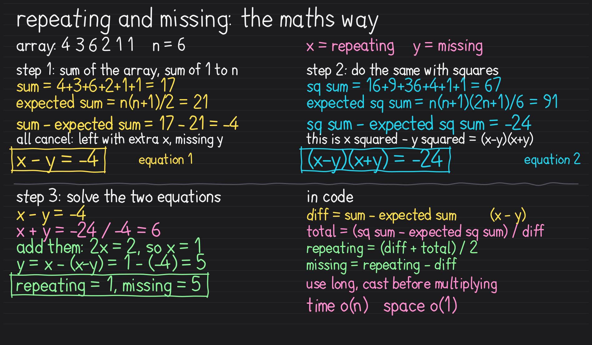
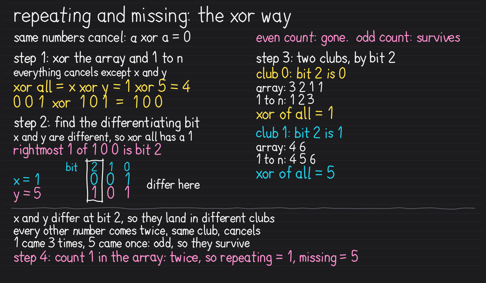

# Find the Repeating and Missing Number

**Pattern:** Arrays + hashing, maths, XOR

**Sign-flip trick (separate short note):** [Set Mismatch: the Sign-Flip Trick](set_mismatch.md)

  -green>) -green>)

---

## The Question

You are given an array of `n` integers. The numbers are from `1` to `n`. **One number appears twice** (the repeating number) and **one number does not appear** (the missing number).

Return the repeating number and the missing number, **repeating first, then missing**.

```
Input:  [4, 3, 6, 2, 1, 1]       n = 6
Output: [1, 5]
```

- The numbers should be `1 2 3 4 5 6`.
- `1` appears twice, so `1` is the repeating number.
- `5` does not appear, so `5` is the missing number.

---

## Quick Revision

| Approach    | Idea                                                                                | Time    | Space  |
| ----------- | ----------------------------------------------------------------------------------- | ------- | ------ |
| Brute force | For each number `1` to `n`, count it in the array                                   | `O(n²)` | `O(1)` |
| Better      | Hash array of counts                                                                | `O(n)`  | `O(n)` |
| Optimal 1   | Sum and sum of squares, solve 2 equations                                           | `O(n)`  | `O(1)` |
| Optimal 2   | XOR, differentiating bit, two clubs                                                 | `O(n)`  | `O(1)` |
| Extra       | [Marker trick](set_mismatch.md): flip signs in the array (array must be changeable) | `O(n)`  | `O(1)` |

**Which one for which listing**

| Listing                                                 | Array can be changed? | Approaches that work                                 |
| ------------------------------------------------------- | --------------------- | ---------------------------------------------------- |
| Set Mismatch #645 (LeetCode, Easy)                      | Yes                   | All of them, including the marker trick              |
| Repeat & Missing Number (InterviewBit, Hard, read-only) | No                    | Brute, hash array, maths, xor (not the marker trick) |

**Key formulas (optimal 1)**

| Purpose                      | Formula                                          |
| ---------------------------- | ------------------------------------------------ |
| Sum of `1` to `n`            | `expectedSum = n(n + 1) / 2`                     |
| Sum of squares of `1` to `n` | `expectedSqSum = n(n + 1)(2n + 1) / 6`           |
| Equation 1                   | `diff = sum - expectedSum = x - y`               |
| Equation 2                   | `total = (sqSum - expectedSqSum) / diff = x + y` |
| Repeating `x`                | `repeating = (diff + total) / 2`                 |
| Missing `y`                  | `missing = repeating - diff`                     |

`x` is the repeating number and `y` is the missing number.

**Memory cue:** Brute: count each number. Better: hash array. Maths: two equations, two unknowns. XOR: xor everything, split by one different bit.

**For an interview:** the maths solution is the one to give. XOR is harder and can be skipped, but it is good to know.

---

## How to Think About It

The numbers are always `1` to `n`, so the full list is known. Only the counts are different: `x` has count 2 and `y` has count 0.

Whenever the question is about counting, the first idea is hashing. The numbers are from `1` to `n`, so a plain array works as the hash.

| Approach                                | Verdict                            |
| --------------------------------------- | ---------------------------------- |
| Count each number by scanning the array | Works, `O(n²)`                     |
| Hash array of counts                    | `O(n)` but uses `O(n)` extra space |
| Maths or XOR                            | `O(n)` time and `O(1)` space       |

---

## Approach 1: Brute Force

**Idea:** Pick each number `i` from `1` to `n`. Scan the array and count how many times `i` appears.

- Count `2`: `i` is the repeating number.
- Count `0`: `i` is the missing number.
- Once both are found, stop.

```
i = 1: appears 2 times   repeating = 1
i = 2: appears 1 time
i = 3: appears 1 time
i = 4: appears 1 time
i = 5: appears 0 times   missing = 5
```

**Code**

```java
class Solution {
    public int[] findMissingRepeatingNumbers(int[] a) {
        // numbers are from 1 to n
        int n = a.length;
        // -1 means not found yet
        int repeating = -1, missing = -1;

        // try every number from 1 to n
        for (int i = 1; i <= n; i++) {
            // count how many times i appears in the array
            int count = 0;
            for (int j = 0; j < n; j++) {
                if (a[j] == i) count++;
            }

            // count 2 means repeating, count 0 means missing
            if (count == 2) repeating = i;
            else if (count == 0) missing = i;

            // both found, no need to go on
            if (repeating != -1 && missing != -1) break;
        }

        return new int[]{repeating, missing};
    }
}
```

- **Time:** `O(n²)`. An outer loop of `n` and an inner loop of `n`.
- **Space:** `O(1)`.

---

## Approach 2: Better (Hash Array)

**Idea:** Counting means hashing. All numbers are from `1` to `n`, so no map is needed. A plain array does the job.

- Make a hash array of size `n + 1`. Index `n` is needed for the number `n`, so the size is one more.
- Start everything at `0`.
- Go through the array and do `hash[a[i]]++`.
- Then go from `1` to `n`: `hash[i] == 2` is the repeating number, `hash[i] == 0` is the missing number.

```
array: 4 3 6 2 1 1

hash after counting:
index:  0  1  2  3  4  5  6
count:  0  2  1  1  1  0  1
```

Index `1` has count `2`, so the repeating number is `1`. Index `5` has count `0`, so the missing number is `5`.

**Code**

```java
class Solution {
    public int[] findMissingRepeatingNumbers(int[] a) {
        // numbers are from 1 to n
        int n = a.length;
        // size n + 1 so index n exists
        int[] hash = new int[n + 1];

        for (int i = 0; i < n; i++) {
            // count every number
            hash[a[i]]++;
        }

        // -1 means not found yet
        int repeating = -1, missing = -1;
        for (int i = 1; i <= n; i++) {
            // count 2 means repeating, count 0 means missing
            if (hash[i] == 2) repeating = i;
            else if (hash[i] == 0) missing = i;

            // both found, no need to go on
            if (repeating != -1 && missing != -1) break;
        }

        return new int[]{repeating, missing};
    }
}
```

- **Time:** `O(n)` for the counting loop and `O(n)` for the check loop, so `O(2n)`, which is `O(n)`.
- **Space:** `O(n)` for the hash array. The interviewer will ask to remove this.

---

## Approach 3: Optimal 1 (Maths)



**Idea:** Let `x` be the repeating number and `y` the missing number. Two unknowns need two equations.

**Equation 1: sum**

- `sum` = sum of all elements in the array.
- `expectedSum` = sum of `1` to `n` = `n(n + 1) / 2`.
- Take `sum - expectedSum`. Every number cancels out except the extra `x` (it appears twice in the array) and the missing `y` (it is in `expectedSum` but not in the array).

```
sum         = 4 + 3 + 6 + 2 + 1 + 1 = 17
expectedSum = 6 × 7 / 2 = 21
sum - expectedSum = 17 - 21 = -4      so   x - y = -4
```

**Equation 2: sum of squares**

One equation is not enough. Do the same with squares.

- `sqSum` = sum of squares of the array elements.
- `expectedSqSum` = sum of squares of `1` to `n` = `n(n + 1)(2n + 1) / 6`.
- Again everything cancels except `x²` and `y²`.

```
sqSum         = 16 + 9 + 36 + 4 + 1 + 1 = 67
expectedSqSum = 6 × 7 × 13 / 6 = 91
sqSum - expectedSqSum = 67 - 91 = -24      so   x² - y² = -24
```

**Solving**

`x² - y²` can be split as `(x - y)(x + y)`.

```
(x - y)(x + y) = -24
x - y = -4                   (from equation 1)
x + y = -24 / -4 = 6
```

Now add `x - y = -4` and `x + y = 6`:

```
2x = 2     so   x = 1
y = x - (x - y) = 1 - (-4) = 5
```

Repeating is `1`, missing is `5`.

**Steps**

1. Compute `expectedSum` and `expectedSqSum` with the formulas.
2. One loop: compute `sum` and `sqSum` from the array.
3. `diff = sum - expectedSum` (this is `x - y`).
4. `total = (sqSum - expectedSqSum) / diff` (this is `x + y`).
5. `repeating = (diff + total) / 2` and `missing = repeating - diff`.

**Code**

```java
class Solution {
    public int[] findMissingRepeatingNumbers(int[] a) {
        // long, so the formulas below do not overflow
        long n = a.length;

        // sum of 1 to n
        long expectedSum = n * (n + 1) / 2;
        // sum of squares of 1 to n
        long expectedSqSum = n * (n + 1) * (2 * n + 1) / 6;

        // sum and sum of squares of the array
        long sum = 0, sqSum = 0;
        for (int num : a) {
            sum += num;
            // cast before multiplying, or it overflows as int
            sqSum += (long) num * num;
        }

        long diff = sum - expectedSum;                      // repeating - missing
        long total = (sqSum - expectedSqSum) / diff;        // repeating + missing

        // add the two equations and divide by 2
        long repeating = (diff + total) / 2;
        // put repeating back into equation 1
        long missing = repeating - diff;

        return new int[]{(int) repeating, (int) missing};
    }
}
```

- **Time:** `O(n)`. One loop.
- **Space:** `O(1)`. Only a few variables.

<details>
<summary>Why use long and cast before multiplying</summary>

The sum and especially the sum of squares can go past the `int` limit. Use `long` for every variable.

Also cast **before** multiplying: `(long) a[i] * a[i]`. If the cast is done after, the multiplication has already overflowed as an `int`.

</details>

<details>
<summary>Why sum - expectedSum leaves only x - y</summary>

The array has every number from `1` to `n` once, except that `x` is there twice and `y` is not there at all.

So `sum` is `expectedSum` plus one extra `x` minus the missing `y`. That means `sum - expectedSum = x - y`.

The same thinking works for squares: `sqSum - expectedSqSum = x² - y²`.

</details>

<details>
<summary>Why x - y = -4 does not tell the two numbers apart</summary>

`-4` could come from `1 - 5`, or `2 - 6`, or many other pairs. One equation with two unknowns has many answers, just like in school. That is why a second equation is needed.

</details>

---

## Approach 4: Optimal 2 (XOR)



This one is harder. It is not needed in an interview if the maths solution is given, but it is worth knowing.

**Facts about XOR to remember**

- `a xor a = 0`. Two same numbers cancel.
- A number that appears an **even** number of times cancels completely.
- A number that appears an **odd** number of times is left once.
- Same bits give `0`, different bits give `1`.

**Idea**

1. **XOR everything.** XOR all the elements of the array and all the numbers from `1` to `n`. Every number appears twice in total, except `x` (three times) and `y` (once). Everything cancels except `x` and `y`. So `xorAll = x xor y`.

   ```
   xorAll = 1 xor 5 = 4
   001 xor 101 = 100
   ```

2. **Find the differentiating bit.** `x` and `y` are different numbers, so they differ in at least one bit. That bit is `1` in `xorAll`. Take the **rightmost** `1` bit of `xorAll`. Here `xorAll = 100`, so it is bit `2`.

3. **Split into two clubs** by that bit (looking at both the array elements and the numbers `1` to `n`):
   - Club 0: numbers where bit `2` is `0`.
   - Club 1: numbers where bit `2` is `1`.

   XOR the numbers inside each club. `x` and `y` differ at that bit, so they are in **different clubs**. Every other number appears an even number of times and both copies fall in the same club, so they cancel.

   ```
   club 0:  array 3 2 1 1   and   1 to n: 1 2 3   -> xor = 1
   club 1:  array 4 6       and   1 to n: 4 5 6   -> xor = 5
   ```

4. **Find which one is repeating.** Count one of the two numbers in the array. If it appears twice it is the repeating number, and the other one is missing. Otherwise it is the other way round.

**Code**

```java
class Solution {
    public int[] findMissingRepeatingNumbers(int[] a) {
        // numbers are from 1 to n
        int n = a.length;

        // step 1: xor of array and 1 to n
        int xorAll = 0;
        for (int i = 0; i < n; i++) {
            xorAll ^= a[i];
            xorAll ^= (i + 1);
        }

        // step 2: rightmost set bit of xorAll
        // bit number counted from the right, starting at 0
        int bitNo = 0;
        while (true) {
            if ((xorAll & (1 << bitNo)) != 0) break;
            bitNo++;
        }

        // step 3: two clubs
        int clubZero = 0, clubOne = 0;
        for (int i = 0; i < n; i++) {
            if ((a[i] & (1 << bitNo)) != 0) clubOne ^= a[i];
            else clubZero ^= a[i];
        }
        for (int i = 1; i <= n; i++) {
            if ((i & (1 << bitNo)) != 0) clubOne ^= i;
            else clubZero ^= i;
        }

        // step 4: which one is repeating
        // count one of the two numbers in the array
        int count = 0;
        for (int i = 0; i < n; i++) {
            if (a[i] == clubZero) count++;
        }

        // appears twice, so it is the repeating one
        if (count == 2) return new int[]{clubZero, clubOne};
        return new int[]{clubOne, clubZero};
    }
}
```

- **Time:** `O(n)`. A few loops of `n`, so about `O(4n)`, which is `O(n)`.
- **Space:** `O(1)`. Only variables, no buckets.

<details>
<summary>Why no buckets are needed</summary>

There is no need to store the numbers of each club in a list. XOR can be done right when a number is collected: `clubOne ^= a[i]` or `clubZero ^= a[i]`. Equal numbers cancel on their own, so storing them first would be pointless.

</details>

<details>
<summary>Why x and y must be in different clubs</summary>

`x xor y = xorAll`, and the chosen bit is `1` in `xorAll`. A `1` in the xor means the two bits are different. So at that bit, one of `x` and `y` has `0` and the other has `1`.

Here: `1` is `001` and `5` is `101`. At bit 2, `1` has `0` and `5` has `1`. So `1` goes to club 0 and `5` goes to club 1.

</details>

<details>
<summary>Shortcut to get the differentiating bit</summary>

Instead of looping to find `bitNo`, the rightmost set bit can be made in one line:

```java
// keeps only the rightmost 1 bit of xorAll
int differentiator = xorAll & ~(xorAll - 1);
```

Then the check becomes `(a[i] & differentiator) != 0` and `(i & differentiator) != 0`.

The loop version is easier to understand, so it is a good one to explain in the interview. The shortcut comes in the bit manipulation topic.

</details>

<details>
<summary>Dry run of the xor method on [4, 3, 6, 2, 1, 1]</summary>

| Step                                                     | Result                       |
| -------------------------------------------------------- | ---------------------------- |
| `xorAll`                                                 | `1 xor 5 = 4` (binary `100`) |
| Rightmost set bit                                        | bit `2`                      |
| Club 0 (bit 2 is 0), array: `3 2 1 1`, `1 to n`: `1 2 3` | xor is `1`                   |
| Club 1 (bit 2 is 1), array: `4 6`, `1 to n`: `4 5 6`     | xor is `5`                   |
| Count of `clubZero = 1` in the array                     | `2` times                    |
| Answer                                                   | repeating `1`, missing `5`   |

</details>

<details>
<summary>Extra: marker trick (only when the array can be changed, like LeetCode Set Mismatch)</summary>

Use the array itself as the hash. The numbers are `1` to `n`, so number `v` can use index `v - 1` as its box. Turning the value in that box **negative** means "`v` has been seen". This is the same idea as the row and column markers in Set Matrix Zeroes.

1. For each element, take `v = abs(a[i])` and look at `a[v - 1]`.
2. If `a[v - 1]` is already negative, `v` was seen before, so `v` is the **repeating** number.
3. Otherwise make `a[v - 1]` negative.
4. After the loop, the one index that is still **positive** is the missing number: `missing = index + 1`.

```
array: 4  3  6  2  1  1

i = 0: v = 4, flip index 3   ->  4  3  6 -2  1  1
i = 1: v = 3, flip index 2   ->  4  3 -6 -2  1  1
i = 2: v = 6, flip index 5   ->  4  3 -6 -2  1 -1
i = 3: v = 2, flip index 1   ->  4 -3 -6 -2  1 -1
i = 4: v = 1, flip index 0   -> -4 -3 -6 -2  1 -1
i = 5: v = 1, index 0 is already negative, so repeating = 1

index 4 is still positive, so missing = 4 + 1 = 5
```

```java
class Solution {
    public int[] findMissingRepeatingNumbers(int[] a) {
        // numbers are from 1 to n
        int n = a.length;
        // -1 means not found yet
        int repeating = -1, missing = -1;

        for (int i = 0; i < n; i++) {
            // abs, because an earlier step may have made it negative; number v uses box v - 1
            int idx = Math.abs(a[i]) - 1;
            // box already negative: seen before, so repeating
            if (a[idx] < 0) repeating = Math.abs(a[i]);
            // first time: mark the box as seen
            else a[idx] = -a[idx];
        }

        for (int i = 0; i < n; i++) {
            // box never marked: that number is missing
            if (a[i] > 0) missing = i + 1;
        }

        return new int[]{repeating, missing};
    }
}
```

- **Time:** `O(n)`.
- **Space:** `O(1)`.
- **Catch:** it changes the input array. That is fine for LeetCode 645, but **not allowed** for the read-only InterviewBit version. For that one use the maths or xor method. If the array must stay unchanged, flip the signs back at the end.
- **Separate short note for this trick:** [Set Mismatch: the Sign-Flip Trick](set_mismatch.md)

</details>

---

## Complexity

> [!NOTE]
> | Approach | Time | Space |
> |----------|------|-------|
> | Brute force | `O(n²)` | `O(1)` |
> | Better (hash array) | `O(n)` | `O(n)` |
> | Optimal 1 (maths) | `O(n)` | `O(1)` |
> | Optimal 2 (xor) | `O(n)` | `O(1)` |
> | Marker trick (changes the array) | `O(n)` | `O(1)` |

## Key Points

> [!TIP]
>
> - Numbers are `1` to `n`, one repeats and one is missing. Return repeating first, then missing.
> - Counting means hashing. The hash array has size `n + 1`.
> - Maths: `sum - expectedSum = x - y` and `(sqSum - expectedSqSum) / (x - y) = x + y`. Then `repeating = (diff + total) / 2` and `missing = repeating - diff`.
> - Use `long` and cast before multiplying.
> - XOR: xor everything gives `x xor y`. Use one differentiating bit to split into two clubs. Each club's xor gives one number.
> - Count one of the two numbers in the array to see which is repeating.
> - Marker trick (flip signs) only when the array can be changed. Not for the read-only version.
