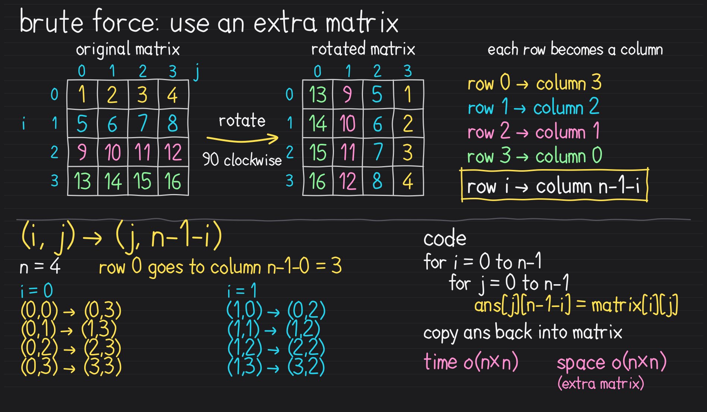
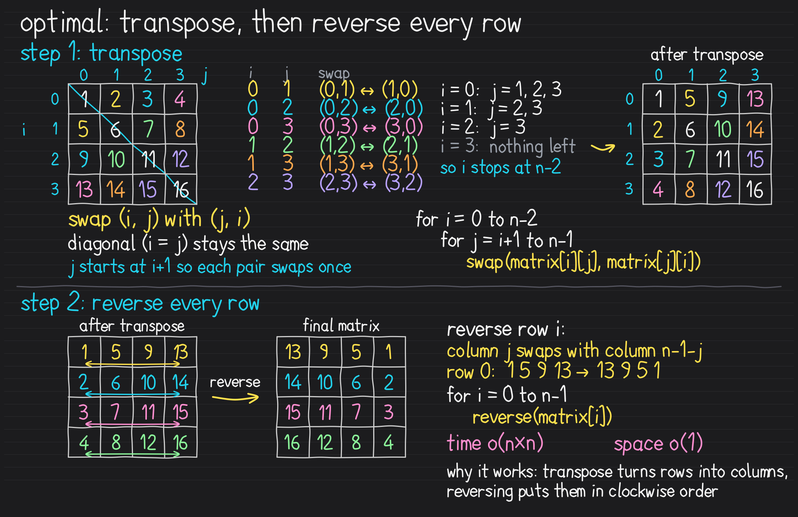

# Rotate Image

**Question Link:** [LeetCode 48 - Rotate Image](https://leetcode.com/problems/rotate-image/)

**Pattern:** Matrix + index mapping (transpose and reverse)

  -green>) -green>)

---

## The Question

Given an `n × n` matrix, rotate it **90 degrees clockwise**.

```
Input        Output
1 2 3        7 4 1
4 5 6        8 5 2
7 8 9        9 6 3
```

**The rules**

- The matrix is square (`n` rows, `n` columns).
- Clockwise means the first row becomes the last column.
- The interviewer wants it **in place**: no second matrix.

---

## Quick Revision

| Approach    | Idea                                       | Time    | Space   |
| ----------- | ------------------------------------------ | ------- | ------- |
| Brute force | New matrix, `ans[j][n-1-i] = matrix[i][j]` | `O(n²)` | `O(n²)` |
| Optimal     | Transpose, then reverse every row          | `O(n²)` | `O(1)`  |

**Key formulas**

| Purpose             | Formula                                       |
| ------------------- | --------------------------------------------- |
| Where `(i, j)` goes | `(i, j) → (j, n - 1 - i)`                     |
| Row `i` goes to     | column `n - 1 - i`                            |
| Transpose swap      | `matrix[i][j]` with `matrix[j][i]`            |
| Transpose loops     | `i = 0 to n-2`, `j = i+1 to n-1`              |
| Reverse a row       | `left = 0`, `right = n-1`, swap, move inwards |

**Memory cue:** Transpose, then reverse every row. Transpose only walks above the diagonal.

---

## How to Think About It

Look at the first column of the input: `1 5 9 13`. In the answer it sits in the **first row**, but backwards: `13 9 5 1`.

This is true for every column: each column of the input becomes a row of the answer, in reverse order.

- Turning columns into rows is a **transpose**.
- Fixing the order is a **reverse of every row**.

| Approach                            | Extra space | Verdict                                   |
| ----------------------------------- | ----------- | ----------------------------------------- |
| Place every element in a new matrix | `O(n²)`     | Works, but the interviewer wants in place |
| Transpose, then reverse each row    | `O(1)`      | Best                                      |

---

## Approach 1: Brute Force (Extra Matrix)

**Idea:** Make an `n × n` answer matrix. Pick each element and put it at its correct place.

**Finding the pattern**

- Row 0 goes to the last column.
- Row 1 goes to the second last column.
- Row 2 goes to the third last column, and so on.

Write the indexes down and look at `j`:

- `(0,0)` goes to `(0,3)`, `(0,1)` goes to `(1,3)`, `(0,2)` goes to `(2,3)`, `(0,3)` goes to `(3,3)`.
- The old `j` becomes the **new row**.
- The old `i` decides the **new column**: row 0 goes to column 3, row 1 goes to column 2.
- So the new column is `n - 1 - i`.

```
(i, j) → (j, n - 1 - i)
```



**Code**

```java
class Solution {
    public int[][] rotate(int[][] matrix) {
        int n = matrix.length;
        // extra matrix for the rotated answer
        int[][] ans = new int[n][n];

        for (int i = 0; i < n; i++) {
            for (int j = 0; j < n; j++) {
                // element at (i, j) goes to (j, n - 1 - i) after a 90 degree turn
                ans[j][n - 1 - i] = matrix[i][j];
            }
        }

        // rotated copy, the original is not changed
        return ans;
    }
}
```

- **Time:** `O(n²)`. Every element is visited once.
- **Space:** `O(n²)`. The extra matrix.

<details>
<summary>Dry run for the first row (n = 4)</summary>

| `i` | `j` | Element | Goes to `ans[j][n-1-i]` |
| --- | --- | ------- | ----------------------- |
| 0   | 0   | 1       | `ans[0][3]`             |
| 0   | 1   | 2       | `ans[1][3]`             |
| 0   | 2   | 3       | `ans[2][3]`             |
| 0   | 3   | 4       | `ans[3][3]`             |

The whole first row `1 2 3 4` fills the last column from top to bottom.

</details>

<details>
<summary>Why this is not enough</summary>

The extra matrix costs `O(n²)` space. The interviewer asks to solve it inside the given matrix.

LeetCode's version wants `void rotate(...)` that changes `matrix` itself, so returning a new matrix does not even pass.

</details>

---

## Approach 2: Optimal (Transpose, Then Reverse)

**Idea:** Two steps, both done inside the given matrix.

1. Transpose the matrix.
2. Reverse every row.



### Step 1: Transpose

Transpose means rows become columns and columns become rows. The element at `(i, j)` swaps with the element at `(j, i)`.

```
Before        After
1  2  3       1  4  7
4  5  6       2  5  8
7  8  9       3  6  9
```

**Finding the loop**

- The diagonal (`i == j`) stays where it is.
- Every other element swaps with its mirror on the other side of the diagonal.
- Walk only **one half** (above the diagonal), or every pair swaps twice and nothing changes.

| Loop | Start   | End     | Reason                                  |
| ---- | ------- | ------- | --------------------------------------- |
| `i`  | `0`     | `n - 2` | Last row has nothing above the diagonal |
| `j`  | `i + 1` | `n - 1` | Starts after the diagonal               |

```java
// transpose: swap matrix[i][j] with matrix[j][i]
for (int i = 0; i < n - 1; i++) {
    // start at i + 1 so each pair is swapped only once
    for (int j = i + 1; j < n; j++) {
        int temp = matrix[i][j];
        matrix[i][j] = matrix[j][i];
        matrix[j][i] = temp;
    }
}
```

### Step 2: Reverse every row

```
After transpose      After reversing every row
1  4  7              7  4  1
2  5  8              8  5  2
3  6  9              9  6  3
```

Reverse with two pointers:

- `left` starts at `0`, `right` starts at `n - 1`.
- Swap, then `left++` and `right--`.
- Stop when `left >= right`.

```java
// reverse every row
for (int i = 0; i < n; i++) {
    int left = 0;  // two pointers, one at each end of the row
    int right = n - 1;

    while (left < right) {
        // swap the two ends
        int temp = matrix[i][left];
        matrix[i][left] = matrix[i][right];
        matrix[i][right] = temp;

        // move both pointers towards the middle
        left++;
        right--;
    }
}
```

### Full Code

```java
class Solution {
    public void rotate(int[][] matrix) {
        // square matrix, n rows and n columns
        int n = matrix.length;

        // Step 1: transpose
        for (int i = 0; i < n - 1; i++) {
            for (int j = i + 1; j < n; j++) {
                int temp = matrix[i][j];
                matrix[i][j] = matrix[j][i];
                matrix[j][i] = temp;
            }
        }

        // Step 2: reverse every row
        for (int i = 0; i < n; i++) {
            int left = 0;
            int right = n - 1;

            while (left < right) {
                int temp = matrix[i][left];
                matrix[i][left] = matrix[i][right];
                matrix[i][right] = temp;

                left++;
                right--;
            }
        }
    }
}
```

- **Time:** `O(n²)`. Transpose is about half the matrix, reverse touches every row.
- **Space:** `O(1)`. Everything happens inside the given matrix.

<details>
<summary>Dry run on the 3 × 3 example</summary>

Start:

```
1 2 3
4 5 6
7 8 9
```

Transpose swaps:

| `i` | `j` | Swap                                         |
| --- | --- | -------------------------------------------- |
| 0   | 1   | `matrix[0][1]` with `matrix[1][0]` (2 and 4) |
| 0   | 2   | `matrix[0][2]` with `matrix[2][0]` (3 and 7) |
| 1   | 2   | `matrix[1][2]` with `matrix[2][1]` (6 and 8) |

```
1 4 7
2 5 8
3 6 9
```

Reverse each row:

```
7 4 1
8 5 2
9 6 3
```

</details>

<details>
<summary>Why does transpose + reverse work?</summary>

After a transpose, each original column becomes a row, but its elements are still in the original top-to-bottom order.

For a clockwise rotation each original column must become a row **in reverse order** (`1 5 9 13` becomes `13 9 5 1`).

Reversing every row after the transpose gives exactly that.

</details>

<details>
<summary>Why does the transpose loop start at j = i + 1?</summary>

- The diagonal elements do not move, so `j = i` is skipped.
- Swapping `(i, j)` with `(j, i)` fixes **both** positions in one go.
- If the loop covered the whole matrix, each pair would be swapped twice and the matrix would go back to the original.
- So only the upper triangle, without the diagonal, is walked.

</details>

<details>
<summary>Why does i stop at n - 2?</summary>

For `i = n - 1` the inner loop would start at `j = n`, which is outside the matrix. There is nothing above the diagonal in the last row, so the loop is skipped.

</details>

---

## Complexity

> [!NOTE]
> | Approach | Time | Extra space |
> |----------|------|-------------|
> | Brute force | `O(n²)` | `O(n²)` |
> | Optimal | `O(n²)` | `O(1)` |
>
> Optimal: transpose `O(n²)` + reverse rows `O(n²)` = `O(n²)`.

## Key Points

> [!TIP]
>
> - Clockwise rotation: `(i, j) → (j, n - 1 - i)`.
> - First row becomes the last column.
> - Transpose, then reverse every row.
> - Transpose loops: `i` to `n - 2`, `j` from `i + 1`.
> - The diagonal never moves in a transpose.
> - Anticlockwise: transpose, then reverse every **column** (or reverse each row first, then transpose).

<details>
<summary>Extra: rotating anticlockwise</summary>

The same two moves in a different order.

- **Clockwise:** transpose, then reverse every row.
- **Anticlockwise:** transpose, then reverse every column (or reverse every row, then transpose).

</details>
