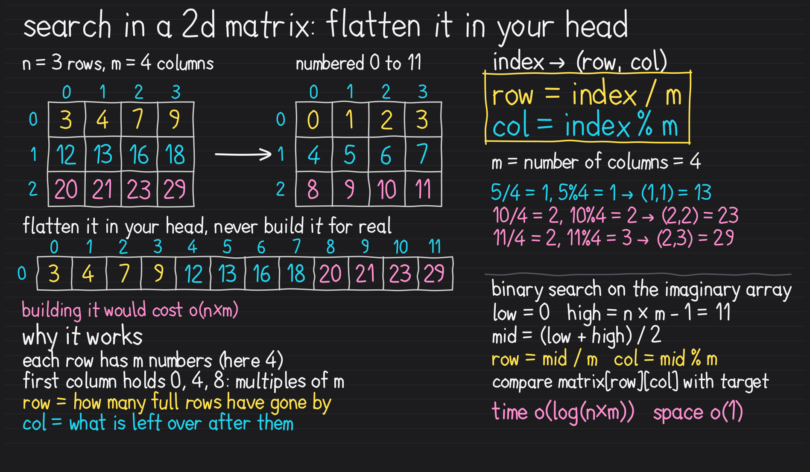
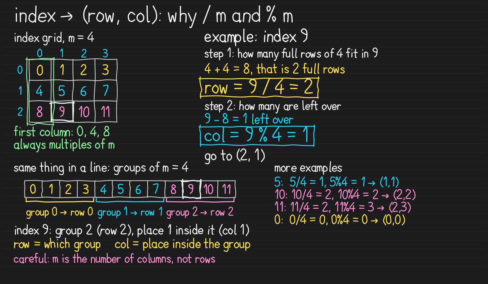

# Search a 2D Matrix

**Question Link:** [LeetCode 74 - Search a 2D Matrix](https://leetcode.com/problems/search-a-2d-matrix/)

**Pattern:** Binary Search on a 2D matrix (flatten in your head)

  )-green>) -green>)

---

## The Question

You are given a **sorted matrix** and a `target`. Return `true` if the target is in the matrix, otherwise `false`.

```
3   4   7   9
12  13  16  18
20  21  23  29
```

`target = 23` gives `true`. `target = 8` gives `false`.

**The rules**

- Every row is sorted.
- The first number of a row is bigger than the last number of the row above it. So the whole matrix reads as one sorted list.
- The matrix has `n` rows and `m` columns. Here `n = 3` and `m = 4`.
- Rows are numbered `0` to `n - 1`, and columns `0` to `m - 1`.

---

## Quick Revision

| Approach    | Idea                                                | Time            | Space  |
| ----------- | --------------------------------------------------- | --------------- | ------ |
| Brute force | Check every element                                 | `O(n × m)`      | `O(1)` |
| Better      | Find the right row, binary search that row          | `O(n + log m)`  | `O(1)` |
| Optimal     | Binary search on the whole matrix as one flat array | `O(log(n × m))` | `O(1)` |

**Key formulas (optimal)**

| Purpose         | Formula                       |
| --------------- | ----------------------------- |
| Search range    | `low = 0`, `high = n × m - 1` |
| Middle          | `mid = (low + high) / 2`      |
| Row of `mid`    | `row = mid / m`               |
| Column of `mid` | `col = mid % m`               |

`m` is the number of **columns**.

**Memory cue:** Imagine the matrix flattened. Binary search on the index, then turn the index into `(row, col)` with `/ m` and `% m`.

---

## How to Think About It

The matrix is sorted, so searching every element wastes that. There are two ways to use the sorting.

- Every **row** is sorted, so one row can be searched with binary search.
- The **whole matrix** is sorted, so it behaves like one long sorted array. One binary search covers everything.

| Approach                              | Verdict                          |
| ------------------------------------- | -------------------------------- |
| Check every element                   | Works, ignores the sorting       |
| Pick one row, binary search it        | Better, still looks at every row |
| One binary search on the whole matrix | Best                             |

---

## Approach 1: Brute Force

**Idea:** Go through every cell. If it equals the target, return `true`. If the loops finish, return `false`.

```java
class Solution {
    public boolean searchMatrix(int[][] matrix, int target) {
        // n = rows, m = columns
        int n = matrix.length;
        int m = matrix[0].length;

        // check every element one by one
        for (int i = 0; i < n; i++) {
            for (int j = 0; j < m; j++) {
                if (matrix[i][j] == target) {
                    return true;
                }
            }
        }
        // not found anywhere
        return false;
    }
}
```

- **Time:** `O(n × m)`. Every cell is checked once.
- **Space:** `O(1)`.

---

## Approach 2: Better (Find the Row, Then Binary Search It)

**Idea:** Each row is sorted, and its first and last numbers tell the range of that row.

- For a row, look at its first number and its last number.
- If the target is **not** between them, it cannot be in this row. Skip the row without looking inside.
- If the target **is** between them, binary search that one row. Whatever it returns is the answer.

```
row 0:  3 ... 9    is 23 between 3 and 9?     no
row 1:  12 ... 18  is 23 between 12 and 18?   no
row 2:  20 ... 29  is 23 between 20 and 29?   yes, binary search this row
```

**Code**

```java
class Solution {
    public boolean searchMatrix(int[][] matrix, int target) {
        // n = rows, m = columns
        int n = matrix.length;
        int m = matrix[0].length;

        for (int i = 0; i < n; i++) {
            // target can only be in this row if it lies between the first and last element
            if (matrix[i][0] <= target && target <= matrix[i][m - 1]) {
                // binary search only in that one row
                return binarySearch(matrix[i], target);
            }
        }
        return false;
    }

    // normal binary search on one row
    private boolean binarySearch(int[] arr, int target) {
        int low = 0, high = arr.length - 1;

        while (low <= high) {
            // this form avoids overflow
            int mid = low + (high - low) / 2;

            if (arr[mid] == target) return true;  // found it
            else if (arr[mid] < target) low = mid + 1;  // target is on the right side
            else high = mid - 1;  // target is on the left side
        }
        return false;
    }
}
```

- **Time:** `O(n + log m)`. The loop over rows is `O(n)`. The binary search happens **only once**, and a row has `m` elements, so it costs `O(log m)`.
- **Space:** `O(1)`.

<details>
<summary>Why the binary search runs only once</summary>

The matrix is sorted, so at most one row can hold the target in its range. The first row that fits is the only candidate, and we return straight away. So there is never more than one binary search.

</details>

This is already good, but there is still a better one.

---

## Approach 3: Optimal (Flatten It in Your Head)



**Idea:** Write the matrix as one long list, in your imagination:

```
3  4  7  9  12  13  16  18  20  21  23  29
```

It has `n × m` elements and it is sorted. A sorted 1D array means plain binary search, which costs `O(log(size))`. So the cost here would be `O(log(n × m))`.

**Do not really flatten it.** Building the flat array costs `O(n × m)`, which is as bad as the brute force. Only imagine it.

**The problem:** the binary search gives an index like `5`, but the matrix has no index `5`. It has a row and a column. So we need a way to turn the 1D index into a 2D `(row, col)`.

**The formula**

```
row = index / m
col = index % m
```

`m` is the number of columns.

| Index | `index / m` | `index % m` | Cell     | Value |
| ----- | ----------- | ----------- | -------- | ----- |
| 5     | 5 / 4 = 1   | 5 % 4 = 1   | `(1, 1)` | 13    |
| 10    | 10 / 4 = 2  | 10 % 4 = 2  | `(2, 2)` | 23    |
| 11    | 11 / 4 = 2  | 11 % 4 = 3  | `(2, 3)` | 29    |



<details>
<summary>Why row = index / m and col = index % m</summary>

Write the imaginary indexes in the matrix shape:

```
0   1   2   3
4   5   6   7
8   9   10  11
```

- Every row has `m` numbers. So the **first column** always holds multiples of `m` (here `0, 4, 8`).
- To get the row, count how many full rows of `m` numbers have gone by. That is `index / m`. For index `5`, one full row of 4 has gone by, so it is row 1.
- To get the column, look at what is **left over** after those full rows. That is `index % m`. For index `5`, 4 numbers went by and 1 is left, so it is column 1.
- The leftovers run `0, 1, 2, 3` along each row, and that is exactly the column number.

</details>

**Steps**

1. `low = 0` and `high = n × m - 1`. There are `n × m` imaginary elements, so the last index is one less.
2. While `low <= high`, take `mid = (low + high) / 2`.
3. Turn it into `row = mid / m` and `col = mid % m`.
4. If `matrix[row][col] == target`, return `true`.
5. If `matrix[row][col] < target`, the target is not in the left half, so `low = mid + 1`.
6. Otherwise `high = mid - 1`.
7. If the loop ends, return `false`.

Do the moves on the **1D index** (`low`, `high`, `mid`). Only the row and the column use the 2D formula.

**Code**

```java
class Solution {
    public boolean searchMatrix(int[][] matrix, int target) {
        // n = rows, m = columns
        int n = matrix.length;
        int m = matrix[0].length;

        // treat the matrix as one flat sorted array of n * m elements
        int low = 0;
        int high = n * m - 1;

        while (low <= high) {
            int mid = low + (high - low) / 2;

            // convert the flat index back to row and column
            int row = mid / m;
            int col = mid % m;  // m = columns, so mid % m is the column

            if (matrix[row][col] == target) {
                return true;
            } else if (matrix[row][col] < target) {
                low = mid + 1;  // target is bigger, go right
            } else {
                high = mid - 1;  // target is smaller, go left
            }
        }
        return false;
    }
}
```

- **Time:** `O(log(n × m))`. Binary search on `n × m` imaginary elements.
- **Space:** `O(1)`.

<details>
<summary>Dry run: target = 23</summary>

Matrix is `3 × 4`, so `m = 4`, `low = 0`, `high = 11`.

| Step | `low` | `high` | `mid` | `(row, col)` | Value | What happens          |
| ---- | ----- | ------ | ----- | ------------ | ----- | --------------------- |
| 1    | 0     | 11     | 5     | `(1, 1)`     | 13    | 13 < 23, so `low = 6` |
| 2    | 6     | 11     | 8     | `(2, 0)`     | 20    | 20 < 23, so `low = 9` |
| 3    | 9     | 11     | 10    | `(2, 2)`     | 23    | found, return `true`  |

</details>

<details>
<summary>Why mid = low + (high - low) / 2 and not (low + high) / 2</summary>

Both give the same middle. The first one never overflows when `low` and `high` are very large. The video writes `(low + high) / 2`, which is fine for this problem, but the safe form is a good habit.

</details>

---

## Complexity

> [!NOTE]
> | Approach | Time | Space |
> |----------|------|-------|
> | Brute force | `O(n × m)` | `O(1)` |
> | Better | `O(n + log m)` | `O(1)` |
> | Optimal | `O(log(n × m))` | `O(1)` |

## Key Points

> [!TIP]
>
> - The matrix is sorted, so use binary search.
> - Better: check the first and last number of a row, binary search only the row that fits.
> - Optimal: imagine the matrix as one flat sorted array of `n × m` numbers.
> - Never build the flat array, it costs `O(n × m)`.
> - 1D index to 2D: `row = index / m`, `col = index % m`.
> - `m` is the number of columns.
> - `low = 0`, `high = n × m - 1`.
