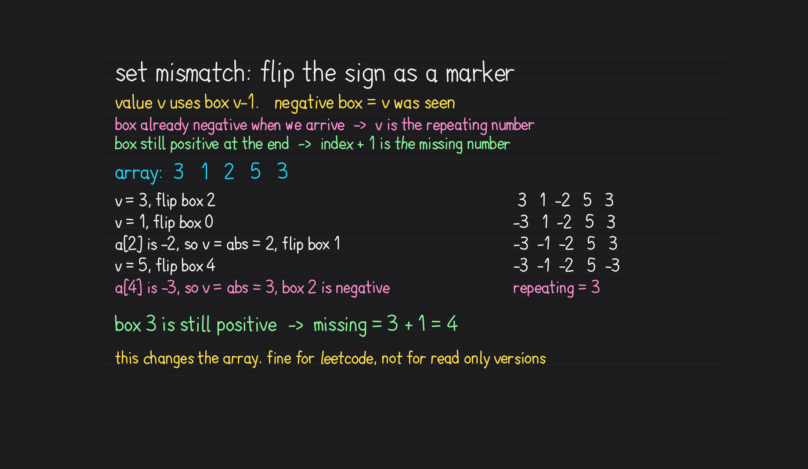

# Set Mismatch: the Sign-Flip Trick

**Question Link:** [LeetCode 645 - Set Mismatch](https://leetcode.com/problems/set-mismatch/)

**Full notes (all approaches):** [Find the Repeating and Missing Number](repeating_and_missing_number.md)

  -green>) -green>)

---

## Is This a Different Question?

No. It is the **same task** as "Find the Repeating and Missing Number" (TUF, InterviewBit). The numbers are `1` to `n`, one number appears twice, one number is missing, and the answer is `[repeating, missing]`.

The only difference is **what you are allowed to do with the array**.

|                           | Set Mismatch (LeetCode 645) | Repeat and Missing Number (InterviewBit) |
| ------------------------- | --------------------------- | ---------------------------------------- |
| Task                      | find repeating and missing  | find repeating and missing               |
| Can you change the array? | **Yes**                     | **No**, it is read only                  |
| Sign-flip trick           | works                       | not allowed (or flip back at the end)    |
| Maths or xor              | works                       | works                                    |

The maths and xor methods are in the [full notes](repeating_and_missing_number.md). This note is only about the sign-flip trick.

---

## Quick Revision

| Item                          | Value                                 |
| ----------------------------- | ------------------------------------- |
| Idea                          | Use the array itself as the hash      |
| Box for value `v`             | index `v - 1`                         |
| Seen                          | make the box **negative**             |
| Box already negative          | `v` is the **repeating** number       |
| Box still positive at the end | `index + 1` is the **missing** number |
| Time                          | `O(n)`                                |
| Space                         | `O(1)`                                |

**Memory cue:** Value `v` lives in box `v - 1`. Negative means seen. Twice negative means repeating. Never negative means missing.

---

## Understand the Trick First



The numbers are `1` to `n`, so every number has its own index. Number `x` belongs to index `x - 1`.

| Number | Its box (index) |
| ------ | --------------- |
| 1      | 0               |
| 2      | 1               |
| 3      | 2               |
| 4      | 3               |
| 5      | 4               |

Instead of a separate `seen` array, the array itself remembers what was seen. A box is marked by making its value **negative**.

- **Positive** value in a box: that number has not appeared yet.
- **Negative** value in a box: that number has appeared.

This is the same idea as the row and column markers in Set Matrix Zeroes.

**The two rules**

1. Arriving at a box that is **already negative** means we are seeing that number for the second time. It is the **repeating** number.
2. After the loop, the box that is **still positive** means that number never came. It is the **missing** number: `index + 1`.

---

## Code

```java
class Solution {
    public int[] findErrorNums(int[] a) {
        // numbers are from 1 to n
        int n = a.length;
        // -1 means not found yet
        int repeating = -1, missing = -1;

        for (int i = 0; i < n; i++) {
            // abs, because an earlier step may have made it negative; number v uses box v - 1
            int idx = Math.abs(a[i]) - 1;
            // box already negative: seen before, so repeating
            if (a[idx] < 0) repeating = Math.abs(a[i]);
            // first time: mark the box as seen
            else a[idx] = -a[idx];
        }

        for (int i = 0; i < n; i++) {
            // box never marked: that number is missing
            if (a[i] > 0) missing = i + 1;
        }

        // repeating first, then missing
        return new int[]{repeating, missing};
    }
}
```

---

## Dry Run, One Iteration at a Time

Example: `a = {3, 1, 2, 5, 3}`, so `n = 5`. The numbers should be `1` to `5`. One repeats (3) and one is missing (4).

**First loop: find the repeating number**

**`i = 0`**, `a[0] = 3`

- `idx = abs(3) - 1 = 2`. Check `a[2]`.
- `a[2] = 2` is positive, so 3 is new. Make it negative.
- Array: `[3, 1, -2, 5, 3]`

**`i = 1`**, `a[1] = 1`

- `idx = abs(1) - 1 = 0`. Check `a[0]`.
- `a[0] = 3` is positive. Make it negative.
- Array: `[-3, 1, -2, 5, 3]`

**`i = 2`**, `a[2] = -2`

- It is negative because we changed it in `i = 0`. The real number is `2`.
- `idx = abs(-2) - 1 = 1`. Check `a[1]`.
- `a[1] = 1` is positive. Make it negative.
- Array: `[-3, -1, -2, 5, 3]`

**`i = 3`**, `a[3] = 5`

- `idx = abs(5) - 1 = 4`. Check `a[4]`.
- `a[4] = 3` is positive. Make it negative.
- Array: `[-3, -1, -2, 5, -3]`

**`i = 4`**, `a[4] = -3`

- It is negative because we changed it in `i = 3`. The real number is `3`.
- `idx = abs(-3) - 1 = 2`. Check `a[2]`.
- `a[2] = -2` is **already negative**. So 3 was seen before.
- `repeating = 3`.

| `i` | `a[i]` | `idx` | Action                               |
| --- | ------ | ----- | ------------------------------------ |
| 0   | 3      | 2     | negate `a[2]`                        |
| 1   | 1      | 0     | negate `a[0]`                        |
| 2   | -2     | 1     | negate `a[1]`                        |
| 3   | 5      | 4     | negate `a[4]`                        |
| 4   | -3     | 2     | already negative, so `repeating = 3` |

Array after the first loop: `[-3, -1, -2, 5, -3]`

**Second loop: find the missing number**

| Index | Value | Meaning                 |
| ----- | ----- | ----------------------- |
| 0     | -3    | number 1 appeared       |
| 1     | -1    | number 2 appeared       |
| 2     | -2    | number 3 appeared       |
| 3     | 5     | number 4 never appeared |
| 4     | -3    | number 5 appeared       |

Index `3` is still positive, so `missing = 3 + 1 = 4`.

Answer: `[3, 4]`

---

## Why `Math.abs(a[i])`?

At `i = 2` the value `a[2]` is `-2`, not `2`, because an earlier step made it negative as a marker. The sign is only a marker. The real number is its absolute value. Without `abs`, `idx = -2 - 1 = -3`, which is a crash.

Always read a value with `Math.abs(a[i])`, then subtract 1 for the box.

> [!NOTE]
> **Complexity:** Time `O(n)`: one pass to mark, one pass to find the missing. Space `O(1)`: no extra array.

---

## Key Points

> [!TIP]
>
> - Works because the values are exactly `1` to `n`, so every value has its own box.
> - **It changes the input array.** That is fine for LeetCode 645. For a read-only version, use maths or xor (see the [full notes](repeating_and_missing_number.md)). Or flip the signs back at the end.
> - Always use `Math.abs(a[i])` when reading a value.
> - The repeating number is found while looping. The missing number is found in a second loop.
