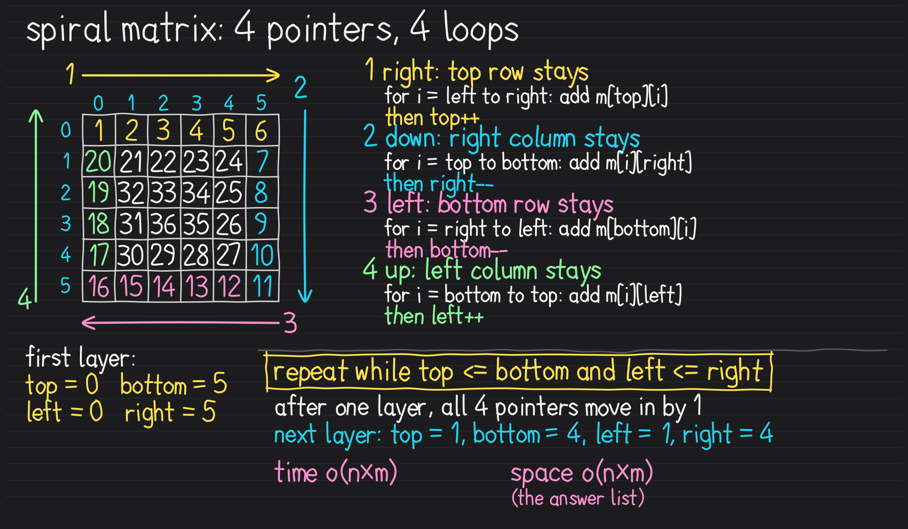
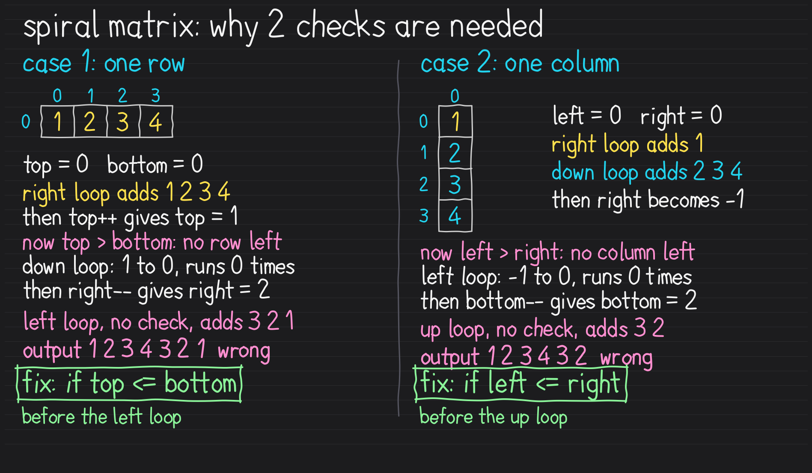

# Spiral Matrix

**Question Link:** [LeetCode 54 - Spiral Matrix](https://leetcode.com/problems/spiral-matrix/)

**Pattern:** Matrix traversal (4 pointers)

  -green>) -green>)

---

## The Question

Given an `n × m` matrix, return all its elements in **spiral order**.

```
Input          Output
1 2 3
4 5 6          1 2 3 6 9 8 7 4 5
7 8 9
```

**The rules**

- Start at the top left and go right.
- Turn when you hit an edge: right, down, left, up.
- Keep going inwards until every element is printed.
- The matrix does not have to be square.

---

## Quick Revision

| Item          | Value                                                                              |
| ------------- | ---------------------------------------------------------------------------------- |
| Pointers      | `top = 0`, `bottom = n - 1`, `left = 0`, `right = m - 1`                           |
| Order         | right, down, left, up                                                              |
| Outer loop    | `while (top <= bottom && left <= right)`                                           |
| Checks needed | `if (top <= bottom)` before the left loop, `if (left <= right)` before the up loop |
| Time          | `O(n × m)`                                                                         |
| Space         | `O(n × m)` for the answer list (nothing extra besides it)                          |

**The four loops**

| Direction | Loop                | What stays fixed | Then       |
| --------- | ------------------- | ---------------- | ---------- |
| Right     | `i = left to right` | row `top`        | `top++`    |
| Down      | `i = top to bottom` | column `right`   | `right--`  |
| Left      | `i = right to left` | row `bottom`     | `bottom--` |
| Up        | `i = bottom to top` | column `left`    | `left++`   |

**Memory cue:** Right, down, left, up. After each side, move that pointer inwards.

---

## How to Think About It

This question has only one solution, and it is the optimal one. The interviewer is testing how cleanly the code is written, not a trick.

- Look at the outer ring. It is right, then down, then left, then up.
- The second ring is the same, just one step inside.
- So print one ring at a time and shrink the box after each ring.

To track the box, four pointers are enough: `top`, `bottom`, `left`, `right`.

---

## Approach: Four Pointers, Layer by Layer



**Steps for one ring**

1. **Right:** the row `top` stays fixed. Go `left` to `right`. Then `top++`, so the next side does not repeat the corner.
2. **Down:** the column `right` stays fixed. Go `top` to `bottom`. Then `right--`.
3. **Left:** the row `bottom` stays fixed. Go `right` down to `left`. Then `bottom--`.
4. **Up:** the column `left` stays fixed. Go `bottom` down to `top`. Then `left++`.

Repeat while there is still at least one row and one column left.

**Code**

```java
class Solution {
    public List<Integer> spiralOrder(int[][] matrix) {
        // answer in spiral order
        List<Integer> ans = new ArrayList<>();

        // n = rows, m = columns
        int n = matrix.length;
        int m = matrix[0].length;

        // the four walls of the part that is not printed yet
        int top = 0, bottom = n - 1;
        int left = 0, right = m - 1;

        // keep going while at least one row and one column is left
        while (top <= bottom && left <= right) {
            // right
            for (int i = left; i <= right; i++) {
                ans.add(matrix[top][i]);
            }
            // top row is done, move the wall down
            top++;

            // down
            for (int i = top; i <= bottom; i++) {
                ans.add(matrix[i][right]);
            }
            // right column is done, move the wall left
            right--;

            // left
            // check: a row may be left, otherwise this would repeat the same row
            if (top <= bottom) {
                for (int i = right; i >= left; i--) {
                    ans.add(matrix[bottom][i]);
                }
                // bottom row is done, move the wall up
                bottom--;
            }

            // up
            // check: a column may be left, otherwise this would repeat the same column
            if (left <= right) {
                for (int i = bottom; i >= top; i--) {
                    ans.add(matrix[i][left]);
                }
                // left column is done, move the wall right
                left++;
            }
        }

        return ans;
    }
}
```

- **Time:** `O(n × m)`. Every element is added exactly once.
- **Space:** `O(n × m)` for the answer list. No other extra space.

<details>
<summary>Why the pointer moves right after each side (top++, right--, ...)</summary>

Each corner belongs to two sides. After the right loop prints the whole top row, the corner at the end is already printed. Doing `top++` makes the down loop start one row lower, so that corner is not printed twice.

The same idea repeats for every side: print it, then pull that pointer in.

</details>

<details>
<summary>Dry run on the 3 × 3 example</summary>

Start: `top = 0, bottom = 2, left = 0, right = 2`.

| Step | Loop                            | Adds    | Pointers after |
| ---- | ------------------------------- | ------- | -------------- |
| 1    | right                           | 1 2 3   | `top = 1`      |
| 2    | down                            | 6 9     | `right = 1`    |
| 3    | left (`top <= bottom`)          | 8 7     | `bottom = 1`   |
| 4    | up (`left <= right`)            | 4       | `left = 1`     |
| 5    | right                           | 5       | `top = 2`      |
| 6    | down (`i = 2 to 1`)             | nothing | `right = 0`    |
| 7    | left (`top <= bottom` is false) | skipped |                |
| 8    | up (`left <= right` is false)   | skipped |                |

Next check: `top = 2 > bottom = 1`, so the outer loop stops.

Answer: `1 2 3 6 9 8 7 4 5`.

</details>

---

## Edge Cases: Why Two Checks Are Needed

The right loop and the down loop do not need a check. Their `for` loops simply run zero times when there is nothing to print.

The left loop and the up loop **do** need one. Their `for` loops walk **backwards from a pointer**, and the pointer values are already stale at that point, so they can print a row or column a second time.



| Case                           | What goes wrong without the check                                            | Output          |
| ------------------------------ | ---------------------------------------------------------------------------- | --------------- |
| One row `[1 2 3 4]`            | After the right loop, `top > bottom`. Left loop prints the bottom row again. | `1 2 3 4 3 2 1` |
| One column (rows `1, 2, 3, 4`) | After the down loop, `left > right`. Up loop prints the column again.        | `1 2 3 4 3 2`   |

- **Fix for a single row:** `if (top <= bottom)` before the left loop.
- **Fix for a single column:** `if (left <= right)` before the up loop.

---

## Complexity

> [!NOTE]
> | Time | Space |
> |------|-------|
> | `O(n × m)` | `O(n × m)` for the answer list |
>
> Every element is printed once, whatever the checks are.

## Key Points

> [!TIP]
>
> - Four pointers: `top`, `bottom`, `left`, `right`.
> - Order: right, down, left, up. Pull the pointer in after each side.
> - Outer loop: `top <= bottom && left <= right`.
> - Checks go before the **left** loop (`top <= bottom`) and the **up** loop (`left <= right`).
> - Right and down loops are safe without a check.
> - Get `n = matrix.length` and `m = matrix[0].length` first.
